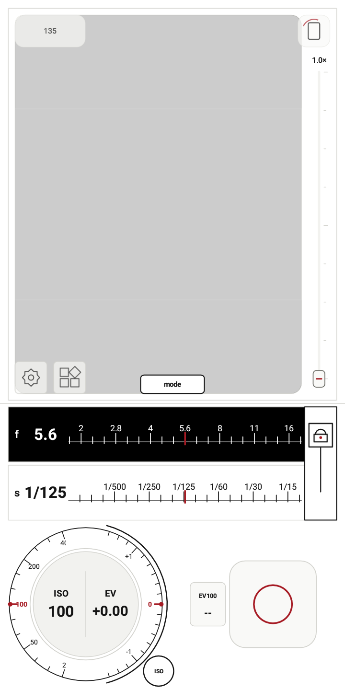
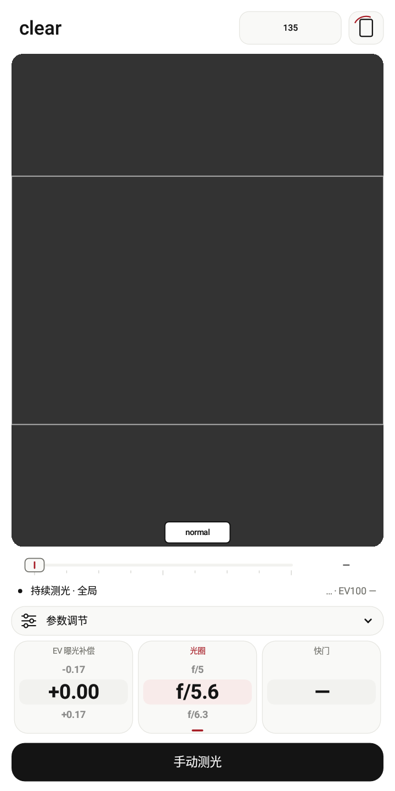
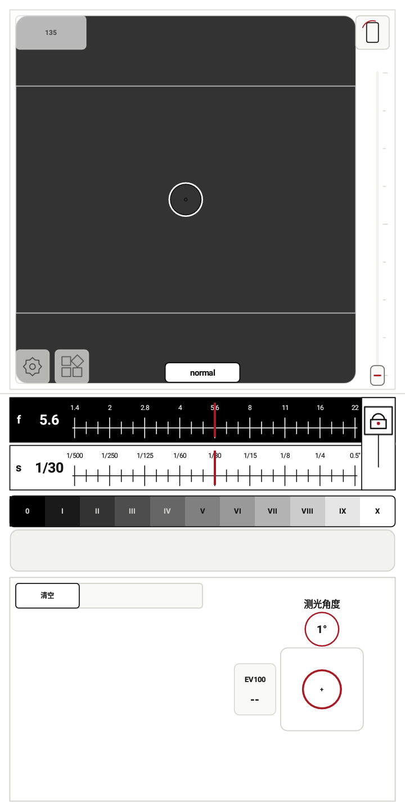

# lightstop（光档）

English | [简体中文](README_ZH.md)

An Android light meter for manual exposure and film photography. Android 9 or newer.

[Download the latest release](https://github.com/the-waterwheel/lightstop/releases/latest) · [Changes](CHANGELOG.md)

## What it does

- RAW-first reflected-light metering, with preview-based fallback on unsupported cameras.
- Normal, Clear and Zone modes, camera calibration, film formats, and exposure controls.
- Lightweight neural global metering, computed entirely on the device, with statistical fallback when a model reading is unavailable.
- Negative preview: one-tap detection and inversion, film-base sampling, crop/rotation controls, and editable RGB curves.
- Flash calculations, automatic distance estimates, and parameter records with optional DNG and location.
- English and Chinese interface, with light and dark themes.

Camera support and distance estimates vary by device. Negative preview works best with an evenly lit film and some clear film base visible. Check important exposures against a known meter.

## Choose a mode

- **Normal:** take a reading and set exposure with the aperture, shutter and ISO controls. Choose center-weighted, spot, angle or global metering.
- **Clear:** a streamlined interface for continuous metering, exposure preview and manual reading or locking.
- **Zone:** place multiple metering points and compare their positions on the Zone scale.

Global metering now uses a small neural network to evaluate the spatial distribution of brightness and recommend exposure. RAW, YUV and preview inputs use their corresponding input mappings. The model ships with the app and runs locally.

| Normal | Clear | Zone |
| --- | --- | --- |
|  |  |  |

Android emulator screenshots with a blank viewfinder. [All mode and tool screenshots](docs/screenshots/v0.7.0/README.md).

## Build

Open the project in Android Studio with JDK 17, Android SDK 36.1, NDK 27.0.12077973, and CMake 3.22.1. The pinned OpenCV AAR is included; rebuilding OpenCV is optional.

```powershell
.\gradlew.bat :app:testDebugUnitTest :app:assembleDebug
```

For distribution, use **Build → Generate Signed Bundle / APK → APK → release** with your existing release key. [0.7.0 release notes](docs/releases/v0.7.0.md) · [OpenCV build](tools/opencv-slim/README.md)

APK builds output separate arm64, armv7 and x86_64 packages plus a universal APK. [Packaging steps](docs/BUILD_RELEASE_APKS_ZH.md). Use `-PsplitApks=false` for only the universal APK.

## Privacy and license

Camera processing stays on your device. No Internet permission, ads, or analytics. Saved records may be included in system backups; location is optional. [Privacy](PRIVACY.md)

Built with AI assistance. Source: [Apache-2.0](LICENSE). Bundled dependencies have their own [notices](THIRD_PARTY_NOTICES.md). [Contributing](CONTRIBUTING.md)
