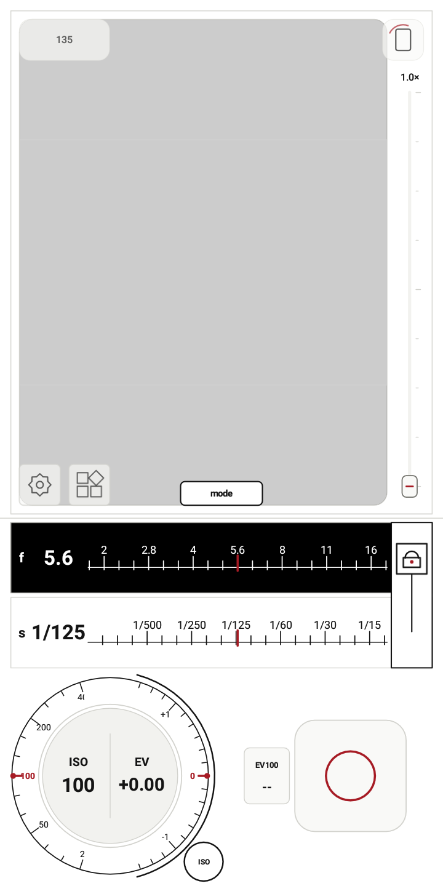
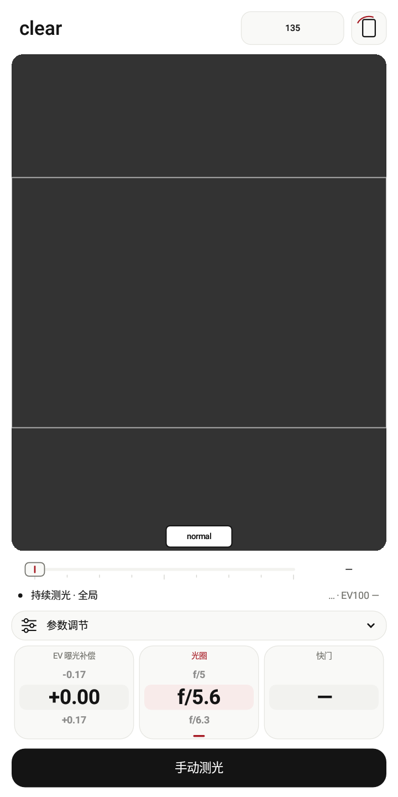
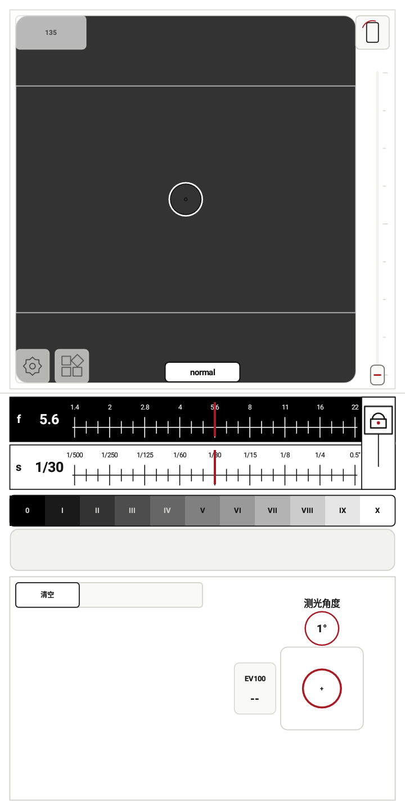

# 光档（lightstop）

[English](README.md) | 简体中文

一个面向手动曝光与胶片摄影的 Android 测光表，支持 Android 9 及以上。

[下载最新版](https://github.com/the-waterwheel/lightstop/releases/latest) · [更新记录](CHANGELOG.md)

## 可以做什么

- 优先使用 RAW 进行反射式测光，不支持的摄像头可使用预览测光。
- Normal、Clear 与 Zone 三种模式、相机校准、胶片画幅和曝光调整。
- 基于轻量神经网络的全局测光，在手机本地计算；模型读数不可用时使用统计测光回退。
- 负片预览：一键识别与反相、片基采样、选区缩放旋转，以及可自由增删点的 RGB 曲线。
- 闪光计算、自动距离估算，以及可附带 DNG 和位置的参数记录。
- 中英文界面，支持亮色和暗色主题。

相机支持和距离估算效果因设备而异。负片预览建议使用均匀背光，并保留一些清晰片基。重要拍摄前，建议与已知可靠的测光表对照。

## 选择模式

- **Normal：** 获取测光读数，通过光圈、快门和 ISO 调整曝光；支持中央重点、点测光、角度测光与全局测光。
- **Clear：** 简洁的连续测光界面，结合曝光预览，也可手动测光或锁定读数。
- **Zone：** 放置多个测光点，在分区曝光标尺上比较画面各处的亮度位置。

全局测光现已加入小型神经网络，结合画面不同区域的明暗分布给出曝光建议。RAW、YUV 与预览输入使用对应的输入映射；模型随应用内置，推理全部在本机完成。

| Normal | Clear | Zone |
| --- | --- | --- |
|  |  |  |

以上为 Android 模拟器截图，取景区为空白。[查看三种模式演示](docs/screenshots/v0.7.0/README.md)。

## 构建

在 Android Studio 打开项目，使用 JDK 17、Android SDK 36.1、NDK 27.0.12077973 和 CMake 3.22.1。仓库已包含固定版本的 OpenCV AAR，日常构建无需重编 OpenCV。

```powershell
.\gradlew.bat :app:testDebugUnitTest :app:assembleDebug
```

正式安装包使用 **Build → Generate Signed Bundle / APK → APK → release**，升级版本沿用原有签名密钥。[0.7.0 发布说明](docs/releases/v0.7.0.md) · [OpenCV 构建](tools/opencv-slim/README.md)

APK 默认分别输出 arm64、armv7、x86_64 和通用包。[打包步骤](docs/BUILD_RELEASE_APKS_ZH.md)。传入 `-PsplitApks=false` 可只生成通用包。

## 隐私与许可

相机画面在本机处理，不申请网络权限，没有广告和统计 SDK。保存的参数记录可能进入系统备份；位置记录为可选项。[隐私说明](PRIVACY.md)

项目在 AI 辅助下开发。源码采用 [Apache-2.0](LICENSE)，随包依赖适用各自的[第三方许可](THIRD_PARTY_NOTICES.md)。[参与开发](CONTRIBUTING.md)
