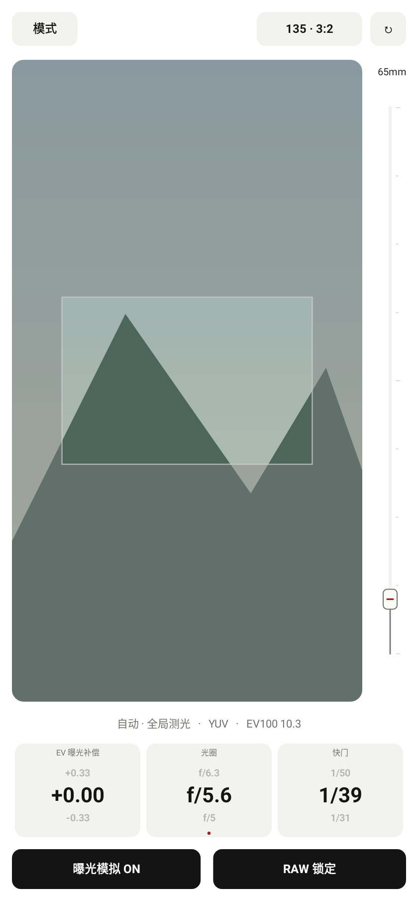
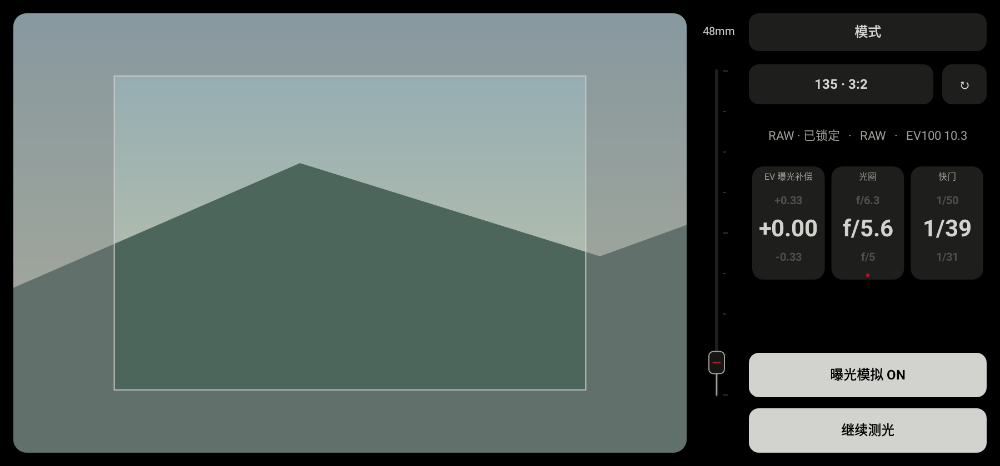

# 自动模式：持续全局测光

2026-10-28，接续 `05950c4`。新增独立于 Normal、Zone 的简洁自动模式。

## 入口与界面

- Normal 的原“zone”滑块及 Zone 的原“normal”滑块均改名为“模式”。在 Normal 中向下拖动进入自动模式；横屏时向右拖动进入，左右手布局都支持。
- 轻点 Normal 的“模式”可直接选择 Normal、Zone 或自动。横屏左手布局中，原来向右进入 Zone 的方向留给自动模式，Zone 仍可通过该菜单进入。
- 自动模式的“模式”按钮和系统返回键回到 Normal。RAW 事务进行中先保持当前页面，避免把迟到的 RAW 结果写进其他模式。
- 独立的大预览布局，横屏时控制区在右侧；不沿用 Normal/Zone 的预览高度。预览使用圆角，画幅灰框保持直角并被预览边界裁剪。
- 画幅、横竖构图、焦距滑杆和双指缩放沿用共享的 `MeterState` / `ViewfinderGeometry`。焦距改变灰框，双指改变检查放大；“无”取消灰框和焦距显示，滑杆与双指控制预览缩放。

## 三档数字滚轮

参数区为 **EV 曝光补偿、光圈、快门** 三列，每列显示上方相邻值、当前值和下方相邻值，当前值居中加大。数值变化经过约 180 ms 的滚动，快速连续操作从当前动画位置继续；关闭系统动画时直接更新。

- EV 替代原来的 ISO 控件；ISO 沿用 Normal 中选择的值参与曝光计算。
- 每列上下拖动直接调节，轻点也可打开数值选择；调节光圈或快门会把该项设为固定项，另一项随当前曝光计算。红点标示固定项。
- EV 的间隔取设置的 `exposureCompensationStep`（1/6、1/3、1/2、整档）；范围仍是 −5 至 +5 EV，内部仍使用既有的六分之一档单位保存。
- 光圈、快门的间隔分别取设置的 `apertureStep`、`shutterStep`。相邻数值按曝光坐标 ± 配置步长计算；光圈和快门时间采用指数关系，并非数值直接加减。
- 未固定的一侧可以显示实时计算出的中间值，相邻值仍相差设置的一档；手动调节使用项目原有的档位网格与合法范围。
- EV100 场景读数与 EV 曝光补偿分开标示，避免把测得的亮度当作补偿量。

## 测光与模拟

`ContinuousPreviewMeter` 持有独立的 `CompatibleLightMeter`，每次完成后约 350 ms 再采样。优先使用现有的 YUV 流，不可用时由原有兼容路径读取 ISP 预览。每个样本只使用同一帧的曝光元数据，固定调用全局测光，不调用普通单次测光的“恢复中性 AE”流程，也不在每次采样时重建 Session。

进入自动模式时，暂时使用系统选择的稳定预览/YUV 管线，原来的 Normal 管线和组合选择偏好不改写；离开时恢复。自动读数保存在 `AutoMeterSession`，不覆盖 Normal 的读数、Zone 点或历史记录。

曝光模拟首次进入时默认开启，模式内可以开关。本次应用会话中保留该开关状态，Normal 的模拟偏好不受影响。模拟复用已有的逐帧 EV 渐变、快门/ISO 对数插值、请求合并与限速；实时读数有轻度平滑和死区，避免噪声反复重启渐变。高光保护改变或测光来源切换仍会更新。

新场景严重饱和或接近全黑时，不把丢失信号的统计当作新亮度。使用采集曝光逐步恢复到有效信号，再接收新读数；如果根据上一有效帧判断是用户的补偿本身造成信号越界，保留上一有效读数并提示信号受限，避免模拟与测光相互追逐。真实设备的 ISP 色调映射仍可能带来误差。

全局范围复用共享的取景框到传感器映射。ISP 回退若无法取得灰框所需的完整画面或精确配对元数据，会报告不可用，不以其他区域冒充框内测光。

## RAW 锁定与生命周期

“RAW 锁定”先停止连续采样，明确请求一次全局 RAW 测光，复用已有的独立 RAW 会话和中性曝光基线；只有收到有效的 RAW 来源读数才锁定。失败或镜头不支持 RAW 时显示原因，不将 YUV/ISP 结果伪装成 RAW 锁定。

锁定后保持实时取景和曝光模拟，读数停止自动更新；点击“继续测光”恢复连续采样。改变画幅或焦距会清除原锁定并重新采样；有画幅时，双指检查放大仍不改变灰框对应的测光范围。

退出模式、切后台或关闭相机时取消采样、超时和等待配对的帧；新会话重新等待自己的帧。切后台时中止未完成的 RAW 请求，避免返回后一直处于等待状态。相机切换会重新尝试 YUV，不将上一会话的 YUV 回退永久带到下一会话。

## 验证与产物

- 新增 16 项回归：状态与 RAW 来源限制 6 项、模式入口/布局/设置步长/拖动/实际滚动帧 6 项、连续全局采样与精确曝光元数据 3 项、持续更新期间的曝光渐变 1 项。
- 完整单元/Robolectric 测试 747 项通过；Debug 三个 ABI 和通用包、AndroidTest APK 构建通过；Lint 零错误、70 项既有警告；`git diff --check` 通过。
- 已查看由生产 View、Android Native Canvas 渲染的竖屏、横屏和紧凑布局。下列背景为合成的静态示例，仅用于核查布局，不是设备相机截图或实测性能证明。
- 尚未连接实体手机验证 Camera2/HAL、ISP 在曝光模拟下的实际响应、RAW 会话恢复和长时间运行。依贡献指南，实机回归继续待办；不据自动化测试宣称实际帧率或功耗改善。

构建：

```powershell
.\gradlew.bat :app:testDebugUnitTest :app:assembleDebug :app:assembleDebugAndroidTest :app:lintDebug '-PuiPreview=true' '-Pandroid.useAndroidX=true' --offline --console=plain
```

通用测试包：`app/build/outputs/apk/debug/lightstop-auto-meter-20261028-universal-debug.apk`，53,053,936 bytes，Android 9+，版本 `0.6.1 (12)`。

SHA-256：`EFB505342B4833E2666BF0783E6B6235199AEDE12B76C0606FD75B7B0BA537AA`。

旧包另行保留，Git 追加本轮源码、测试和预览，不提交 APK 或本机配置。




