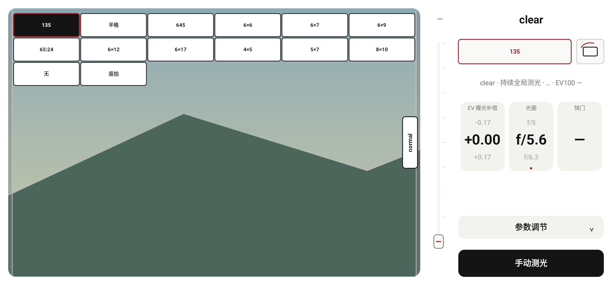
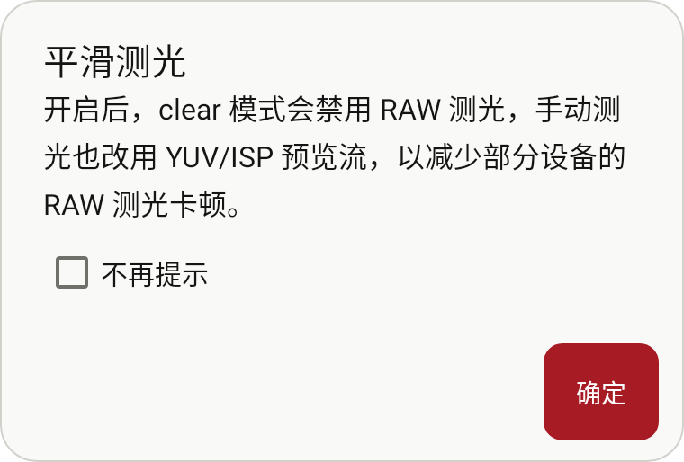
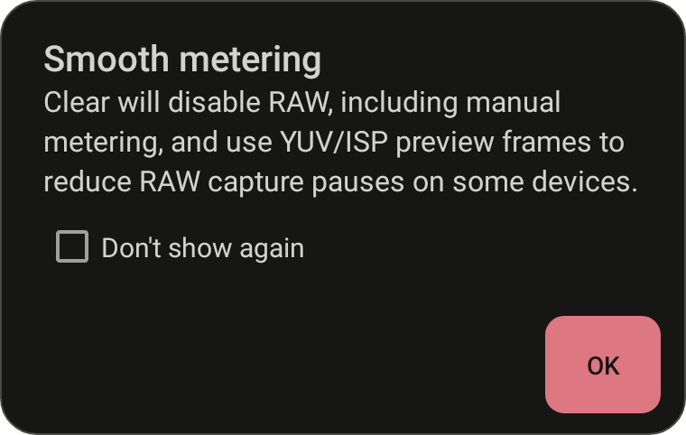
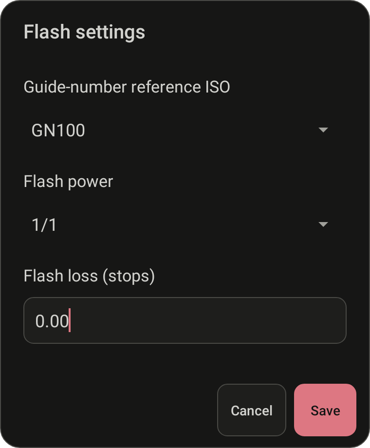

# clear 取景控件复用与应用弹窗样式

2026-10-29，接续 `55e872e`，追加修改，保留既有提交、文档与测试包。

clear 原本已接入横竖屏切换入口，但用小号“↻”文字表示。现在与 normal 共用 `ViewfinderControls`：画幅按钮、取景框加旋转弧线图标、画幅网格绘制，以及画幅/横竖构图选择逻辑。界面方向按钮继续走原有 `MeterLayout.handleOrientationToggle()` 入口，与 normal 相同。

- clear 的画幅选择改为原界面上的网格，保留所有画幅、“无”和最后的横竖构图切换，不再打开单选对话框。界面横竖屏与画幅横竖构图继续是两个不同操作。
- normal 的原有网格位置保持；clear 根据自身更大的预览范围放置网格。未统一各模式的预览比例或大小。
- clear 在左右手横屏布局中均保留可见的方向按钮，打开画幅网格时点击方向按钮会先关闭网格再切换界面。normal 与 clear 的网格选项都支持无障碍操作。
- 画幅网格与 clear 参数设置互斥展开；关闭 clear 会清理临时网格状态。原有灰框、焦距、双指放大和测光流程保持。

应用内 35 处对话框创建入口统一经 `AppDialogs`，覆盖相机/校准提示、设备说明、RAW 提示、参数记录、历史、景深、宽容度、倒易率、闪光设置，以及 clear 参数选择与平滑测光提示。

- 统一暖白/深灰圆角卡片、细边框、遮罩和标题正文层级；确认按钮使用强调色，取消/次要按钮使用中性色。深色主题采用更明亮的强调色和清晰文字。
- 输入框统一背景、边框、圆角和留白；表单内容可滚动，窗口宽高受当前屏幕约束，输入时采用系统窗口调整。按钮栏高度随内容计算，避免平台固定高度裁掉圆角。
- 单选列表、复选框、输入框和下拉选择适配明暗主题；保留语义错误颜色、链接和原有中英文文案。
- 样式层通过窗口附着/布局事件工作，不占用业务的 `OnShowListener`，不替换确认、取消、输入校验、嵌套确认或“不再提示”回调。clear 平滑测光提示仍只有“不再提示”与“确定”。
- 本轮统一的是应用对话框样式，原有工具页、记录抽屉、clear 小设置等展开界面未套用对话框样式。

验证：

- 784 项完整单元/Robolectric 回归通过，零失败、错误或跳过，新增 7 项回归。
- clear 控件检查覆盖横竖屏 × 左右手 × 中英文 × 明暗主题的 16 组组合；验证方向按钮、画幅选择、构图切换、“无”、网格边界及无障碍选择。
- 对话框测试覆盖确认/取消、复选框、单选回调、`create()` 后设置校验再 `show()`、横屏长表单滚动，以及真实胶片编辑和嵌套重置确认。增加按钮栏不裁切上下边缘的检查。
- 实际 clear 提示和闪光设置均渲染了中英文及明暗主题；长表单另行检查横屏滚动。预览来自生产 View 与平台 AlertDialog 的 Android Native Canvas，取景背景为合成场景，并非手机拍摄。
- Debug 三种 ABI、通用 APK 及 AndroidTest APK 构建通过；Lint 零错误、69 项警告（上一版本为 70），`git diff --check` 通过。AndroidTest APK 未在手机执行。

```powershell
.\gradlew.bat :app:testDebugUnitTest :app:assembleDebug :app:assembleDebugAndroidTest :app:lintDebug '-PuiPreview=true' '-Pandroid.useAndroidX=true' '-PpreviewOutput=build/ui-preview/framing-dialogs-20261029' --offline --console=plain
```

测试包：`app/build/outputs/apk/debug/lightstop-clear-framing-dialogs-20261029-universal-debug.apk`，53,095,800 bytes，Android 9+，`0.6.1 (12)`。APK 不提交到 Git。

SHA-256：`6D25F19D63EE8AE0CFD3356A127FE25C6F96EEEE4BA0837BE89D3E5692E0E5D9`。








