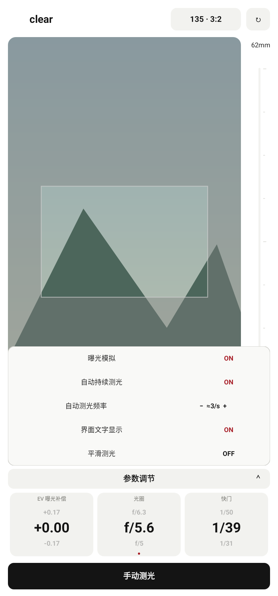
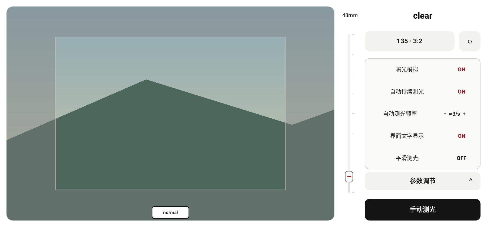
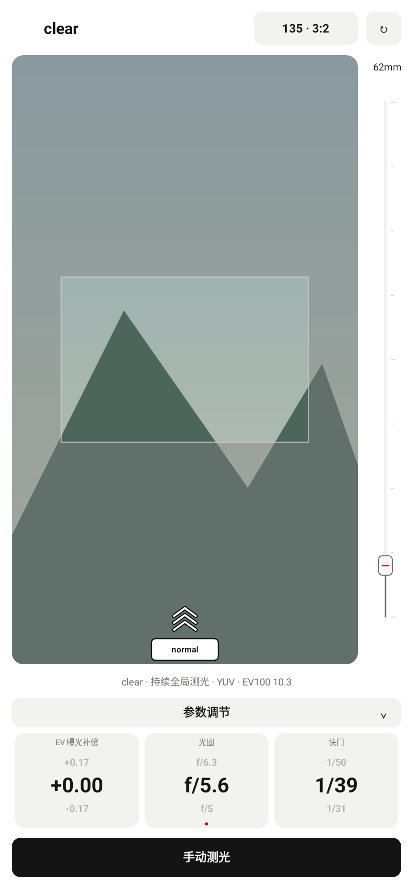
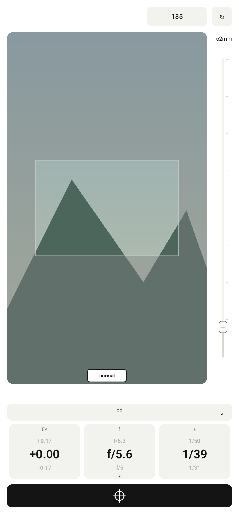

# clear 模式：参数调节、持续测光与模式手势

2026-10-29，接续已保存的 `ddd75d1`。本轮为追加提交，保留此前历史和测试包。

- 模式名称统一为 `normal`、`zone`、`clear`。clear 顶部只显示名称，移除原来的模式按钮；取景底部增加 `normal` 滑块，横竖屏均向上滑动返回 normal。按住或轻点显示向上指引，取消手势不切换。
- normal 滑块文字为 `mode`，保留向上进入 zone、向下进入 clear 的竖屏手势；横屏向右进入 clear。三种模式共用三层空心折线箭头，白色笔画、黑色描边，按方向旋转。
- clear 的 EV、光圈、快门继续显示当前值及上下相邻值，间隔沿用设置中的各自档位。数值变化有 220 ms 滚动过渡；连续快速调节从当前实际可见位置接续，持续 5 Hz 更新会释放透明的旧标签。遵循系统关闭动画的设置。
- 取消独立曝光模拟按钮，以“参数调节”栏展开本页小设置，不跳转页面，也不改变预览尺寸或画幅几何。竖屏设置浮层覆盖预览下部，横屏展开在参数区。

| 小设置 | 行为 |
| --- | --- |
| 曝光模拟 | 使用既有、按相机帧推进的曝光平滑过渡 |
| 自动持续测光 | 开启/停止全局测光；关闭后保持读数，不接收迟到的连续帧或错误 |
| 自动测光频率 | 0.5、1、2、约 3、5 次/秒；关闭持续测光时置灰、禁止调节；实际采样仍受设备和帧准备速度限制 |
| 界面文字显示 | 关闭模式标题、测光按钮汉字及状态信息；保留必要参数数值、画幅/焦距和导航；测光按钮用图标表示 |
| 平滑测光 | clear 手动测光也禁用 RAW，使用 YUV/ISP；开启立即生效，信息提示只有“不再提示”复选框与“确定”按钮 |

五项选项和提示偏好独立保存，不改写 normal/zone 的测光流程偏好。设置展开时，触摸和无障碍操作优先命中可见的设置；离开 clear 后清理浮层、拖动和指引状态。

“RAW 锁定”改为“手动测光”：支持 RAW 且未开启平滑测光时使用 RAW；无 RAW 支持或开启平滑测光时使用既有 YUV/ISP 预览流，按灰框内范围进行全局测光，并使用匹配的曝光元数据。预览流单次测光不执行 RAW 会话切换，也不先重置为中性 AE，保留曝光模拟。成功后保持读数并关闭持续测光，可再次手动测光，或开启“自动持续测光”恢复更新；失败恢复操作前的自动/锁定状态。

画幅、构图横竖比例、焦距滑杆及双指检查放大继续使用已有的灰框和坐标计算。展开小设置不改变测光区域。

验证结果：

- 最终完整单元/Robolectric 回归 765 项通过，零失败、错误或跳过；相较上一提交新增 14 项回归，覆盖持久化、禁用频率、手动测光来源和恢复、提示抑制、横竖屏上滑、浮层触摸/无障碍、真实动画衔接及长期更新资源回收。
- Debug 三种 ABI、通用 APK 和 AndroidTest APK 构建通过。Lint 零错误，70 项既有警告；`git diff --check` 通过。
- 预览来自生产 View 的 Android Native Canvas，背景为合成测试场景，并非手机拍摄截图。真实设备的 RAW 停顿、连续取帧及曝光变化平滑程度仍待手机测试；AndroidTest APK 仅构建，未在手机执行。

构建命令：

```powershell
.\gradlew.bat :app:testDebugUnitTest :app:assembleDebug :app:assembleDebugAndroidTest :app:lintDebug '-PuiPreview=true' '-Pandroid.useAndroidX=true' '-PpreviewOutput=build/ui-preview/clear-20261029' --offline --console=plain
```

测试包：`app/build/outputs/apk/debug/lightstop-clear-20261029-universal-debug.apk`，53,076,812 bytes，Android 9+，`0.6.1 (12)`。APK 不提交到 Git，之前命名的测试包保留。

SHA-256：`5EB48171D12A91AB47D536B808340C6D318C6226FF973544D1FCF267FBF7BADF`。









