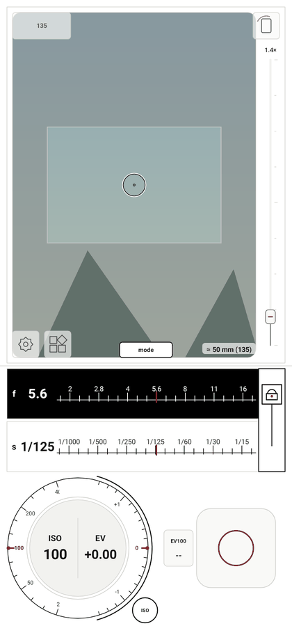
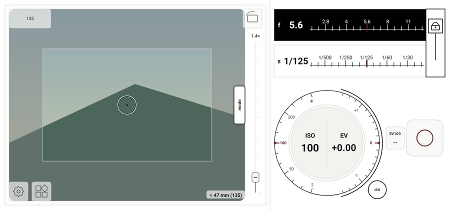
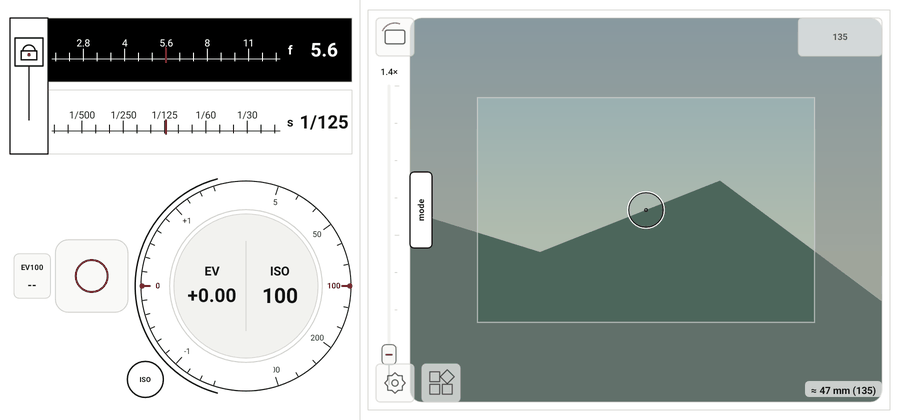

# normal / clear 跟手切换动画

2026-10-29，接续 `83ea8e8`，追加修改，保留已有提交与测试包。

normal 与 clear 的模式滑块现在向宿主持续报告拖动进度。参数区随手势移动并渐隐，目标参数区从另一侧移入并渐显；松手后按阈值完成切换或回弹，取消手势回到原模式。

| 布局 | normal → clear | clear → normal |
| --- | --- | --- |
| 竖屏（左右手） | normal 参数区向下移出 | clear 参数区向上移出 |
| 横屏右手 | normal 参数区向右移出 | clear 参数区向左移出 |
| 横屏左手 | normal 参数区向左移出 | clear 参数区向右移出 |

- 沿模式切换方向拖动 18% 的屏幕边长对应完整进度；进入 clear 的松手阈值为 45%，返回 normal 为 55%。松手补间沿用 zone 的减速曲线及按剩余距离计算的 260–420 ms 时长。系统关闭动画时直接完成或复位。
- 两个模式仍保留各自独立的预览尺寸；切换时共享一份连续插值的预览区域和灰框遮罩，避免双重灰框、透明度叠加及突然改变预览尺寸。参数移动独立于预览遮罩，不推动相机画面到预览外。
- 原始曝光参数、画幅选择、焦距滑块、双指检查放大及滚轮方向保持原有规则；normal/zone 切换继续使用已有实现。
- 模式仅在动画完成后确认。拖动中暂停 clear 连续采样，取消后恢复原模式；回弹不切换相机测光流程。clear 当前锁定及读数在取消返回手势后保留。
- 松手补间期间的新触摸由宿主持有到抬起/取消，防止结束动画时穿透到手动测光或参数按钮；过渡层也拒绝无障碍控件激活。
- 旋转、改变惯用手、退到后台及移除 View 时清理未完成动画，回到最后已确认的模式，不保留半透明层或位移。测光/相机恢复忙碌时不开始模式过渡。

验证：

- 新增 6 项原生 Canvas/UI 回归，覆盖横竖屏与左右手方向、淡出/淡入、相机模式延迟提交、短拖动、取消、反向拖回、旋转/换手/生命周期中止及动画期间新触摸拦截。
- 竖屏动画起点、终点与对应静止模式逐像素一致，验证无额外灰框遮罩。全不透明端点不创建多余透明图层。
- 790 项完整单元/Robolectric 回归通过，零失败、错误或跳过；Debug 三种 ABI、通用 APK 与 AndroidTest APK 构建通过；Lint 零错误、69 项警告；`git diff --check` 通过。
- 动图由生产 View 的手势进度帧合成，背景为合成场景，用于查看布局与方向，不代表手机实际帧率。AndroidTest APK 仅构建，尚未在实体手机执行；实际 Camera2/HAL 与动画流畅度仍待实机验证。

构建命令：

```powershell
.\gradlew.bat :app:testDebugUnitTest :app:assembleDebug :app:assembleDebugAndroidTest :app:lintDebug '-PuiPreview=true' '-Pandroid.useAndroidX=true' '-PpreviewOutput=build/ui-preview/clear-transition-20261029' --offline --console=plain
```

测试包：`app/build/outputs/apk/debug/lightstop-clear-transition-20261029-universal-debug.apk`，53,106,908 bytes，Android 9+，`0.6.1 (12)`。APK 不提交到 Git。

SHA-256：`BB9317031045513DEDBB9EA1D86A65567A011FB93D3EE0327C7D6E6C166207C0`。






