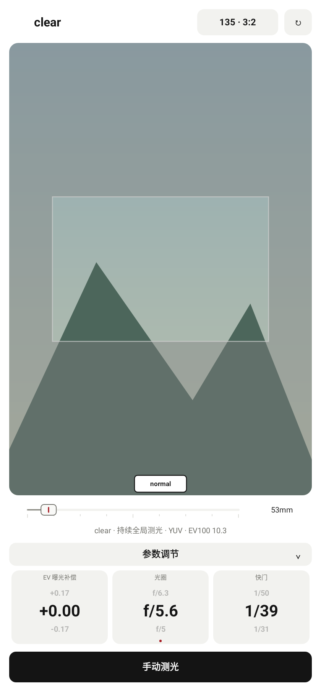
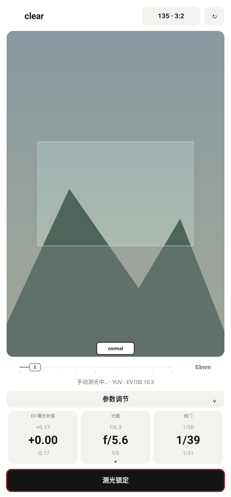
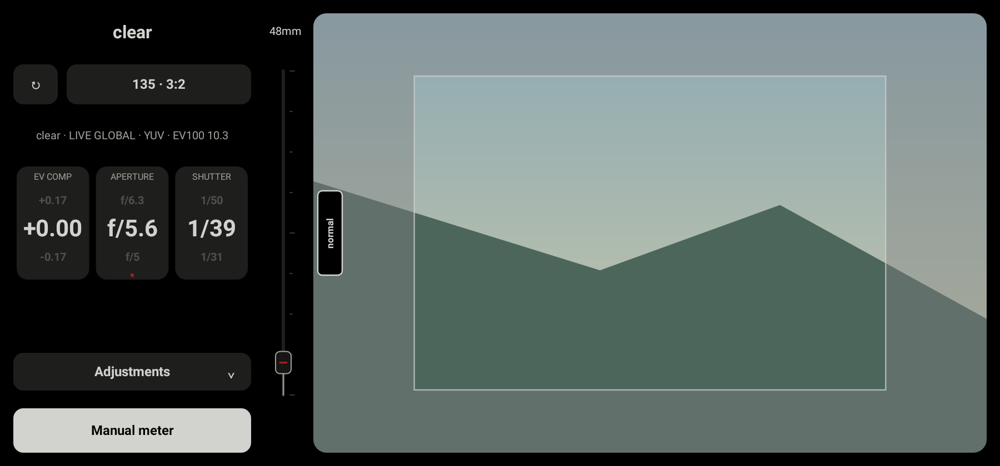
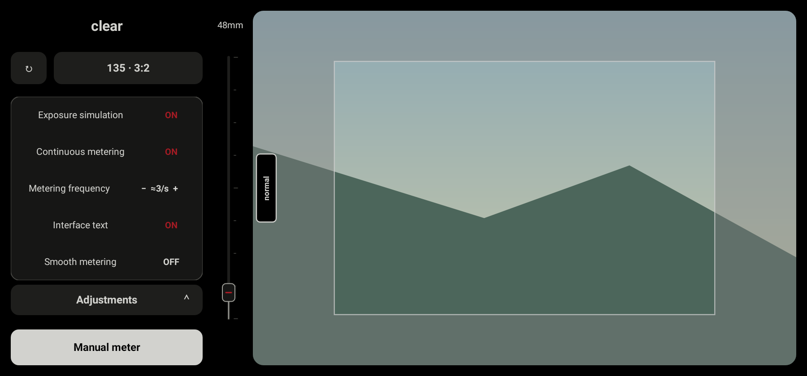

# clear 锁定、模式导航与左右手布局修复

2026-10-29，接续 `d078a10`。本轮说明取代上一份 clear 控制说明中“手动测光关闭持续测光”和“横屏从底部上滑返回”的旧行为；保留旧提交、文档和 APK。

- normal 单击 `mode` 或执行无障碍点击，只显示双向箭头，不弹出模式选择界面。指引先保持 500 ms，再分别沿方向外移并在 400 ms 内渐隐。竖屏为上下箭头，横屏为左右箭头。
- normal、zone、clear 的模式滑块，竖屏中心都对齐屏幕中轴，横屏中心都对齐屏幕高度中点。各模式继续使用独立的预览尺寸。
- clear 横屏返回滑块放在预览的惯用手一侧：右手在右边，左手在左边，朝预览内部滑动返回 normal。左手横屏的预览、参数栏、画幅/旋转按钮及变焦滑杆同时镜像；文字和参数顺序保持可读。
- normal 横屏原来的左手“右滑同时命中 zone 和 clear”冲突已修复，两个方向分别进入不同模式。

| 当前模式 | 竖屏 | 横屏右手 | 横屏左手 |
| --- | --- | --- | --- |
| normal | 上滑 zone，下滑 clear | 左滑 zone，右滑 clear | 右滑 zone，左滑 clear |
| zone | 下滑 normal | 右滑 normal | 左滑 normal |
| clear | 上滑 normal | 左滑 normal | 右滑 normal |

clear 手动测光现在区分“持续测光设置”和“临时读数锁定”：

- 持续测光开启：按下手动测光即进入锁定，按钮显示“测光锁定”并增加红色边框；测量结果保持。再次点击解除锁定，恢复持续测光，不会把设置项改成关闭。
- 捕获尚未完成时也可以解除锁定。既有请求继续完成，迟到的结果不会重新锁定，也不提交并行捕获。
- 持续测光关闭：每次点击只执行单次手动测光并保存读数，不进入切换锁定状态。
- 测光结束后的锁定不阻止离开 clear。相机实际捕获/恢复期间仍保留既有操作互斥，避免与 Camera2 恢复重叠。

clear 竖屏变焦滑杆改为预览下方的水平滑杆，向右放大，两种惯用手方向一致；焦距文字位于滑杆右侧。预览左右留白相等，取景区域居中。灰框、焦距换算、全局范围测光和双指检查放大继续使用原来的几何规则。

无文字模式移除手动测光按钮中央的十字图标，保留空白按钮与锁定边框；无障碍标签继续可用。clear 的手动/锁定状态、设置项和频率单位均有中英文对应；中文使用“开启/关闭”和“次/秒”，英文使用 `ON/OFF` 和 `/s`。明暗主题使用统一颜色来源。

验证：

- 773 项完整单元/Robolectric 回归通过，零失败、错误或跳过；新增 8 项回归，并更新旧行为测试。
- 模式对齐覆盖两种横屏尺寸、两种竖屏尺寸及左右手。真实 ViewGroup 测试覆盖横屏左右手分别进入 zone 和 clear，以及完成手动锁定后正常退出。
- clear 界面检查遍历横竖屏 × 左右手 × 中英文 × 明暗主题共 16 组，分别验证可见控件边界、手动锁定/解除、关闭自动后的重复手动测光、设置展开、无文字按钮像素和变焦操作。
- 原生 Canvas 验证 normal 指引的 500 ms 静止、移动渐隐和结束清除，无普通点击或无障碍点击弹窗。
- Debug 三种 ABI、通用 APK、AndroidTest APK 构建通过；Lint 零错误、70 项既有警告；`git diff --check` 通过。AndroidTest 仅构建，未在手机执行。
- 预览来自生产 View 的 Android Native Canvas，采用合成场景。真实手机的 RAW、HAL 及曝光模拟流畅度尚待实机验证。

构建命令：

```powershell
.\gradlew.bat :app:testDebugUnitTest :app:assembleDebug :app:assembleDebugAndroidTest :app:lintDebug '-PuiPreview=true' '-Pandroid.useAndroidX=true' '-PpreviewOutput=build/ui-preview/clear-navigation-20261029' --offline --console=plain
```

测试包：`app/build/outputs/apk/debug/lightstop-clear-navigation-20261029-universal-debug.apk`，53,080,412 bytes，Android 9+，`0.6.1 (12)`。APK 不提交到 Git。

SHA-256：`F46A0BD446A4EC96BBD66E5518822D0E3652F5937D9025C5403773D4D41F4BF5`。








