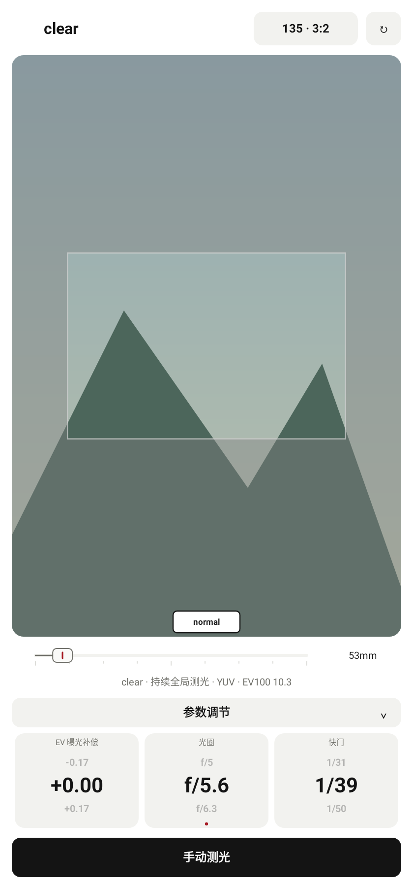

# clear 参数滚轮上下顺序修复

2026-10-29，接续 `ae91cf2`，追加修改并保留旧提交与测试包。

三个参数共用的 `RollingParameterWindow` 原本把上下邻居绘制顺序反置，导致相邻数值的位置与滚动进入中央的方向不一致。修正静止标签、新值入场和中途重定向快照中的位置映射：向上滑动，原先下方的值滚入中央；向下滑动，原先上方的值滚入中央。

EV、光圈、快门的调节方向、档位间隔、曝光计算保持原来的规则；仍保留平滑动画、快速连续操作衔接和透明标签回收。

新增原生 Canvas 回归，直接捕获生产 View 绘制的上下标签，再对三个参数的各档位执行上下滑动，验证中央显示值与原来可见的相邻标签一致，ISO 不变。原有动画中间帧、快速重定向和持续更新资源回收测试继续通过。

验证：774 项完整单元/Robolectric 回归通过，零失败、错误或跳过；Debug 三种 ABI 与通用 APK 构建通过；Lint 零错误、70 项既有警告；`git diff --check` 通过。预览为生产 View 的 Android Native Canvas 渲染，采用合成场景。

```powershell
.\gradlew.bat :app:testDebugUnitTest :app:assembleDebug :app:lintDebug '-PuiPreview=true' '-Pandroid.useAndroidX=true' '-PpreviewOutput=build/ui-preview/clear-reel-order-20261029' --offline --console=plain
```

测试包：`app/build/outputs/apk/debug/lightstop-clear-reel-order-20261029-universal-debug.apk`，53,080,412 bytes，Android 9+，`0.6.1 (12)`。APK 不提交到 Git。

SHA-256：`288E75C46A98C747F3D6A14B304DFDA777AA8C32CA0B1DA297359DDC57591286`。


