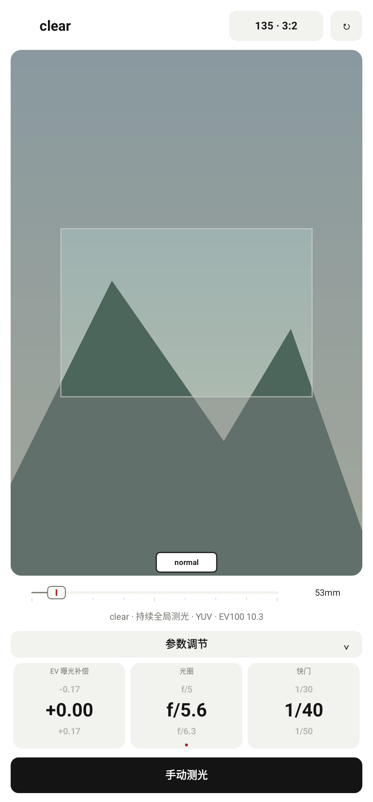

# clear 快门滚轮标准档位修复

2026-10-29，接续 `2cbb794`，追加修改，保留旧提交与测试包。

此前 clear 将连续测光算出的快门坐标直接交给滚轮，例如 EV100 10.3、光圈坐标 5 时会显示 `1/39`，上下邻值也随之偏离标准档位。现在先将快门滚轮的中央显示位置对齐到设置中的档位，再由相同间隔得到上下邻值，全部使用 normal/zone 现有的 `ExposureMath.shutterTicks` 与标称快门值：

| 档位设置 | 上方较慢值 | 中央值 | 下方较快值 |
| --- | --- | --- | --- |
| 整档 | 1/15 | 1/30 | 1/60 |
| 半档 | 1/30 | 1/45 | 1/60 |
| 1/3 档 | 1/30 | 1/40 | 1/50 |

只对滚轮显示位置进行档位对齐，原始测光结果、曝光计算和曝光模拟继续使用连续精度。保留上滑选择原下方值、下滑选择原上方值的规则和平滑动画。超过可调快门范围的邻值显示“—”；30 秒以上长曝光继续沿用现有扩展档位，不截断到 30 秒。

新增三项生产 View 原生 Canvas 回归：连续非档位读数在三种设置下的显示及计算精度；现有三个标准快门表的全部档位与邻值；30 秒以上长曝光及范围边界。777 项完整单元/Robolectric 回归通过，零失败、错误或跳过。Debug 三种 ABI 与通用 APK 构建通过，Lint 零错误、70 项既有警告，`git diff --check` 通过。

构建命令：

```powershell
.\gradlew.bat :app:testDebugUnitTest :app:assembleDebug :app:lintDebug '-PuiPreview=true' '-Pandroid.useAndroidX=true' '-PpreviewOutput=build/ui-preview/clear-shutter-stops-20261029' --offline --console=plain
```

测试包：`app/build/outputs/apk/debug/lightstop-clear-shutter-stops-20261029-universal-debug.apk`，53,080,636 bytes，Android 9+，`0.6.1 (12)`。APK 不提交到 Git。

SHA-256：`1FC0DA294D08FB26965AD57422DC524552E9A4A7312137E9E279903EF7113793`。

预览来自生产 View 的 Android Native Canvas，背景为合成场景：


