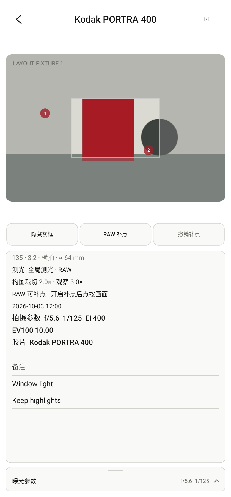

# 参数记录灰框与历史页面触摸修复

2026-10-28，接续 `657492a`，追加修改，不重写此前提交。

- 新记录沿用已有的 `RecordedViewfinder` 快照，保存当时的画幅、横竖构图、焦距、灰框归一化范围与预览检查放大。JPEG 保留干净图像，灰框独立绘制，仍可在详情中隐藏或显示。
- 分类封面、记录缩略图改用与确认页、详情相同的 `RecordedPreviewRenderer`，都显示记录自己的半透明灰框，不从后来改变的实时画幅或焦距推算。
- “无”画幅仍不画框。缺少取景快照的旧记录继续按原保存图读取，不编造当时的灰框或焦距；本轮不修改记录格式，也不重写用户记录。
- 历史页所有区域都接收自身的触摸。无操作的空白、折叠后不可见的参数区域，以及切图动画期间的新触摸，不再传给底下的实时仪表；动画中途结束时，已接收的手势仍由历史页持有到抬起/取消。
- “长按参数记录”只在开启记录且实时 Normal/Zone 界面无遮挡时显示。历史页、确认页、工具、设置、自动模式等覆盖页面会将它隐藏；关闭覆盖页的退出动画完成后再恢复。相机/UI 刷新和重新布局不再把它移到历史页之上。
- 隐藏或移除长按控件时，取消已排队的长按任务；记录状态与临时隐藏分开，返回实时取景后可以继续记录。

验证：

- 751 项完整单元/Robolectric 回归通过，零失败、错误或跳过；Debug 三种 ABI 与通用包构建通过；Lint 零错误、70 项既有警告；`git diff --check` 通过。
- 新增 3 项真实 ViewGroup 派发/层级/长按取消回归，以及 1 项封面、缩略图、详情使用已存灰框的图像回归。原有“隐藏区域不修改参数”测试增加了不穿透触摸的要求。
- 拍摄边界回归扩展到保存并重新读取仓库，检查画幅/焦距改变后灰框仍正确，并以实际渲染像素验证有框与“无”画幅的差异；兼容旧记录与 RAW 补点回归继续通过。
- 预览图由生产 View 的 Android Native Canvas 渲染，使用合成测试图片；没有将用户提供的截图写入仓库。真实手机的操作反馈仍可用于进一步回归。

构建命令：

```powershell
.\gradlew.bat :app:testDebugUnitTest :app:assembleDebug :app:lintDebug '-PuiPreview=true' '-Pandroid.useAndroidX=true' --offline --console=plain
```

测试包：`app/build/outputs/apk/debug/lightstop-record-history-fix-20261028-universal-debug.apk`，53,055,076 bytes，Android 9+，版本 `0.6.1 (12)`。

SHA-256：`7C729F165428B93E3AF716B4DC045B78901F171F38F1A316EF8963BBAE8C8A9F`。此前测试包另行保留，APK 不提交到 Git。


