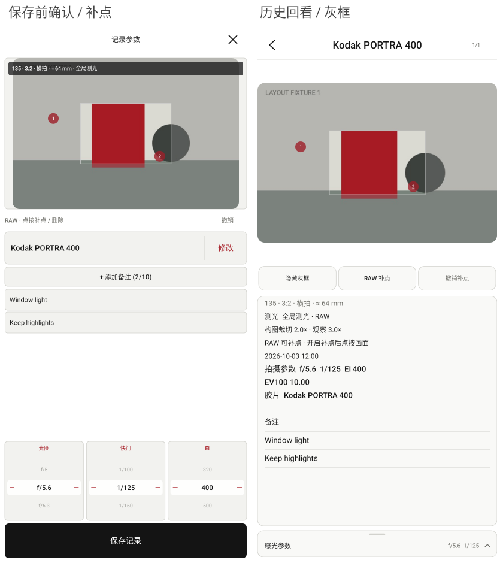
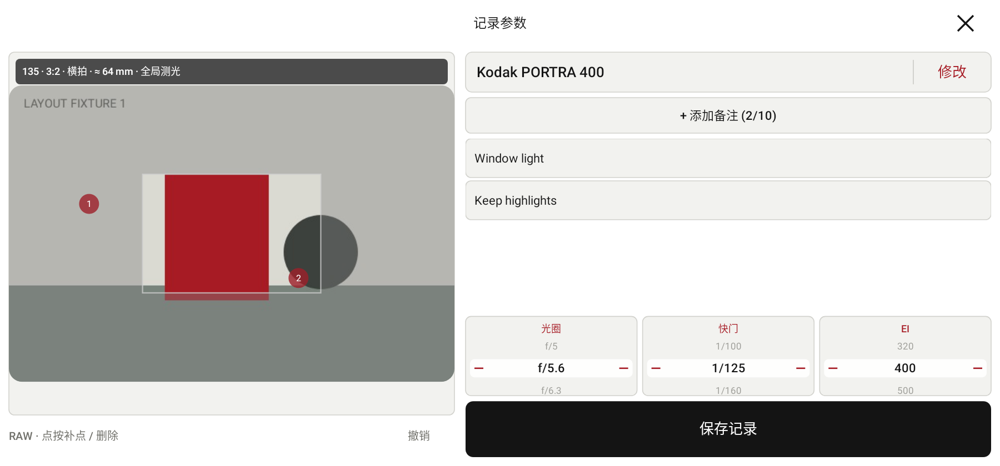
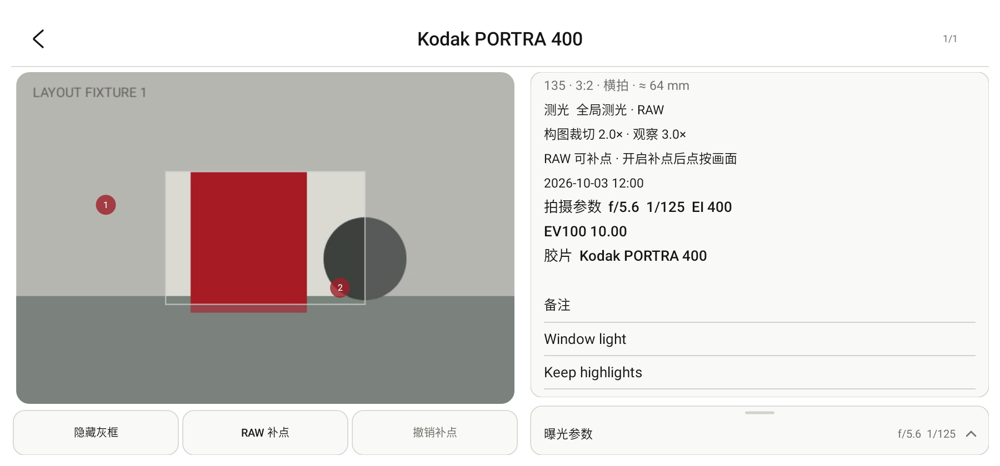

# 参数记录布局预览

2026-10-27。生产 View 在 Robolectric 原生图形模式下的模拟场景，使用程序生成的图像和虚构记录，无私人照片。

完整竖屏图：[保存前确认](editor-840x1800.png)、[历史回看](history-840x1800.png)。

通过 `ParameterRecordFramingTest.renderNewRecordConfirmationAndHistoryLayouts` 在 `app/build/ui-preview/records-framing/` 重新生成。图中一个测点位于灰框之外，用于检查全图补点与框线的层次。
