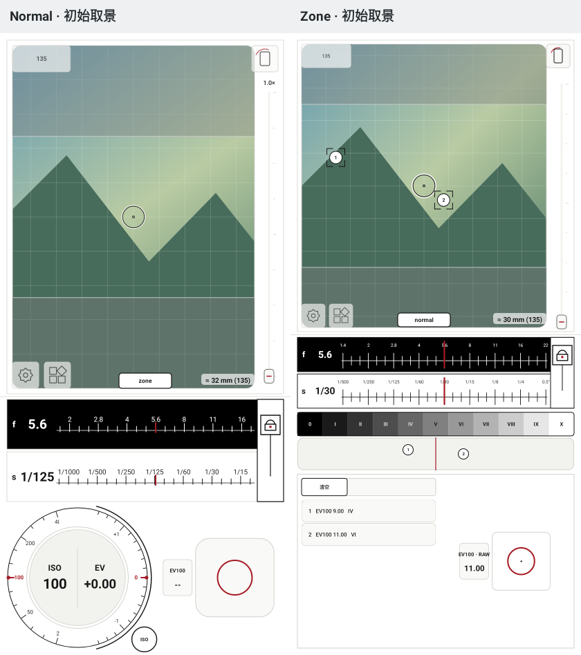
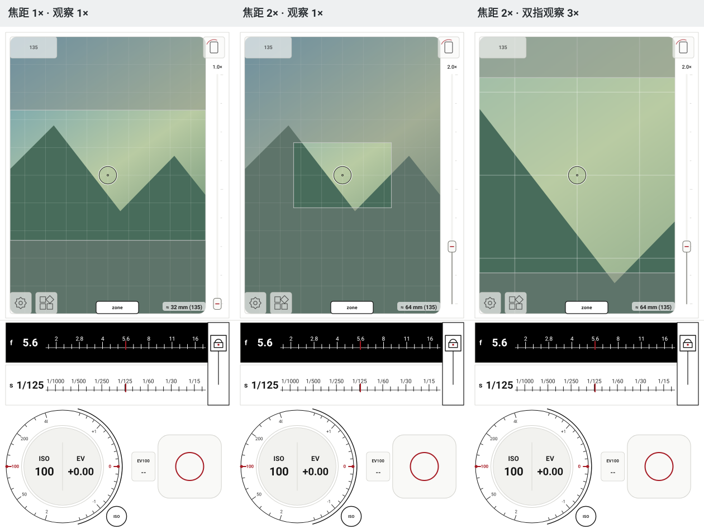
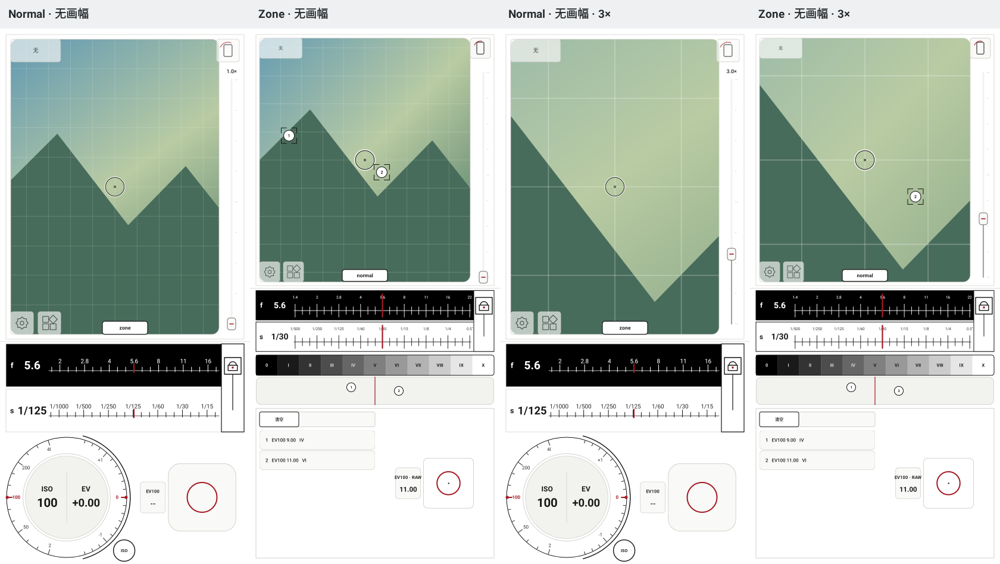
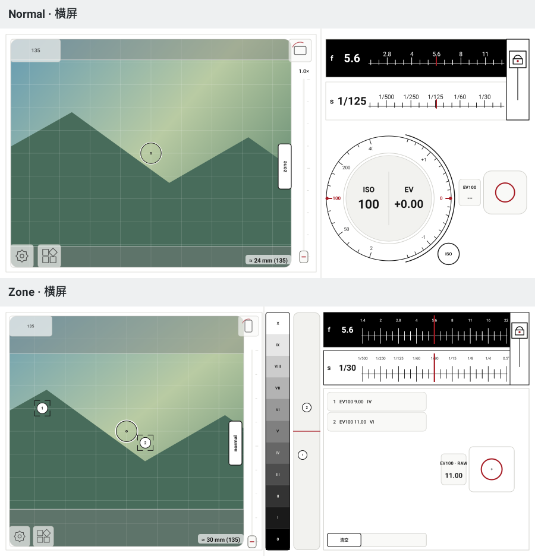
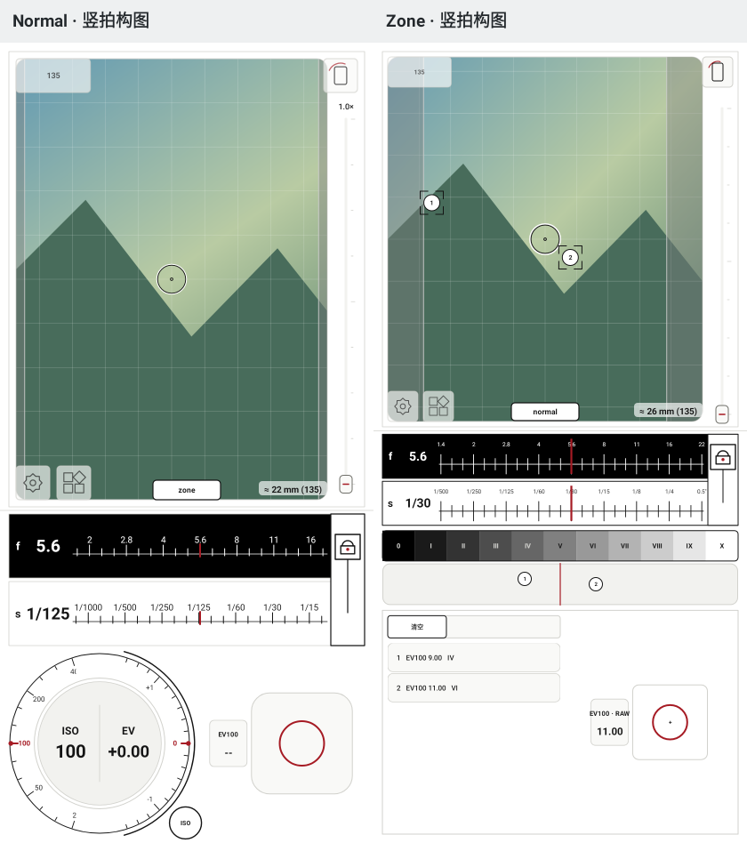

# Normal / Zone 取景布局预览

2026-10-26。由生产 `InstrumentView` / `ZoneSystemView` 在 Robolectric 原生图形模式下绘制，使用程序生成的山形和网格场景；不是设备相机截图。

运行 `ViewfinderFramingIntegrationTest.renderFramingPortraitAndLandscapeWithBothModes` 可在 `app/build/ui-preview/framing/` 重新生成全套预览。这些图片用于检查空间比例、灰框、圆角、焦距标签和缩放状态；真实 Camera2、EGL、RAW 和运动跟踪仍需手机验收。

Normal 和 Zone 分别填充自己的可用预览区域。

右侧滑杆改变灰框；双指改变预览观察倍率。观察倍率不参与灰框焦距计算。

“无”画幅取消灰框和焦距，滑杆与双指共同控制预览裁切倍率。

