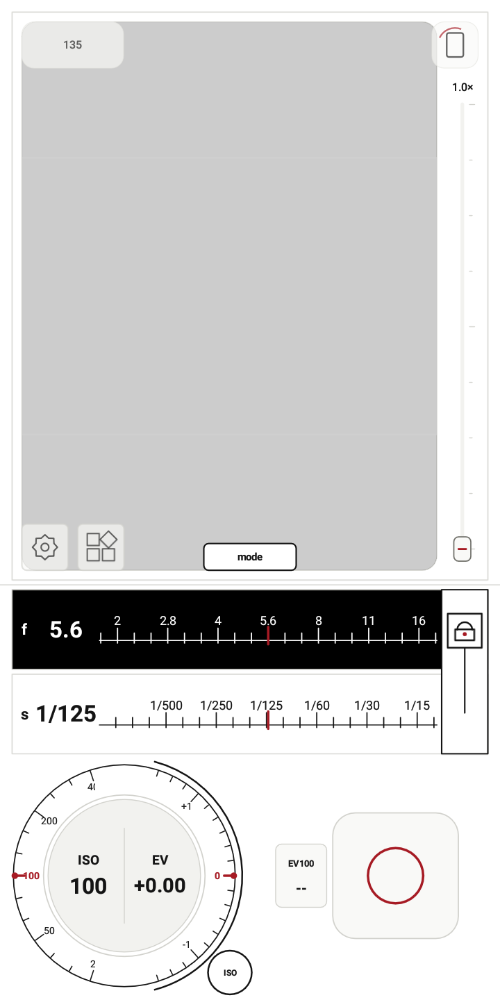
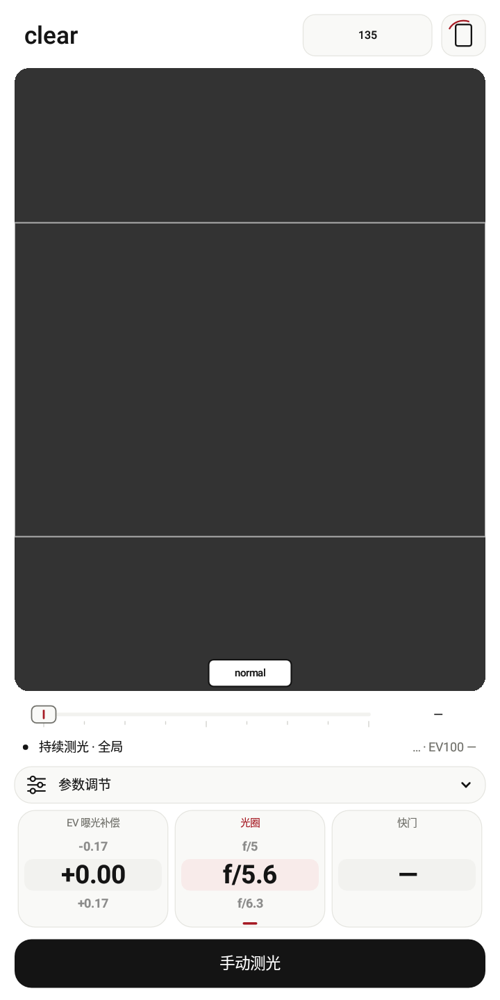
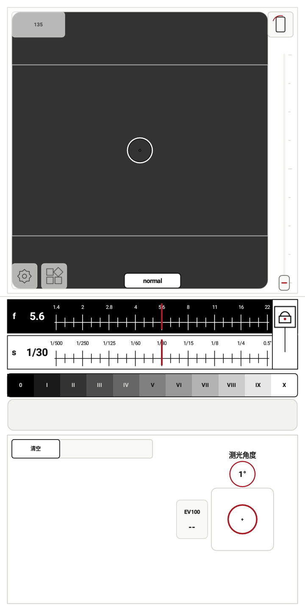

# lightstop 0.7.0

Android 9+，版本号 13。正式 APK 使用 0.6.1 的发布密钥签名后可覆盖升级。

## 中文

- 全局测光接入轻量神经网络模型，使用已保存的 epoch 219 权重。
- 新增 Clear 模式，与 Normal、Zone 组成三种测光界面；支持连续测光、曝光预览和多点分区测光。
- 改进 Clear 连续测光与曝光预览衔接、过曝／低信号恢复和预览校准等待，增加曝光预览超出可执行范围时的提示。
- 改进取景裁切、Clear、参数记录及工具界面。
- 正在训练的候选模型、训练 checkpoint、原图和共享缓存均不包含在应用中。

提供 arm64-v8a、armeabi-v7a、x86_64 和通用 APK。

## English

- Added lightweight neural global metering using the packaged epoch 219 weights.
- Added Clear alongside Normal and Zone, covering continuous metering, exposure preview and multi-point Zone readings.
- Improved Clear continuous metering, exposure-preview transitions, recovery from unusable signals, calibration readiness, and preview-limit feedback.
- Refined framing, Clear, parameter records and utility interfaces.
- Active candidate models, checkpoints, original images and shared training caches are excluded from the application.

Android 9+, versionCode 13. Separate ARM64, ARMv7, x86_64 and universal APKs.

## 模式演示 / Mode demos

| Normal | Clear | Zone |
| --- | --- | --- |
|  |  |  |

Android 模拟器中的三种模式。 / Three modes shown in the Android emulator.
