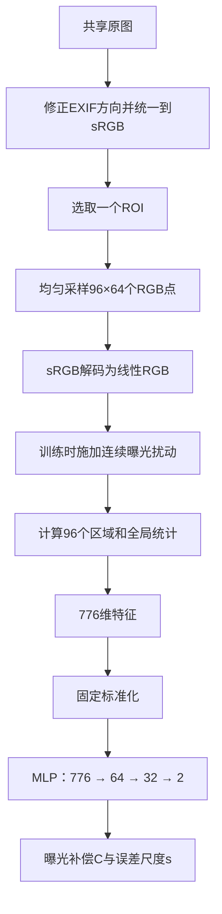

# 当前轻量测光模型：从图像到曝光补偿的完整实现

更新日期：2026-10-27。

2026-10-28状态更新：原JPEG续训链最新已保存至第134轮；应用全局输入映射和新的RAW域微调包已准备，小批恢复验证通过，长期微调尚未启动。本文主体保留原配方的结构说明；当前断点、应用契约、共享图源和训练命令见[最新交接规范](<C:/Users/15449/.codex/worktrees/5b24/lightmeter a/docs/research/GLOBAL_METERING_TRAINING_HANDOFF_2026_10_28_ZH.md>)。

本文依据当前实际运行的 `runtime-snapshot-v8-auto-admission`、测光第124轮checkpoint，以及与该快照一致的仓库源码编写。重点介绍已经搭建的模型；文末单独介绍下一步可以怎样演进。

## 1. 模型到底在学什么

当前模型的任务是：**观察一幅画面或选区，判断应该增加或减少多少曝光，才能回到参考照片的曝光取舍。**

例如，把一张参考照片在线模拟压暗1.3档，模型的目标输出就是 `+1.3 EV`；模拟提亮0.7档，目标就是 `−0.7 EV`。输出是连续数值，可以是0.23档、−1.46档，并不局限于整档或三分之一档。

模型的两个输出是：

| 输出 | 单位 | 含义 |
|---|---|---|
| 曝光补偿 C | EV，即曝光档数 | 正值增加曝光，负值减少曝光 |
| 误差尺度 s | EV | 模型预计这次判断有多大的误差量级，较小表示它预计更容易判断 |

如果固定ISO和光圈，只通过快门执行补偿，则有：

```text
新的曝光时间 = 当前曝光时间 × 2^C
```

例如当前为1/125秒，`C=+1`，相应曝光时间约为1/62.5秒；`C=−1`则约为1/250秒。这说明输出的物理方向。最终应用怎样分配快门、ISO、光圈，是模型之后的相机控制逻辑。

当前模型直接学习的是曝光补偿。绝对场景EV100所需要的光圈、快门、ISO与设备标定，仍由应用现有测光流程提供。

> 应用侧政策（不属于模型本身）：模型最终给出的曝光会在应用内再固定提亮一档，理由是负片宽容度不对称、宁过曝不可欠曝。因此应用里的最终建议是 `recommendedEv100 = cameraEv100 − C − NEGATIVE_FILM_OVEREXPOSURE_EV`（=1.0），模型原始 `C` 仍单独保留以便与训练输出直接比对。详见 `docs/CAMERA_PIPELINE.md` 的 “Global model exposure bias / 全局模型曝光偏置”。

## 2. 整体结构：稀疏统计 + 小型神经网络

模型并没有把数百万像素直接送入卷积网络，而是先用少量采样点描述画面的空间明暗分布，再交给一个很小的全连接网络。



推理时沿用同样的采样、线性化和特征计算，只是不施加模拟曝光扰动。

这里可以把职责理解为：统计模块负责告诉网络“哪里亮、哪里暗、分布如何”；网络负责学习“面对这样的分布，怎样的曝光取舍更接近参考”。

## 3. 原图、裁切和缓存怎样组织

### 3.1 共享原图，独立测光样本

测光和除尘共用一份原图池，原图只下载、存储和去重一次，统一保存来源、作者、许可、SHA-256、phash及划分信息。当前来源包括已登记的LIU4K作者图源和Wikimedia Commons摄影图片。

测光有自己的manifest、参考曝光标签、采样缓存、checkpoint、优化器状态和消费记录。两个模型共享照片，不共享标签或模型状态。

首轮使用263张照片，划分为231张训练、16张验证、16张测试。持续训练阶段按共享数据池的准入结果建立新的冻结清单；其中一张原训练图片在后续审计中被排除。新图会陆续加入，固定验证/测试原图及其分组保持隔离。

截至本文记录，第12个测光续训阶段使用134张训练原图。这是该阶段的原图数量，不是历次训练累计看到的全部照片数。

### 3.2 每张原图建立16个ROI

ROI是本次要分析的画面范围。当前固定生成以下16个：

| 类型 | 数量 | 位置与倍率 |
|---|---:|---|
| 完整画面 | 1 | 1倍全图 |
| 中央裁切 | 3 | 中央1.5倍、2倍、4倍 |
| 偏离中央的裁切 | 12 | 四个角分别取1.5倍、2倍、4倍 |

裁切宽、高分别为原图宽、高除以倍率，保持原画幅比例。四角裁切贴着相应边缘，中央裁切位于正中。

这样，一张照片不只提供全图明暗，还会提供主体被放大、天空占比改变、主体靠边、局部阴影占比增加等不同构图。它也让训练过程覆盖数码裁切变焦。

当前ROI并没有另行输入“这是2倍变焦”这样的标记；网络看到的是该范围重新分区后的统计特征。任意形状蒙版也还没有加入特征提取，目前是完整矩形ROI。

### 3.3 每个ROI只保留6,144个采样点

每个ROI均匀选取 `96×64=6,144` 个RGB点，取采样中心对应的原生像素，不先缩略插值。采样点覆盖ROI内部，随后按位置分为12列、8行，共96格，每格恰好有8×8个点。

```text
一个ROI
  └─ 12列 × 8行 = 96个区域
       └─ 每区8 × 8 = 64个RGB采样点

总采样量：96 × 64 = 6,144个RGB点
```

无论原图是800万还是4,000万像素，进入特征计算的点数都相同。画面分辨率增加不会增加网络输入维度。

准备缓存时，程序先解码原图、修正EXIF方向、按ICC配置转换到sRGB，然后提取这些点。每张原图保存一个形状为 `[16,3,64,96]` 的uint8数组：

- 单个ROI约18 KiB。
- 一张原图的16个ROI合计288 KiB，不计很小的文件头。
- 后续epoch反复使用这个小缓存，曝光变化在线生成，不保存成千上万张曝光变体。

离线准备阶段仍会解码整张原图；节省的是后续重复解码、浮点处理、存储和训练的开销。

## 4. 曝光样本和标签怎样生成

### 4.1 先解码sRGB，再改变曝光

将8位sRGB数值归一化为 `u∈[0,1]`，按标准分段函数转换：

```text
u ≤ 0.04045：linear = u / 12.92
其余：       linear = ((u + 0.055) / 1.055)^2.4
```

因为缓存只有256种通道数值，实现中预先建立256项查找表，训练时直接查表。

随后施加曝光扰动：

```text
I_delta = clamp(I_reference × 2^delta, 0, 1)
目标补偿 y = −delta
```

这里乘的是线性RGB，而不是直接对JPEG编码数值乘倍数。高光溢出时截到1，低亮度部分仍保留在统计中。

### 4.2 曝光变化是连续随机的

每一路增强独立执行：

- 25%概率使用原参考，`delta=0`、标签为0。
- 75%概率在 `[-3,+3] EV` 连续均匀采样。

例如实际可能得到 `−2.137、+0.084、+1.629 EV`。验证里的九个固定档位只是为了重复比较结果，训练并不只见过这九档。

原图文件不被修改，曝光变化发生在采样后的浮点数据上。

### 4.3 同一个ROI每次产生两路曝光

每个训练batch先取128个ROI，然后给每个ROI抽两个独立扰动，形成a、b两路：

```text
同一个参考ROI
    ├─ delta_a = −1.4 EV → 目标 +1.4 EV
    └─ delta_b = +0.6 EV → 目标 −0.6 EV
```

两路都训练补偿和误差尺度，同时用二者之间已知的曝光差施加一致性约束。两路使用相同网络、共享参数。

## 5. 776维特征具体是什么

### 5.1 亮度和EV坐标

在线性RGB上计算亮度：

```text
Y = 0.2126 R + 0.7152 G + 0.0722 B
e = log2(max(Y, 0.000001) / 0.18)
```

以0.18为坐标参考，亮度0.18对应0，0.36对应+1，0.09对应−1。这里的0.18是建立图像相对亮度坐标的基准；训练仍会学习不同内容的曝光取舍，不会把所有照片都强制拉成同一个平均灰。

区域平均是在EV域进行的：例如两个点的Y分别为0.09和0.36，它们对应−1和+1 EV，平均为0 EV；如果先平均Y得到0.225再取log₂，结果则约为+0.322 EV。当前区域特征采用前一种计算顺序。

先对整个ROI的6,144个e排序，得到两个稳健统计：

- **B，基础亮度**：EV分布5%到95%区间的均值。
- **H，亮端亮度**：EV分布98%到99.5%区间的均值。

区间边界用精确面积权重处理，落在分位边界的采样点可以只贡献一部分权重。B减少极少量最暗/最亮点对整体坐标的影响，H单独描述亮端。

### 5.2 每个区域的8项特征

每格有64个采样点，输出：

| 序号 | 特征 | 具体含义 |
|---|---|---|
| 1 | 区域平均EV − B | 该区域相对整个ROI偏亮还是偏暗 |
| 2 | 区域EV标准差 | 区域内部明暗变化程度，使用总体标准差 |
| 3 | 区域P10 EV − B | 区域较暗部分相对整体的位置 |
| 4 | 区域P90 EV − B | 区域较亮部分相对整体的位置 |
| 5 | 饱和比例 | 任一线性RGB通道≥0.98的采样点比例 |
| 6 | 低信号比例 | Y≤0.000001的采样点比例 |
| 7 | log₂(平均R / 平均G) | 区域颜色相对偏红/偏绿的程度 |
| 8 | log₂(平均B / 平均G) | 区域颜色相对偏蓝/偏绿的程度 |

颜色比先对通道求均值，再取比值和log₂；分母/分子使用最小信号值保护。P10、P90使用相邻排序值线性插值。

96个区域按从上到下、从左到右排列，每个区域的8项连续存放，共 `96×8=768` 维。因此网络可以区分“上方很亮”和“下方很亮”，而不仅知道整图有多少亮点。

### 5.3 额外8项全局特征

| 序号 | 特征 | 用途 |
|---|---|---|
| 1 | B本身 | 保留当前画面整体曝光位置 |
| 2 | H − B | 亮端与基础亮度相差多少档 |
| 3 | 全局P90 − P10 | 画面主要亮度跨度 |
| 4 | 全局饱和比例 | 高光截断程度 |
| 5 | 全局低信号比例 | 黑场/极低信号程度 |
| 6 | 有效覆盖率 | 当前完整矩形ROI固定为1 |
| 7 | 全局log₂(R/G) | 整体颜色倾向 |
| 8 | 全局log₂(B/G) | 整体颜色倾向 |

最终维度：`768+8=776`。

局部特征减B，可以更稳定地描述构图中的相对明暗；全局特征又保留B，使网络知道整幅画面现在有多亮。这两部分配合，避免只保留相对分布而丢掉曝光信息。

在没有截断且高于信号底时，曝光增加delta档，会有 `e'=e+delta`、`B'=B+delta`，所以 `区域平均e'−B'=区域平均e−B`。明暗结构、EV标准差和颜色比基本保持，主要由全局B记录整体平移。这是当前特征设计联系画面内容与曝光连续变化的关键。

### 5.4 输入标准化

首轮只用训练集，分别在−2、0、+2 EV下计算每个特征维度的均值μ和标准差σ，然后固定下来：

```text
z_j = (x_j − μ_j) / max(σ_j, 0.001)
```

这是一套全数据集共享的776维标准化参数，不是每张照片重新减去自身亮度。持续训练时沿用原标准化参数，避免图池更新导致输入坐标突然变化。

标准化参数作为模型buffer保存，也包含在导出的推理图里。

## 6. 神经网络怎样作出判断

### 6.1 三层全连接网络

```text
输入776维特征
    ↓ 固定标准化
Linear(776,64) + ReLU
    ↓
Linear(64,32) + ReLU
    ↓
Linear(32,2)
    ↓
输出变换：补偿C、误差尺度s
```

| 层 | 权重数量 | 偏置数量 | 参数合计 | MAC |
|---|---:|---:|---:|---:|
| 776→64 | 49,664 | 64 | 49,728 | 49,664 |
| 64→32 | 2,048 | 32 | 2,080 | 2,048 |
| 32→2 | 64 | 2 | 66 | 64 |
| 合计 | 51,776 | 98 | **51,874** | **51,776** |

MAC表示一次乘加。FP32可训练参数占207,496字节，约203 KiB；再加约6 KiB的标准化和误差尺度buffer，以及序列化文件头。

这个网络没有卷积、注意力或图像生成解码器。第一层就能同时读取96个区域的信息，后面两层通过非线性组合学习不同明暗、颜色和位置关系对应的曝光取舍。

### 6.2 它是否给每个区域学习了权重

每个区域在输入中有固定位置，第一层对这些位置使用不同的可学习系数，后续ReLU又会让不同画面激活不同组合。因此，区域位置、亮度、颜色和对比度可以影响最终结果。

不过当前实现没有显式输出96个区域权重，也没有执行“先预测权重，再对区域EV加权求和”这一步。它直接从776维统计回归补偿值。区域权重可视化或显式加权测光头，是下一版可以增加的结构。

当前模型也没有人脸、AF点、距离或单独的场景识别分支。它主要依靠空间统计和颜色线索学习画面规律。

### 6.3 输出如何变成EV

最后一层得到两个原始数值 `r0、r1`，再进行变换：

```text
C = 4 × tanh(r0 / 4)
s = min(softplus(r1) + 0.05, 4) × k
```

补偿C平滑限制在±4 EV内；误差尺度始终为正。k是验证集误差尺度校准系数，当前第124轮checkpoint中为1.0。

误差尺度的单位是EV：例如s=0.3表示模型预计误差量级较小，s=1.2表示预计更难判断。它用于排序、筛选或后续融合，不是“准确率百分比”。

## 7. 三部分损失怎样训练这个网络

网络同时优化曝光补偿、误差尺度和同一画面的曝光关系：

```text
总损失 = 补偿损失 + 0.1 × 误差尺度损失 + 0.1 × 曝光一致性损失
```

### 7.1 补偿损失：直接学习应该调几档

两路分别计算Smooth L1，再平均：

```text
L_point = [SL1(C_a, −delta_a) + SL1(C_b, −delta_b)] / 2
beta = 0.25 EV
```

误差小于0.25 EV时使用平滑的二次形式，较大误差近似线性增长。这样既能细调小误差，又不会让个别大误差完全支配梯度。

### 7.2 误差尺度损失：学习哪些画面难判断

每一路采用：

```text
L_scale = stop_gradient(|C − y|) / s + log(s)
```

第一项让误差大的样本倾向于预测较大的s；第二项阻止模型通过无限放大s降低损失。残差在这条损失里停止梯度，尺度监督主要校准s，补偿值由主损失和一致性损失训练。

### 7.3 曝光一致性损失：同一画面提亮后，应少补一点

同一个ROI的两路曝光已知，因此要求：

```text
C_a − C_b ≈ (−delta_a) − (−delta_b)
          = delta_b − delta_a
```

例如a路压暗1.4档、b路提亮0.6档，两个预测补偿理应相差2档。该约束把相对曝光变化和画面内容联系起来。

实现中，只有两路都满足“饱和比例≤5%、低信号比例≤20%”时才加入一致性项。主补偿损失和误差尺度损失仍使用整个batch，较困难的样本仍参与训练。

这是一项权重0.1的软约束；当前网络没有在结构上把曝光斜率固定为−1，因此仍可能出现某些ROI对曝光变化响应不够准确的情况。

## 8. 最初训练和现在持续训练的区别

### 8.1 共用的基本配置

| 项目 | 当前值 |
|---|---|
| 框架 | PyTorch，现有CUDA环境 |
| GPU | RTX 5070 Laptop GPU |
| 精度 | FP32 |
| Batch size | 128个参考ROI，每个产生两路曝光 |
| 优化器 | AdamW |
| 基础学习率 | 0.001 |
| 最低学习率 | 0.00001 |
| Weight decay | 0.0001 |
| 学习率预热 | 5轮 |
| 后续学习率 | 余弦下降，按累计轮数推进 |
| 梯度范数上限 | 5 |
| 累计轮数上限 | 200 |
| CPU线程 | 2 |
| CUDA显存预算 | 每进程最多设备显存的20% |

一轮epoch是当前训练清单中的每个ROI被抽取一次；每次抽取又产生两路随机曝光。第12阶段134张训练图对应2,144个ROI，约17个batch/epoch。

### 8.2 首轮：三个种子选择初始模型

最初在同一固定数据集上独立训练 `20261025、20261026、20261027` 三个种子，按验证集全量MAE选择模型。首轮每个种子连续25轮没有提升时停止。

最终选中种子20261025的第39轮，验证MAE约0.5686 EV，完成safetensors和ONNX导出。三个种子不是现在同时运行的三个测光模型；当前持续训练是沿既有checkpoint链路推进的一条模型。

保存用于评估/导出的最佳模型，与保存用于恢复训练的最后断点，是两份文件。实际共享续训从这个种子的第64轮 `last.pt` 接续，随后累计到第124轮；第39轮的 `best.pt` 仍保留为历史最佳。因此，首轮导出的模型和当前监视器显示的最新模型并不是同一份权重。

### 8.3 持续训练：新图分阶段进入

共享采集器继续获取原图，通过统一自动准入后进入图池。测光调度器根据仍可用的已接受原图生成新的阶段manifest，并冻结该阶段成员。

每个测光阶段：

1. 从父checkpoint恢复权重、AdamW状态、学习率调度器和随机数状态。
2. 恢复原有776维标准化参数。
3. 为当前清单加载ROI缓存，新图生成相同格式的缓存。
4. 按原配方继续训练和固定验证。
5. 每轮原子保存 `last.pt`，有新的历史最佳时保存该阶段的 `best.pt`。
6. 阶段提交后更新消费记录，将GPU交回共享队列。

当前续训单阶段最多10轮；如果连续5轮没有刷新历史最佳验证MAE，则结束本阶段，等待下一批新图。累计轮数仍受200轮上限约束。这与首轮“耐心值25”的规则不同。

数据不是在一个正在运行的epoch中途随下载随插入，而是在阶段边界更新。某张原图只要仍在可用目录中，就可能出现在后续阶段，形成一定程度的旧图复用；当前没有额外维护一个固定大小、按比例抽样的长期回放池。

原图缓存的回收由共享消费台账管理：除尘和测光相关训练都已提交、使用完成后才进入回收流程。测光的checkpoint、优化器和派生采样缓存按各自记录保留。

## 9. 怎样评价模型效果

### 9.1 固定验证组

验证曝光固定为：

```text
−3、−2、−1、−0.5、0、+0.5、+1、+2、+3 EV
```

16张验证原图，每张16个ROI、每个ROI九个曝光，共2,304个样本。每轮用同一组输入比较，便于观察训练是否改善。

MAE的计算方式是先对每张原图的样本求平均绝对误差，再对原图求平均。P90表示样本绝对误差的90分位点；它反映误差尾部，和平均值互补。零扰动分组还用于观察参考照片自身被建议调整了多少。

首轮最终导出流程会在验证集上校准误差尺度k和筛选阈值，再计算封存测试结果。持续训练阶段主要记录固定验证结果；当前第124轮的k仍为1，阶段结束也不会自动重新导出首轮目录里的ONNX。

### 9.2 与传统统计算法比较

现有统一检测额外比较四种方法：

| 方法 | 如何计算 |
|---|---|
| 当前MLP | 776维特征经网络输出C |
| 项目全局统计核 | B加受限亮端调整，再转换成补偿 |
| 完全平均EV | 对所有采样点的log₂亮度坐标求平均 |
| 平均亮度后取log₂ | 先平均Y，再转换成EV坐标 |

统计基线各自只用训练参考拟合一个固定EV锚点。所有方法共用采样点、参考目标和同一可靠子集，同时显示覆盖率与模型全量MAE。

项目全局统计核的比较采用同一显示线性RGB输入，是统计策略对照；应用里的设备响应校准、曝光元数据和RAW多帧处理属于完整相机流程的另一层。

### 9.3 本文记录时的结果

当前第124轮全量MAE为 **0.5864 EV**，P90为 **1.3400 EV**，观察最大绝对误差 **3.9341 EV**；历史最佳全量MAE仍为第39轮的 **0.5686 EV**。

共同可靠子集有1,400个样本，覆盖率60.8%：

| 方法 | 平均误差/EV | P90/EV |
|---|---:|---:|
| 当前模型 | 0.5197 | 1.2496 |
| 项目全局统计核 | 1.2177 | 2.6908 |
| 完全平均EV | 1.3269 | 2.8061 |
| 平均亮度后取log₂ | 1.0676 | 2.5303 |

这些结果说明，模型已经学到了一些超出固定亮度均值的参考曝光规律。当前继续训练的平均误差有波动，较困难ROI的尾部误差仍明显，下一步应重点改善目标和曝光关系，而不只是继续增加轮数。

## 10. 推理开销和移动端接入位置

一次推理的主要工作量可以拆成：

```text
取得当前帧/选区
  → 读取6,144个RGB采样点
  → 线性化、log₂、分区统计与排序
  → 776维标准化
  → 51,776次网络乘加
  → 输出C和s
```

特征提取包括一次6,144元素的全局排序，以及96次64元素的局部排序；网络本身很小。手机优化应同时考虑取帧、跨语言数据复制、特征计算、调度和网络，而不仅是矩阵乘法。

首轮导出模型的桌面单线程、batch=1基准为P50约 **0.0688 ms**，P95约 **0.1175 ms**，包含标准化、MLP及输出变换；图像采样和特征提取不在这个计时内。

按照每秒1次或3次测光设计，单次只需对当前ROI运行一次网络。训练时16个ROI、两路曝光用于增加训练覆盖，手机上不必同时执行全部16个ROI，也不必为一次预测采集两种曝光。

当前导出格式是ONNX opset 17，输入为float32 `[batch,776]`，输出为float32 `[batch,2]`。ONNX包含固定标准化和输出变换；图像取样和特征提取在模型图外。首轮PyTorch与ONNX的最大补偿差约 `0.0000023 EV`。

应用接入时，可以让RAW和预览/YUV各自经过已有的颜色与响应处理，再提供一致定义的线性RGB采样值给 `from_linear` 所对应的特征逻辑。RAW/YUV取帧频率、相机曝光控制、读数时间平滑和曝光预览放在外层管理。当前MLP本身没有时间状态或非线性平滑模块，Android也尚未切换为此模型。

## 11. 这版设计怎样继续演进

这版已经实现了低成本采样、空间分区、连续曝光监督和两路一致性。下一步最有价值的改动有三项：

1. **把目标曝光与当前曝光分开计算。** 让小网络从相对分布和内容线索预测目标T，再用 `C=T−B` 输出补偿。在内容特征保持稳定且没有截断时，B随曝光平移，补偿会自然反向平移。
2. **增加更可靠的选区目标。** 当前所有ROI都继承原图零补偿锚点；下一版可为选区建立人工认可的曝光范围，或利用真实包围曝光选择目标，减少“局部白墙应不应该保持全图曝光”这样的标签歧义。
3. **增加可解释的区域决策。** 可让网络显式输出区域权重，或增加轻量主体/AF信息。这样既方便观察模型为什么调整曝光，也更接近矩阵/评价测光的区域决策方式。

这些结构可以继续使用当前共享原图和小型网络预算。真实包围曝光、偏好标签与成组训练可以在离线阶段增加，移动端仍保留单帧、小输入和一次前向的计算方式。

2026-10-28补充：[RAW与JPEG非线性差异及测光域适配方案](<C:/Users/15449/.codex/worktrees/5b24/lightmeter a/docs/research/RAW_JPEG_METERING_DOMAIN_ALIGNMENT_2026_10_28_ZH.md>)，详细说明JPEG曝光合成与真实RAW变化的区别、相关研究，以及统一输入域和跨域微调的实现方向。

## 12. 对应代码与文件

以下链接指向本机当前工作区。训练/特征/模型核心与实际运行快照的内容已核对一致。

| 文件 | 职责 |
|---|---|
| [metering_data.py](<C:/Users/15449/.codex/worktrees/5b24/lightmeter a/tools/metering-training/metering_data.py>) | 方向/ICC处理、ROI定义、稀疏取样和缓存 |
| [metering_features.py](<C:/Users/15449/.codex/worktrees/5b24/lightmeter a/tools/metering-training/metering_features.py>) | sRGB查找表、亮度、分区统计和776维特征 |
| [metering_model.py](<C:/Users/15449/.codex/worktrees/5b24/lightmeter a/tools/metering-training/metering_model.py>) | MLP、固定标准化及两个输出 |
| [train.py](<C:/Users/15449/.codex/worktrees/5b24/lightmeter a/tools/metering-training/train.py>) | 连续曝光抽样、三项损失、首轮训练和导出 |
| [config.json](<C:/Users/15449/.codex/worktrees/5b24/lightmeter a/tools/metering-training/config.json>) | 训练与验证超参数 |
| [metering_evaluation.py](<C:/Users/15449/.codex/worktrees/5b24/lightmeter a/tools/metering-training/metering_evaluation.py>) | 固定验证、误差统计和尺度校准 |
| [当前运行的metering_job.py](<C:/Users/15449/.codex/worktrees/5b24/lightmeter a/outputs/shared-training-20261025/runtime-snapshot-v8-auto-admission/tools/shared-training/metering_job.py>) | 分阶段续训、状态恢复和消费提交 |
| [compare_metering.py](<C:/Users/15449/.codex/worktrees/5b24/lightmeter a/tools/metering-training/compare_metering.py>) | 模型与三种统计基线的同组比较 |
| [统一监视与检测入口](<C:/Users/15449/.codex/worktrees/5b24/lightmeter a/outputs/shared-training-20261025/training-ops/ops.py>) | 当前误差、进度、对照结果和健康检查 |
| [当前测光状态](<C:/Users/15449/.codex/worktrees/5b24/lightmeter a/outputs/shared-training-20261025/metering-status.json>) | 最新阶段、轮数、checkpoint和验证MAE |
| [最新同组对照结果](<C:/Users/15449/.codex/worktrees/5b24/lightmeter a/outputs/shared-training-20261025/metering-comparison/report.json>) | 当前比较的完整JSON |
| [首轮导出目录说明](<C:/Users/15449/.codex/worktrees/5b24/lightmeter a/tools/metering-training/README.md>) | 初始训练命令、产物和导出接口 |

代码继续采用Apache-2.0，图片沿用共享来源台账中的授权与署名记录。
