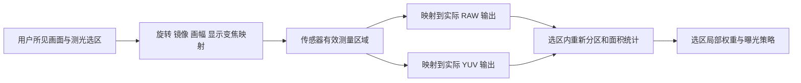

# 分区 EV 加权测光、轻量学习策略与 RAW 低开销输出

研究时间：2026-10-24—25。源码基线：已整合的 `a2bace2`。本轮核查公开源码/论文/Android 文档，运行自有 C++ 合成实验；没有改动 Android 应用算法、引入第三方依赖、训练网络或进行手机实测。

共享数据补充：后续训练复用「训练监测」任务下载的原图，独立保存测光标签并统一回收条件；现有 263 张图片已散列核验，没有重复下载。许可、精度标签边界、数字裁切增强与缓存保护接入要求见 [共享图库方案](SHARED_TRAINING_IMAGE_POOL_2026_10_25_ZH.md)。

## 1. 当前判断

优先路线调整为：**选定测光范围内的稀疏分区 EV 统计 + 可解释的区域权重 + 独立的高光/低信号质量检查**。先比较固定规则和小型统计网络学习权重，只有它们不能满足真实场景准确度时，再引入低分辨率图像 CNN 或独立人脸模型。

这比先接入整图 CNN 更符合当前输入和 1–3 Hz 目标。原来的小图 CNN 方案仍可作为后续候选，但不再是首轮唯一主线。分区数、每区采样数、权重、重拍触发阈值都需要独立验证，不能把“分成几块”本身当作准确度证明。

已有实现本就不是逐像素测光：`sampleEvaluativeRaw()` 最多采约 32,768 个完整 Bayer 单元；Kotlin 对每个局部亮度取 log₂，排序后积分分位区间。当前 RAW 也已经从设备声明的 RAW_SENSOR 尺寸里选择最小面积。新方案的收益来自保留空间、减少样本与排序/数据搬运、改善曝光策略，以及寻找更合适的实际相机输出，不能把这些已有优化重复计为新增收益。

## 2. EV 平均的准确含义

设一帧的曝光归一化为 K，区域 i 内采样的线性亮度为 Yᵢⱼ，来源校准为 C(Y)：

```text
K = log2(N_phone² / t_phone × 100 / ISO_effective)
E_ij = K + log2(max(Y_ij, signalFloor) / referenceLevel) + C(Y_ij)
mu_i = sum(a_ij * E_ij) / sum(a_ij)
E_weighted = sum(W_i * mu_i) / sum(W_i)
```

`a_ij` 是采样所代表的有效面积，`W_i` 需要同时表达区域面积和拍摄策略。等面积分区且每区采样相同，默认等权即可；遇到裁切边缘、不规则选区或不等面积分区，不能每格一票。

`ISO_effective` 按来源定义：RAW 使用真实传感器 ISO，处理后输出在有对应逐帧数字增益时要正确计入，不能用网络吸收遗漏的增益。这里的 `referenceLevel` 与来源校准共同定义标定，不把 0.18 当成任意手机 RAW 的物理常量。

这是 **先把局部测量换成 EV，再平均 EV**，等价于线性亮度的加权几何均值。它不同于先平均线性亮度再取 log₂。例如两个局部 EV 为 8 和 12，EV 平均为 10；线性亮度平均对应约 EV11.087，相差约 1.087 档。更不能直接平均光圈数值、快门秒数或 ISO。

若区域内部具有明显反差，不能只算一个线性均值 Ȳ，再把 `log2(Ȳ)` 称为区域平均 EV。严格的 EV 均值仍需若干 log₂；降低成本的方式是稀疏采样、近似 log LUT、分桶和有界统计，而不是改掉估计器。低光中 log 会放大黑电平/读噪声影响；信号落底须保留面积与不可信状态，不让任意 floor 变成精确测量。必要的微小邻域线性降噪须明确其统计尺度，再验证偏差。

对 RAW，校准常为逐帧/镜头标量，可以在区域聚合后加；对 YUV/ISP，既有响应修正 C(Y) 依赖亮度，不能擅自改成 `C(mean(Y))`。可将解码与响应校准合成每帧/校准版本适用的 LUT，但须与原路径数值对照。

## 3. 传统相机与开源实现比较

### 3.1 佳能胶片机说明了什么

佳能官方列出 EOS 650 的 6 区评价测光；ELAN 7N/7NE（EOS 33V/30V）说明书列出 35 区测光、可关联 AF 点，曝光判断考虑主体位置、亮度、背景和前/逆光条件。[EOS 650 官方资料](https://global.canon/en/c-museum/product/film122.html)、[ELAN 7N 官方手册，第 52、96 页](https://downloads.canon.com/cpr/pdf/Manuals/elan7n_instructions.pdf)

可借鉴的是“低维区域信息 + 主体线索 + 场景判断”，不是照抄某个固定中心权重表。公开手册没有给出完整权重、判定阈值或测光电路到内部数学域的映射，不能声称已复现佳能算法，也不能认定它们必然使用本方案的 EV 平均。

手机 AF 点只描述手机的对焦选择，不一定代表用户将用外部相机拍摄的主体；显式点选和可靠人脸证据比盲目追随手机 AF 更适合作为主体输入。

### 3.2 可复用程度与许可

下表中的效果描述来自目标、源码结构或作者报告，均不等于光档上的准确度实测。libcamera 不同硬件后端属于同一家族，不能视为三套相互独立的学习型测光算法。

| 上游 | 实际方法与开销 | 对本项目的价值、效果与限制 | 许可核查与建议 |
| --- | --- | --- | --- |
| Raspberry Pi/libcamera RPi AGC | 区域权重、亮度目标、直方图分位约束、时间滤波；决策遍历少量统计，不需要大网络 | **最适合作为工程基座参考**。能建立中央/点/矩阵和高光/暗部策略；其亮度估计主要在线性域，需按本项目 EV 定义重写 | 所读 `agc_channel.cpp` 为 BSD-2-Clause；配置文件与被复制依赖分别核查 |
| libcamera rkisp1 | 配置测光权重，区域 exp_mean 按权重汇总；直方图与均值型 AGC 组合 | **最接近“分块统计 + 不同权重”的明确源码**。原输入来自 ISP 硬件统计；Android 应用需自己从公开图像流构造，不能假定能取得同样 ISP 数据 | `rkisp1/algorithms/agc.cpp` 和公共 AGC 为 LGPL-2.1-or-later；当前优先借鉴方法，自行实现；实际复制须处理对应义务 |
| libcamera IPU3 | Bayer 下采样统计网格、RGB 区域均值、直方图及公共 AGC | 证明可以在粗网格上工作。所读实现基本等权，不是自动主体识别；不能直接作为智能加权成品 | 所读 `ipu3/algorithms/agc.cpp` 为 LGPL-2.1-or-later |
| RealSense librealsense 软件 AE | ROI 的 256 桶直方图，统计明暗端，步进控制曝光/增益，支持抗频闪；帧处理有 worker 和跳帧机制 | **适合借鉴低成本直方图、ROI 和稳定策略**。所读软件 AE 不是所有 RealSense 硬件内部 AE；8 位输入、目标亮度与硬件控制范围须替换 | `src/algo.cpp` 明确 Apache-2.0；保留许可，避免引入整个 SDK |
| Magic Lantern Auto ETTR | RAW 分位数、raw_to_ev、饱和/噪声线索；可用步进密度 2、4 等下采样检查 | **最值得参考的高光旁路**。没有必要全像素计算；但 ETTR 为数码 RAW 信噪比/动态范围服务，不能把“向右曝光”直接当成胶片建议 | 仓库 COPYING 为 GPLv2；`src/raw.c` 明确 GPL-2.0-or-later，ETTR/直方图相关文件仍需逐文件确认。当前 Apache 版本不复制这些代码 |
| MIT-Bilab/vo-autoexpose | 对多个虚拟曝光用 LUT 生成图像，比较梯度/特征，再拟合曝光；有运动信息选项 | 可借鉴曝光变化预测与 LUT。多次图像变换和梯度比区域 EV 汇总复杂，目标是 VO 特征而非胶片调子，不作为默认策略 | 根 LICENSE 为 MIT；核心是 C++/OpenCV/Eigen，整库移植不是必要条件 |
| ShuyangUni/drl_exposure_ctrl | SAC 确定性 actor，4×84×84 多帧输入，CNN 加全连接；有训练和两个约 7.8 MB 权重 | 有实际学习型曝光实现，作者报告 CPU 1.58 ms，平台包括 Intel i3-N305；需要重新训练摄影任务，不能当成低端 Android 结论 | README 声明源码 MIT，但本次未见完整根 LICENSE，源码头及权重/外链数据授权需进一步确认；暂不发行其权重 |
| Google HDRNet | 低分辨率 CNN 预测双边网格变换，随后将变换应用高分辨率图像 | 能借鉴“低维空间/颜色统计驱动内容相关决策”。它是增强模型，不输出校准 EV。原实现老 TensorFlow/自定义 GPU 算子，Android prototype 未完整提供；**不建议原样接入** | 根许可和 `models.py` 为 Apache-2.0；代码许可不自动覆盖所有外链模型/数据 |
| PhotonCamera | Android Camera2 与应用内 RAW/GL 管线，含 BinnedRaw 和曝光/ISO 分配 | 适合研究格式、元数据和 GPU 处理边界。其软件 binning 在已有 RAW 缓冲之后，不能由此推断传感器读出或 DMA 变小；也没有证明它更适合 1–3 Hz 测光 | 根 LICENSE 为 GPLv3；当前 Apache 版本不直接并入，未来 GPLv3 版本仍审计具体文件与依赖 |

已阅读的直接入口：

- [RPi AGC](https://github.com/raspberrypi/libcamera/blob/main/src/ipa/rpi/controller/rpi/agc_channel.cpp)、[IMX219 配置](https://github.com/raspberrypi/libcamera/blob/main/src/ipa/rpi/vc4/data/imx219.json)。该配置的 matrix 为全 1 权重，不应把模式名解释为已经具有主体语义；区域编号也不能未经硬件布局核对就画成普通矩形表。
- [rkisp1 AGC](https://github.com/raspberrypi/libcamera/blob/main/src/ipa/rkisp1/algorithms/agc.cpp)、[IPU3 AGC](https://github.com/raspberrypi/libcamera/blob/main/src/ipa/ipu3/algorithms/agc.cpp)、[公共均值 AGC](https://github.com/raspberrypi/libcamera/blob/main/src/ipa/libipa/agc_mean_luminance.cpp)。
- [RealSense 软件 AE](https://github.com/realsenseai/librealsense/blob/master/src/algo.cpp)、[配置与统计结构](https://github.com/realsenseai/librealsense/blob/master/src/algo.h)。源码有 sample_rate，但当前默认值为 1，不应夸大为默认已大幅空间抽样。
- [Magic Lantern ETTR](https://github.com/reticulatedpines/magiclantern_simplified/blob/dev/modules/ettr/ettr.c)、[RAW 与许可头](https://github.com/reticulatedpines/magiclantern_simplified/blob/dev/src/raw.c)、[直方图](https://github.com/reticulatedpines/magiclantern_simplified/blob/dev/src/histogram.c)。实际发行应锁定具体 commit。
- [MIT VO 曝光实现](https://github.com/MIT-Bilab/vo-autoexpose/blob/master/vo_autoexpose/src/vo_autoexpose.cpp)、[MIT 许可](https://github.com/MIT-Bilab/vo-autoexpose/blob/master/LICENSE)。
- [DRL 作者代码](https://github.com/ShuyangUni/drl_exposure_ctrl)、[论文与平台](https://arxiv.org/html/2408.17005v1)。
- [HDRNet 代码](https://github.com/google/hdrnet)、[作者项目页](https://groups.csail.mit.edu/graphics/hdrnet/)。
- [PhotonCamera BinnedRaw](https://github.com/eszdman/PhotonCamera/blob/master/app/src/main/java/com/particlesdevs/photoncamera/processing/opengl/scripts/BinnedRaw.java)、[许可](https://github.com/eszdman/PhotonCamera/blob/master/LICENSE)。

另有 *Personalized Exposure Control Using Adaptive Metering and Reinforcement Learning*，直接研究用可学习测光把语义与曝光关联，并报告 iPhone 7/Pixel 数据。它比一般低光增强更接近本需求，但本次未核实到可直接发行的作者完整代码与权重，只列为方法参考。[论文](https://arxiv.org/abs/1803.02269)

`JeffRen1977/auto-exposure` 虽声明 MIT 并列出区域分析功能，但根目录未见完整 LICENSE，README 留有示例仓库占位地址；本轮没有确认独立性能与摄影准确度，暂不作为可靠主方案。没有用仓库数量替代可用性评价。

## 4. 建议的分区和权重结构

### 4.1 96 区起步，而不是只测 96 个像素

起步试验为 12×8 区，每区 8×8 个完整 Bayer 单元，共 6,144 个亮度样本；它读取约 24,576 个原始感光点，但相机仍可能交付完整 RAW。画幅比例改变时调整行列或有效 mask，保持格子在选区内近似均匀。与 8×6、16×12、每区 64/128/256 个样本比较，不把 96 作为固定摄影标准。

每区至少保存：平均 EV、EV 离散程度、亮暗分位、颜色比例、各通道截断/低信号面积、有效面积和采样数。噪声指标不能简单用场景内方差替代；方差可能只是纹理。输出小型统计数组，不再为区域决策传回所有像素或全尺寸 RGB。

权重分三层管理：

1. 面积 Aᵢ：表示选区内真正覆盖的面积，裁切边界不失真。
2. 位置/主体先验 Pᵢ：温和中心权重、显式点选、可靠人脸，定义在当前测光选区坐标中。
3. 场景自适应 Mᵢ：识别大面积亮背景、主体与背景反差等；由规则或小网络给出，限制极端权重和跨帧跳变。

归一化后权重为 `W_i ∝ A_i * P_i * M_i`。质量无效的区域不能悄悄剔除后重新归一化，以免大面积暗部/截断被掩盖；保留对应面积，必要时降低整次建议可信度、加测或失败。

先提供可复现的等权和温和中心基准，再训练自适应权重；“中心”只是一种先验。离中心主体、雪景、夜景和大面积天空必须有单独的效果评价，不能从中心权重的合理外观推断准确。

### 4.2 神经网络可以更小

一个候选是 96 区×8 项特征，加 32 项全局/上下文，构成 800 维输入；`800→64→32→97` 输出 96 个权重与一个待校准误差/可信度分数。该示例有 **56,545 参数、56,352 MAC**，INT8 权重约 56.5 KB，不含 scale/bias、容器或运行时。最后的非负约束、面积合成和归一化可以在普通浮点数学中完成。

这是规模算术，不是已训练模型或真机推理成绩。先用浮点和独立参考训练/验证，达到门槛后再比较量化；对如此小的网络，手写有数值对照的小 MLP 或裁剪运行时都可评估，避免引擎体积远大于模型。

首轮模型固定使用 96 格和对应特征规范。选区太小、实际独立样本不足时，回退到较少分区的规则路径；若以后训练 mask/多网格模型，再扩展模型输入。不能把重复采样或插值伪装成完整有效的 96 格测量。

仅凭区域亮度/颜色不能保证识别所有主体；如失败分析确实表明缺少语义，再加入可靠 Camera2 人脸证据、小图 CNN 或许可明确的 YuNet。网络输出的权重也不自动构成正确的语义解释。

现有全局 B 继续作为测量与诊断基准，当前 `delta` 作为无模型回退。候选加权 EV 与 B 的差属于曝光策略，不能写入镜头校准。明确选择“网络预测权重后统一决策”或“预测相对 B 的完整修正”，不要重复叠加网络补偿与原高光减曝光。

### 4.3 高光需要旁路

每个区域只保存均值会抹平小窗、舞台灯和小片亮衣服。保留一份**选区内面积等权的亮端分布与截断计数**，与主体权重分离；均值、区域权重再合理，也不能替代亮端检查。

可在同一轮采样收集全局 EV 直方图和逐通道截断比例，使用本帧曝光附近的动态桶范围，避免固定范围静默夹住极端 EV。1/32 EV 桶宽的中心量化误差不超过 1/64 EV，但这只约束桶化误差，不约束漏采、颜色、噪声或校准误差。

截断估计接近阈值、区域内部反差大、运动/变焦改变采样相位时，使用独立错位/分层加密采样。加密不能只是沿同一规则网格机械增加点数；实验已经看到某些窄亮区的误差没有随样本数线性改善。时间平滑不能恢复从未采到的信息。

手机 RAW 饱和表示测量被截断，不等于外部胶片会过曝。补测用于恢复测量信息；胶片高光/暗部偏好属于下一层策略，不直接套用数码 ETTR。

## 5. 数码裁切变焦与测光范围：必须共享坐标契约



建议定义不可变 `MeteringDomain`，携带实际 camera/physical route、session/geometry generation、可见画幅、显示变焦、测光选区与对应传感器区域、输出 crop/pixel mode/format/size、sensor timestamp。继续使用项目已经区分的 `PreviewStreamGeometry`、`RawSensorGeometry` 和 `CameraGeometryContext`，不要把逻辑预览几何强行当成物理 RAW 几何。

必须保持：

- **范围先决定，分区随后生成。** 分区权重、亮端分布和截断面积均相对于当前有效测光选区，不能把框外天空计入高光保护。
- 普通矩形、局部选区、不同胶片画幅、数字变焦、横竖屏和前置镜像均走明确变换。若以后允许取景与测光分别缩放，分别表达两者的变换，不能共用一个含义不清的 zoom。
- RAW/YUV 输出可能已由 HAL 裁切或缩放，按实际 CaptureResult/输出域反投影，只应用一次裁切；不能在已裁切 RAW 上再乘相同显示 zoom。
- 位置/主体权重在测光选区的局部坐标定义；镜头暗角图仍在真实传感器坐标取值，不能在选区内从 0 到 1 重新铺一张暗角图。
- ROI 边界按完整 Bayer 单元处理，并记录真实覆盖面积；小选区降低分区数量/每区样本数，不能反复读取同一点冒充新样本。选择为空、覆盖太少或不能可靠映射时，明确返回不适用/低可信。
- 改变镜头、画幅、变焦、选区、方向或输出模式，递增 generation 并失效旧统计、网络权重、主体框和滤波状态；旧 RAW 确认值若仍显示，必须保留已锁定/过期身份。
- **纯数字裁切没有“增加几档曝光”的公式。** 同一场景局部的光照和物理镜头光圈不因软件放大而改变；读数变化应来自所测区域或实际采集模式/元数据变化，不加 `2*log2(zoom)`。

本轮合成实验验证了一个直接 ROI 不变量：只修改 2× 中心裁切之外的所有像素，区域 EV、亮端和加权结果变化均为 0。它只验证本机实验器的选区隔离，没有验证 Android 屏幕到 RAW/YUV 的完整旋转、镜像、逻辑/物理路由或新硬件 crop 映射。

## 6. RAW 能否降低分辨率或读出负担

需要分开四项：传感器读出、HAL/ISP 和缓冲传输、应用内存访问、测光数学。软件少取点主要改善后两项；只有实际输出模式或相机采集计划变化，才可能改善前两项。

| 手段 | 减少应用计算/内存访问 | 减少传感器/输出负担 | 判断 |
| --- | --- | --- | --- |
| 稀疏采样 + 分区统计 | 明确减少 | 不直接减少完整 RAW 输出 | 推荐先做，项目已有基础 |
| 收到 RAW 后软件缩小/binning | 可减少后续处理，但新增一次聚合/拷贝 | 不会倒推减少已经发生的读出/DMA | 测光不需要先生成小图；直接稀疏统计通常更合适 |
| 选择更小的受支持 RAW 尺寸 | 通常减少 | 可减少输出字节；实际读出/帧率取决于模式 | 当前已选最小 RAW_SENSOR，需进一步比较格式与时序 |
| 设备原生 binned 输出 | 通常减少 | 可能减少并改善低光 SNR，具体看硬件 | 优先使用公开可用、已校准的默认/低分辨率输出；无通用任意 binning 倍率开关 |
| RAW10 / RAW12 | 稀疏解包有少量位运算，缓冲更小 | 同尺寸可减少输出带宽，不能保证传感器扫描更快 | 有价值的设备候选；需位深、格式、CFA、校准与 DNG 工作流验证 |
| `SCALER_CROP_REGION`、Image 的 cropRect 或 GL 显示 zoom | 限定应用测量范围 | 普通 RAW 不保证随之减小输出或读出 | 不能当成通用 RAW 性能开关 |
| API 34+ `CROPPED_RAW` use case | 正确限定原生 RAW 视场 | 不保证更小/更快，甚至可能 un-bin/remosaic | 是能力受限的几何选项，不能作为必然性能收益 |
| 将 RAW 请求降到 1–3 Hz | 减少不需要的 RAW 交付/处理 | 可能减少被 RAW target 驱动的工作；配置了 RAW 的会话仍可能限速 | 需同路由实测，不能假定 resident RAW 无成本 |

### 6.1 分辨率只能从设备支持项中选

Camera2 应用不能普遍要求“给我任意 640×480 RAW”。必须枚举格式对应的 `getOutputSizes()`；部分高分辨率输出另列在 `getHighResolutionOutputSizes()`，最大分辨率传感器模式另有独立 map。当前 `CameraOpenConfigurationResolver` 用 RAW_SENSOR 最小面积，已经完成了基础尺寸降级。[输出尺寸与帧时序文档](https://developer.android.com/reference/android/hardware/camera2/params/StreamConfigurationMap)

更好的选择器应比较 `(format,size,pixelMode,FOV)`、声明的 minimum frame duration/stall 和真实事务耗时。最小像素数不必然是最快模式；时长为 0 表示未提供时不能当作无限快。多流会话还受组合中最慢流及 stall 影响，最终以实际配置、图像和恢复结果验证。

### 6.2 默认模式可能已经做过硬件合并像素

API 31 的 `SENSOR_PIXEL_MODE_DEFAULT` 与 `MAXIMUM_RESOLUTION` 区分默认和最大分辨率模式，官方说明默认模式通常进行 binning，最大分辨率模式通常不合并。它不是一个可任意指定 2×/4× 的通用硬件 binning 控件。对测光没有理由主动追求最大分辨率；但默认模式究竟对应哪个读出、是否实际更快，仍由设备决定。[传感器模式说明](https://developer.android.com/reference/android/hardware/camera2/CaptureRequest#SENSOR_PIXEL_MODE)

更换输出模式必须重新核查有效像素区、Bayer/Quad Bayer 解释、黑白电平、噪声、颜色和校准 signature；像素更少不保证仍可按当前普通 2×2 Bayer 读取。

### 6.3 RAW10/12 是值得增加的候选

按无额外行 padding 的 1200 万像素示例：RAW_SENSOR 16 位容器约 24 MB，RAW10 约 15 MB，RAW12 约 18 MB，相对分别少 37.5%、25%。这是容器算术，不是手机峰值内存或传感器时间实测，也不代表 16 位容器内原本有 16 位有效信号。

RAW10 四像素打包五字节，RAW12 两像素打包三字节；公开 Image 的 pixelStride 为 0，不适用当前 `pixelStride>=2` 的 RAW_SENSOR 读取器。应提供格式专用的稀疏 Bayer 单元读取，直接定位需要的 packed group，不先完整解包整幅 RAW 再缩小。[RAW10/RAW12 格式定义](https://developer.android.com/reference/android/graphics/ImageFormat#RAW10)

若更低位深确实损失可测低信号，要用重复性/参考 EV 判定能否采用；不能只比较文件字节。切换格式还要审计校准身份、相机组合探测和已有 DNG 记录流程；首版可保留 DNG 功能原 RAW_SENSOR 路由，测光另试低成本格式，不悄悄损坏记录功能。

### 6.4 裁切 RAW 不等于省像素

普通 RAW 通常不受通用 crop/数字 zoom 影响。API 34 的 `SCALER_AVAILABLE_STREAM_USE_CASES_CROPPED_RAW` 要求设备声明支持；官方用途包括在特定 zoom 下 un-bin/remosaic，得到**更窄视场但相同像素数**的 RAW。必须读取 `CaptureResult.SCALER_RAW_CROP_REGION` 作为实际覆盖，不能把这个 use case 理解为小图或速度保证。[CROPPED_RAW 定义](https://developer.android.com/reference/android/hardware/camera2/CameraMetadata#SCALER_AVAILABLE_STREAM_USE_CASES_CROPPED_RAW)、[实际 RAW crop](https://developer.android.com/reference/android/hardware/camera2/CaptureResult#SCALER_RAW_CROP_REGION)

对本项目先保持“完整受支持 RAW + 选区稀疏测量”作为通用路径，再按设备能力试验小尺寸/packed RAW。裁切会改变 FOV 的输出，只有覆盖整个用户测光选区时才是有效候选。

### 6.5 采集流程可能比数学优化重要

分别测量准备/AE、会话切换、请求到 Image、元数据配对、采样、JNI 数据、EV 决策和预览恢复。若捕获固定耗时 200 ms，即使把应用统计从 10 ms 降到 1 ms，总时间也只是 210→201 ms；这是示例算术，不是本机实测。

适合继续评估的实际采集优化：按实际格式/尺寸选 frame duration；稳定路由按需提交 RAW target；不让每次 1–3 Hz 更新都重建会话；明亮高质量条件沿用当前单帧，低照按质量保留多帧；尽早关闭 Image，直接从原始 ByteBuffer 统计。设备只能隔离 RAW 时，YUV 做实时预估、RAW 按需确认，来源身份仍需明确。

用户选区可在支持的设备上辅助手机 AE 的采样区域，以减少无效饱和补拍，但不能把手机 AE 结果直接当外部胶片曝光真值。源间校准继续独立，并先修复已知处理后增益/局部几何问题，避免模型学习输入错误。[既有审计](../METERING_CODE_AUDIT_2026_10_21_ZH.md)

## 7. 本轮桌面实验：计算更轻，但不能忽略漏采

自有源文件：[grid_benchmark.cpp](../../tools/metering-research/grid_benchmark.cpp)。原始输出：[合成实验 CSV](data/grid_benchmark_2026_10_24.csv)。运行日期 2026-10-24；Windows x86-64、AMD64 Family 25 Model 97、MSYS2 g++ 16.1.0、`-O3`，4000×3000 RAW16 中性合成缓冲，20 次预热、160 次计时。

“当前”一项调用仓库真实原生 sampler，在宿主 C++ 中重现 EV 转换和排序/分位积分；不是 Android/Kotlin/JNI 实测。分区原型没有完整 AWB、颜色剪裁、暗角、低光可信度、元数据、线程与缓存生命周期，重复使用同一热缓冲；下表只能证明某些计算结构更轻，不是端到端等价替换或手机功耗结论。

| 统计路径 | P50 | P95 |
| --- | ---: | ---: |
| 当前 sampler（预算 32,768）+ EV 排序 | 1.5812 ms | 2.2258 ms |
| 12×8 区、每区 64 点、标准 log₂、直方图 | 0.1572 ms | 0.1910 ms |
| 同上，用 1025 项插值 log LUT | 0.1074 ms | 0.1818 ms |
| 12×8 区、每区 256 点、LUT | 0.4639 ms | 0.6941 ms |

在 50 万个 `2^-20..2^3` 正值输入上，LUT 最大绝对 log₂ 误差打印约 0.0000002 EV。LUT 的 double 表约 8 KiB；换 float 或修改插值须重新验证。**这个误差不是整个测光误差。** EV 直方图原型桶宽 1/32 EV，亮端误差还包含桶化和采样。

对照用同一合成缓冲的全部 300 万个 Bayer 单元，比较 B/U 分位区间估计器；它不是外部测光真值：

| 合成场景 | 6,144 点 B 误差 | U 误差 | 含义 |
| --- | ---: | ---: | --- |
| 平缓亮度梯度 | −0.00019 EV | +0.00028 EV | 平滑场景用稀疏分区可以非常接近稠密参考 |
| 0.60% 面积过曝窄窗 | −0.00045 EV | −0.11985 EV | B 看起来稳定，亮端仍可显著漏采 |
| 夜景细小灯点 | −0.01263 EV | −0.01263 EV | 本例主要表现为直方图桶中心误差，不证明任意灯点都可忽略 |
| 单 Bayer 单元周期条纹 | +0.00559 EV | +0.00200 EV | 必须专门检查采样格栅与图案的相位关系 |
| 中央暗主体、明亮背景 | −0.01132 EV | −0.00639 EV | 本例无主体权重的分布近似较好；加主体权重的摄影正确性仍需独立标签 |

最重要的反例：真实截断面积 0.006，当前固定抽样估计为 0.0047847，可能低于现有 0.005 的补拍阈值；6,144 点网格估为 0.0051875，24,576 点网格在这个位置仍相同。当前 U 误差约 −0.146 EV。由此不能宣布新网格全面更准，应该增加独立采样相位、阈值附近的保守复查与可见选区移动测试。

示例中心先验在合成逆光场景把建议 EV 从无权重 B 附近约 8.895 拉到约 8.133，即倾向增加曝光。这符合其设计方向，不证明人物肤色、胶片高光或摄影意图正确。

本轮还验证直接选区外像素变化不影响选区统计；没有测 Android 的完整裁切/方向映射。没有训练或测量任何神经网络速度，没有给出实际手机的 FPS、功耗或绝对测光精度。

## 8. 接下来实施与验证的顺序

1. **先建立正确的测量域。** 选区/画幅/zoom/输出 crop 共用不可变几何证据，修复既有来源增益和局部 YUV 几何问题，保留校准边界。
2. **增加并行候选统计，不立即替换默认。** 复用当前 RAW 稀疏读取，输出 96 区 EV/颜色/质量；对照原 B/U、稠密离线参考和独立参考表。全局高光检查始终以选区面积为准。
3. **比较等权、固定位置权重、规则自适应。** 使用逆光、雪景、夜景、偏心主体、不同测光选区与 zoom，报告失败而非仅平均误差。
4. **训练微型权重网络。** 区域特征不足时再加小图 CNN/人脸；按真实场景和设备分组留出测试，不能只模仿现有规则后声称提高摄影准确度。
5. **设备输出能力清单与基准。** 枚举 RAW_SENSOR/RAW10/RAW12 尺寸、FOV、时序、pixel mode、实际 CFA/电平；逐路由验证，不添加按品牌猜测的模式。
6. **端到端验收。** 低端 arm64 上验证 1–3 Hz、场景切换延迟、内存、热态耗电、预览与恢复；armv7 独立设档。采样误差、曝光策略误差和绝对标定误差分别统计。

候选门槛：普通场景对稠密同估计器参考的 B 误差 P95 先争取 ≤0.05 EV；亮端与截断阈值单独评价漏检/误检，不能只要求 U 均值误差；真实曝光准确度沿用此前独立参考门槛。裁切不变量、不同采样相位、任一 RAW 通道饱和、极暗、频闪、多镜头/模式和旧结果失效必须覆盖。未达到门槛时扩大合理采样或回退原策略，不用隐藏拒绝率换取表面准确。

许可证继续按当前 Apache-2.0 可发行要求筛选。BSD/MIT/Apache 组件优先；LGPL/GPL 参考文件不混入当前代码。若正式转 GPL-3.0，再逐文件处理可组合性、版本与对应源码义务；代码、权重和训练数据始终分别核查。研究思路与直接复制实现是不同决策。
