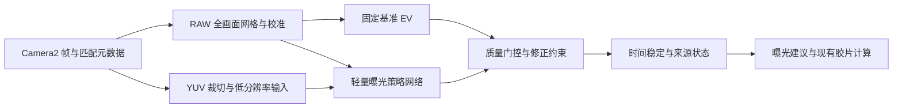

# 光档：移动端轻量神经网络全局测光调研与实施方案

日期：2026-10-24。源码基线更新为 0.6.1 `7ff2147` 加 `codex/independent-metering` 的 `5281609`、该工作树 2026-10-18 兼容修正与设备测试，以及 `codex/non-normal-visual-polish` 的 `74df53a`。详见 [本次整合记录](../WORKTREE_INTEGRATION_2026_10_24_ZH.md)。

本文完成源码研究、上游资料与许可核查、实现规划，并在用户指出未合并工作树后重新核对全局测光实现。最初只阅读 `7ff2147` 得出的“尚无全局测光”结论不适用于整合后的代码，已在下文修正。没有引入神经运行时、下载执行模型、训练模型或进行新的真机基准测试。下文模型规模、延迟、精度和功耗数字如无特别说明，均为**设计预算或拟议验收门槛，不是实测结果，也不是准确性保证**。

## 1. 推荐决策

推荐做“**经过校准的全画面亮度统计 + 轻量神经网络曝光策略 + 有界修正与回退**”。保留 RAW 作为有条件的测量依据，以 YUV 提供 1–3 Hz 实时建议；神经网络主要处理主体、逆光和调子取舍，不承担从一张经过 ISP 处理的图像中凭空恢复绝对照度的任务。

开源实现确实存在，但本次没有找到同时满足“Android 离线部署、胶片外部测光、跨设备校准、可核实的代码/权重许可、低端机性能已经验证”的即插即用预训练模型。最接近的曝光网络大多服务机器人视觉或图像质量，仍需重新训练与独立评估。

建议同时建立两个候选：极小的统计网络 N0 用作低成本基准，低分辨率视觉与统计融合网络 N1 作为主要研究路线。最终选择通过准确度门槛后最省资源的模型；不能为了预设的模型体积牺牲测光准确性，也不能用缺乏语义的统计模型宣称已经解决主体识别。

许可证暂按 Apache-2.0 的现有约束选型，优先 MIT/BSD/Apache-2.0，保留以后整体采用 GPL-3.0 的选择。代码、预训练权重、训练数据、推理引擎及其传递依赖分别核查。

## 2. 项目目的、构成与现有能力

项目是面向手动曝光与胶片摄影的 Android 反射式测光表，不是相机 ISP 或照片增强应用。手机测出场景信息，向外部相机提供光圈、快门与 ISO 建议。

| 层次 | 当前组成 | 对新功能的意义 |
| --- | --- | --- |
| 平台与构建 | Kotlin/JVM 17、Camera2、自定义 View、C++17/JNI；minSdk 28、targetSdk 36；NDK r27 | 可直接加入纯数学决策模块与小型 C++/Android 推理后端 |
| 硬件分发 | arm64-v8a、armeabi-v7a、x86_64 分包及通用包 | 新推理库必须逐 ABI 验证，不能只考虑高端 arm64 手机 |
| 相机组织 | `CameraController` 协调 `CameraSessionCoordinator`、RAW、兼容测光、校准与组合探测 | 新实时管线必须沿用路由 identity、会话恢复与资源所有权约束 |
| 测光 | `RawLightMeter`、`CompatibleLightMeter`、`MeteringAnalysis`、`MeteringFusion` | 已有黑白电平、曝光归一化、时间戳配对和多帧融合 |
| 全局测光 | `EvaluativeFrameAnalyzer`、`EvaluativeMeteringAlgorithm`、原生全画面 Bayer 采样、独立 Normal/Zone 模式选择 | 已有全画面基准、亮端统计与自动减曝光，可作为神经方案基线 |
| 校准 | RAW 用户偏移；YUV/ISP 响应校准；按实际镜头路由保存；另有暗角图 | 测量标定与场景策略必须独立保存 |
| 摄影功能 | Normal/Zone、画幅与变焦、曝光补偿、胶片互易律、宽容度工具、色温、闪光与距离、DNG/位置参数记录、负片预览 | 新模式应与现有胶片工作流组合，不能把手机拍照参数当成外部相机参数 |
| 图像运行时 | 固定散列的 OpenCV 4.12.0 r2 compact AAR | 已有跟踪能力，但未包含 `dnn`、`objdetect`，无法直接调用 YuNet 推理 |
| 隐私 | Manifest 无网络权限，本机处理；位置可选 | 权重随包提供；不依赖首次下载、云端推理或在线训练 |
| 代码与验证 | 整合后枚举 225 个主 Kotlin 文件、107 个 JVM 单测文件，另有 UI 预览测试、androidTest 与设备记录 | 可以增加独立数学测试，但 JVM 通过不能代替 Android 推理、相机与功耗验证 |

依据：[README_ZH](../../README_ZH.md)、[Gradle](../../app/build.gradle.kts)、[相机管线契约](../CAMERA_PIPELINE.md)、[OpenCV 构建说明](../../tools/opencv-slim/README.md)。

### 2.1 已实现的全局测光

`MeterModels.kt` 已有 `CENTER_WEIGHTED / SPOT / ANGLE / AVERAGE`，第四项在设置中显示“全局测光 / Global”，保留 `AVERAGE` 作为旧设置标识。只在 Normal 执行全局算法；进入 Zone 临时使用按角度/局部模式，返回 Normal 恢复全局选择。

`EvaluativeFrameAnalyzer` 对当前可见画幅和变焦范围采样。RAW 的 `sampleEvaluativeRaw()` 一次读取最多 32,768 个完整 Bayer 单元，扣黑、归一化、合成局部线性亮度并应用可用暗角图；YUV/ISP 有独立可见范围和来源解码。均按面积等权得到区域 EV，排序后对分位边界做部分面积积分：

```text
B = EV 分布 5%–95% 区间均值
U = EV 分布 98%–99.5% 区间均值
delta = clamp(U - B - 2.5, 0, 0.5)
recommendedEv100 = B + delta
```

`B` 保持为测量基准，`delta` 表示减曝光，最多半档；与用户补偿分离。基准或亮端不可信时有明确判据；RAW 亮端截断超过 0.5% 时可连续每级降 3 EV 重拍，在相机控制范围内恢复亮端，保留先前可信基准。不是固定拍满三级，也没有把手机采样减曝光直接作为外部相机减曝光量。

因此已具备真正的全画面统计与确定性曝光策略，但仍未做主体识别或学习型评价。接入模型应复用现有采样/标定，保留未排序样本的空间信息并扩展网格特征，而非重建整个全局模式。既有局部 JNI 的六项中位数接口仅用于局部路径，不应再笼统描述为项目唯一测光接口。

依据：[全局测光实现记录](../AVERAGE_METERING_IMPLEMENTATION_2026_10_15_ZH.md)、[纯算法](../../app/src/main/java/com/lightmeter/rawmeter/EvaluativeMetering.kt)、[采样与曝光归一化](../../app/src/main/java/com/lightmeter/rawmeter/EvaluativeFrameAnalyzer.kt)。

### 2.2 当前性能基础与旧文档差异

当前 `RawMeteringPolicy`：ISO <500 为 1 帧，500–1199 为 2 帧，≥1200 为 3 帧；未知 ISO 为 2 帧。可因噪声有界补 1 帧，异常统计另有曝光重试。`PIPELINE_DEPTH` 为 1，一张 RAW 处理并关闭后才提交下一张。

当前连续降曝光重拍：局部任一通道中位数饱和时每级降 5 EV，全局亮端截断时每级降 3 EV。每级一帧，达到可控下限或恢复可信统计后停止，仍受取消、超时和恢复约束。此流程会使实时更新周期随场景而变，不能只用正常一帧耗时预算。

`CompatibleLightMeter` 已经采用单帧 YUV/ISP，YUV 与 `CaptureResult` 按完全相同的传感器时间戳配对；预览还有元数据色调曲线、输出传递函数和 YUV 色彩范围处理。因此不能再把这些列为完全缺失的能力。

Zone 常驻 YUV 长边目标为 640，使用三缓冲与忙碌丢帧；但只复制 Y 平面，且提交与 OpenCV tracker 预约绑定。`ZoneTrackingFrame.capturedAtNs` 默认是 `System.nanoTime()`，不能当作 `Image.timestamp` 来配对曝光元数据。

同一 YUV reader 当前先由待处理的兼容测光消费，否则交给 Zone/距离处理。实时模式需要共享一次 acquire 的帧分发，不能让多个消费者分别抢读同一个 reader。

旧研究 [MATRIX_METERING_RESEARCH_2026_10_05_ZH.md](MATRIX_METERING_RESEARCH_2026_10_05_ZH.md) 中“3/5 帧 RAW、窗口深度 2、三次 Bitmap 样本、仅 SPOT/CENTER_WEIGHTED”等内容已与当前代码不同。本方案保留其测量/策略分离方向，以本次源码为准。

### 2.3 已知的准确度前置问题

[2026-10-21 测光审计](../METERING_CODE_AUDIT_2026_10_21_ZH.md) 还记录两个在本次导入代码中尚存的问题：处理后来源的 EV 归一化没有抵消逐帧 `CONTROL_POST_RAW_SENSITIVITY_BOOST`；局部 YUV ROI 的短边尺寸及显示变焦映射不一致。前者也影响全局 YUV/ISP，后者不等同全局独立裁切错误。

本次任务是整合各工作树，没有顺带改写这两类算法。后续在训练前优先复现并修正，特别区分旧处理后校准可能吸收的偏差与 RAW 独立校准；不能让网络学习并掩盖这些确定的输入误差。审计原始反例和构建目录保留在原工作树，不把临时日志或设备数据纳入源码。

## 3. 必须先定义什么叫准确

准确性包含两个独立问题：

1. **测量准确**：在已校准设备、有效曝光与匹配元数据下，稳定测出目标的反射亮度对应 EV100。
2. **曝光策略合适**：对逆光人物、雪景、夜景、小光源、暗主体等，选择符合拍摄意图与胶片偏好的曝光。

后者可能没有唯一答案。反射式相机不能仅凭单幅画面可靠地区分“白物体处于暗光”与“暗物体处于亮光”，也不能读取摄影者心中真正的主体。神经网络能提供统计先验，不能消除这种歧义。入射测光参考必须与灰卡/主体位置、光照方向和曝光意图对应，不能直接把它当作任意画面的全局标签。

主路径应继续使用经标定的曝光归一化。对有效线性亮度，沿用项目形式：

```text
E_camera100 = log2(N_phone² / t_phone × 100 / ISO_phone)
E_region100 = E_camera100 + log2(Y_region / referenceLevel) + calibration
E_recommend100 = E_base100 - policyCompensationEv
E_effective100 = E_recommend100 - userCompensationEv
```

`referenceLevel` 与 calibration 共同定义标定关系；代码当前为 0.18，不应把它理解为任意手机 RAW 的物理常量。自动策略正补偿表示增加曝光，因此推荐 EV 降低。后续胶片 ISO、互易律、用户补偿按现有顺序继续处理，不让模型重复处理。

`sceneEv100` 继续表示测量，不直接改成模型偏好的曝光值。现有 `EvaluativeMeteringResult` 已分开保存 `baseEv100 / exposureReductionEv / recommendedEv100`，应沿用并扩展策略来源/可信度。上式补偿符号以“增加曝光为正”定义，所以现有无模型策略对应 `policyCompensationEv = -delta`。模型首次接入优先预测相对 B 的完整策略补偿，可靠时替换现有规则，失效时恢复原 `delta`；若选择残差训练，标签必须明确相对原推荐值，避免把亮部保护重复应用。校准样本和 Zone 点读数继续保持原语义。

## 4. 已核查的上游路线

### 4.1 可以实际研究的开源曝光网络：drl_exposure_ctrl

[作者仓库](https://github.com/ShuyangUni/drl_exposure_ctrl) 对应 *Efficient Camera Exposure Control for Visual Odometry via Deep Reinforcement Learning*，不是另一篇 CVPR 2024 DRL-AE。核查版本：`359ae12107b7058a0e1d536d523be3203ab64e18`。

已阅读 README、`agent.py`、`infer.py`，枚举 model 目录：有两个各 7,796,476 字节的 `.pth` 权重。推理输入是 4×84×84，多帧灰度；网络包含三层卷积和 512 宽度的全连接层。只部署确定性 actor，不需要把 critic、训练框架或随机采样放进 Android。

论文报告 CPU 平均推理 1.58 ms，实验平台包括 Intel i3-N305 便携 PC，不能当作低端 Android 实测。目标是特征跟踪/视觉里程计，输出是相机曝光动作，不能直接用作外部胶片相机的校准 EV。[论文与平台说明](https://arxiv.org/html/2408.17005v1)

许可状态：README 明确说 **source code 为 MIT**，但本次根目录未见完整 LICENSE 文件，源码头有 All Rights Reserved，权重和外链数据未见单独明确的授权文本。可以研究方法与结构；实际复制/分发前补齐授权证据，特别不能把“源码 MIT”直接推导成“权重、数据也已获得同样许可”。当前列为研究候选，不列为已通过发行审计的模型。

适合借鉴：离线曝光模拟、多帧稳定性训练、推理只保留 actor。主要不足：任务不匹配、许可证据尚不完整、原始权重不是最小方案。

### 4.2 极小统计网络的方法参考：CVPR 2024 DRL-AE

[作者项目页](https://sites.google.com/view/drl-ae) 和 [论文](https://arxiv.org/abs/2404.01636) 报告轻量状态设计、CPU 约 1 ms、曝光在约 3–5 帧内收敛。

本次未核实到作者公开且具有明确许可的完整代码/预训练权重，不能当作可直接集成的开源模型。它说明“曝光策略不一定需要大视觉网络”，不证明跨手机/胶片准确性。低频输出下，闭环多步收敛还可能带来数秒等待，所以本项目优先单次预测相对固定基准的修正，而非每次累加一个动作。

### 4.3 可直接获得的主体组件：YuNet

[OpenCV Zoo YuNet](https://github.com/opencv/opencv_zoo/tree/main/models/face_detection_yunet) 的 README 明确该目录所有文件为 MIT，目录有完整 LICENSE。核查 Zoo 版本：`48b10fa505aeb51fbd127fc60a5c660040e823b7`。

`2023mar` 模型 LFS 指针列出 FP32 文件 232,589 字节、普通 INT8 文件 100,416 字节；这只是权重大小，不包括运行时、激活或 APK 增量。上游同时有 `2026may` 动态输入导出，README 区分 OpenCV 4.x DNN 与 5.x ONNX Runtime 的接口行为，接入时固定具体模型和散列。

YuNet 只检测人脸，不输出 EV，也不能覆盖所有拍摄主体。可作为可选人像线索，将可靠人脸位置映射回 RAW 网格。不要把所有肤色强制放到同一目标亮度。当前精简 OpenCV 缺少 dnn/objdetect，采用 OpenCV 原生示例需重建并审计 AAR；转为 ncnn/LiteRT 同样需验证转换与检测后处理，不能只改文件扩展名。

Camera2 人脸元数据可作为无新增应用模型的可选输入，但是否支持和质量取决于设备，不能作为统一行为的保证。[Android 人脸检测接口](https://developer.android.com/reference/android/hardware/camera2/CaptureRequest#STATISTICS_FACE_DETECT_MODE)

### 4.4 非神经基准：Raspberry Pi AGC

本次重新核查 [RPi agc_channel.cpp](https://github.com/raspberrypi/libcamera/blob/main/src/ipa/rpi/controller/rpi/agc_channel.cpp) 文件头为 BSD-2-Clause。适合借鉴统计分位约束和稳定策略，作为神经模型的对照与回退。只借鉴或移植已逐文件核查的部分；不能把整个 libcamera 都标为 BSD，其它模块存在 LGPL。

### 4.5 不建议作为发行基础的方案

| 方案 | 不选择的原因 |
| --- | --- |
| Zero-DCE/Zero-DCE++ 等低光增强 | 输出增强图片，不是校准曝光值；Zero-DCE++ 作者 README 明示 academic research / CC BY-NC 4.0，不符合当前商业再分发要求，GPL-3.0 也不会消除 NC 限制 |
| 为目标检测训练的 Neural Auto-Exposure | 值得研究直方图和语义双分支，但检测目标与胶片调子不同；本次未核实可发行的完整作者模型包 |
| 任意大分割、通用检测、Transformer | 当前任务不要求完整语义图，先用更小输入与专用任务；没有必要为 1–3 Hz 的曝光策略先承担大运行时和激活成本 |
| 手机 AE/默认 JPEG 曝光作为唯一真值 | 会把厂家 ISP 偏好、局部色调和设备差异直接学入模型，无法独立证明测光准确 |

来源：[Zero-DCE++ 作者 README](https://github.com/Li-Chongyi/Zero-DCE_extension/blob/main/README.md)、[Neural Auto-Exposure 论文](https://light.cs.princeton.edu/wp-content/uploads/2021/04/Neural_Auto_Exposure.pdf)。

## 5. 推荐架构



### 5.1 测量层：扩展已有全画面信息

以现有 `sampleEvaluativeRaw()` 为基础增加空间统计输出，在当前可见画幅/变焦 crop 内汇总 16×12 起步的网格，按画幅调整网格或使用有效区域 mask。先保持现有最多 32,768 单元预算，并与更高采样密度对照；保留每个样本排序前的空间位置/格子归属，不逐格重复扫描整幅 RAW。接口可用版本化新方法或 `analyzeRawGrid()`，不要静默改变原 JNI 的返回约定。

每格保存线性亮度统计、分位、颜色比例、暗部/饱和比例、有效数与噪声指标；全局保存直方图与空间反差。先得到局部线性亮度再统计，避免通道各自中位数合成引入不同估计器。对数特征可供网络输入，但不能把平均 EV 误当成平均线性亮度。稀疏抽样须测试条纹/细纹别名、采样密度收敛与小亮区漏采。

复用黑白电平、CFA、stride、颜色元数据、物理镜头 identity、裁切映射及当前全局路径已有的暗角采样。与 HAL lens shading 信息确认选用关系，避免重复补偿。

固定使用现有 B/U/delta 作为首个非神经对照，不随训练结果同时调整它。B 是面积等权的截尾 EV 区间均值，不能把它描述成线性亮度平均。只有独立消融表明需要调整采样或基准后，再单独评估变化。

### 5.2 模型 N0：统计型极小网络

输入为网格特征、直方图、曝光/质量元数据与拍摄偏好，采用小 MLP 或网格卷积，输出相对固定基准的自动曝光补偿及误差估计。

一个可精确预算的 MLP 例子：`1616 → 64 → 32 → 2`，含 bias 为 105,634 参数，线性层约 105,536 MAC/次；FP32 参数约 0.423 MB，INT8 权重约 0.106 MB，均未计容器、量化元数据与激活。1616 可由 16×12×8 网格特征、64 个全局特征、16 个上下文特征组成，后续特征定义需通过消融确定。

优势是低开销、容易离线和跨设备推理。限制是统计相同而语义不同的场景仍可能需要不同曝光；不能靠 N0 稳定识别任意主体。若它达不到准确度门槛，作为低算力回退或对照，不冒充完整智能全局测光。

### 5.3 模型 N1：低分辨率视觉与统计融合，主要候选

RGB 图像分支采用窄通道深度可分离 CNN，起步输入 128×96 或 160×120，保留画幅比例/mask，结合 N0 的统计与匹配曝光元数据。先预算 0.2–0.8M 参数、5–20M MAC/次，INT8 权重约 0.2–0.8 MB；这些是候选范围，实际规模须由导出图计算。MAC 指乘加次数，不能与把一次乘加计为两次操作的 FLOPs 混用。

训练先用离线监督学习，预测 `policyCompensationEv` 与可校准误差/区间；可增加主体/高反差辅助标签。优先单一曝光补偿头，避免同时随意改变区域权重和额外补偿造成重复作用。若以后输出权重，必须重新定义对应基准与解释，不把任意注意力图当作可信主体解释。

网络每次预测相对同一测量基准的补偿，不累加上次动作。量化友好算子为 Conv/DepthwiseConv/ReLU/Pooling/Dense 等，避免动态 shape、复杂后处理和不必要的算子回退。仅有明确许可的预训练骨干/权重才可初始化；否则从合法自采数据训练，并评估数据量是否足够。本方案不假定一个通用 ImageNet 骨干已经学会了胶片曝光。

若小主体识别不足，在准确度/资源曲线上比较更大输入或可选 YuNet，而不是直接削减模型来追求速度。人脸检测不要求每次与策略网络同时运行，可在进入场景、构图变化时触发，并严格限制结果有效期。

### 5.4 质量门控和时间处理

网络修正初期可先限制在 ±1 EV，作为灰度试验边界，而非曝光正确范围的结论。需要更大修正的已验证类别可扩大；无法支持时给出低置信度或手动补偿提示。限幅会导致残余误差，须计入准确度统计。

元数据缺失、重要区域饱和/过暗、低置信度、超出训练分布、画幅/镜头/会话发生变化时，按明确规则缩小修正或返回非神经基准；超时和加载失败也使用该路径。低置信度回退只能限制新增风险，不能保证基准本身一定正确。单一模型输出的 confidence 必须在独立数据上校准，不能把 softmax 或任意分数直接当作正确率。

稳定场景对 EV 做时间滤波与小变化迟滞；场景切换立刻重置，不将两个场景的输出混合。使用实际时间差，适应 1 Hz 与 3 Hz；检测频闪、运动和明显亮度阶跃。缓存的语义补偿只能在构图/光照/镜头稳定且未过期时复用，亮度测量仍需新帧。

## 6. 实时采集与推理后端

### 6.1 两种实时等级必须分别声明

| 等级 | 采集与显示 | 能承诺的含义 |
| --- | --- | --- |
| 预览实时建议 | 常驻 YUV + 匹配元数据 + 已有响应校准，策略 1–3 Hz；可用 RAW 时按需刷新测量依据 | 新预览帧产生的新建议，明确为预估，不声称每次都有新 RAW |
| RAW 实时测量 | 仅在实测能维持稳定常驻工作流的路由中尝试 1–3 Hz RAW 网格 | 逐次都有新 RAW；需同时通过采集、恢复、噪声和功耗验收 |
| RAW 确认 | 用户锁定或必要条件触发，使用当前 RAW/隔离事务 | 输出 RAW 来源的确认结果，耗时按设备测量 |
| 仅 ISP 兼容 | 不为了新功能强行创建设备不支持的 YUV/RAW 输出 | 能力较弱，准确度单独统计和标识 |

当前完全隔离 RAW 工作流需要拆建会话，直接每秒 3 次调用现有 `measure()` 会反复停止/恢复预览；不作为统一默认实现。相机组合探测与恢复契约继续生效，不为推理强行升级已稳定的会话。

即使模型只耗时 1 ms，也不能解决 400 ms 的采集事务。导入的 [2026-10-18 真机记录](../DEVICE_METERING_VALIDATION_2026_10_18_ZH.md) 中，单台 vivo 主摄固定场景全局 RAW 五次请求到结果约 183–293 ms，全局连续三级降曝光约 676–781 ms。它支持“正常场景采集可接近 3 Hz”的研究假设，不证明持续吞吐、热态功耗、绝对准确度或所有镜头都能达标；这也不是本次整合后重新实测的结果。

YUV 的逆传递函数和 reported curve 只改善估计，不保证完整逆转 ISP 的非线性与局部色调处理。Android 官方明确描述 FAST/HIGH_QUALITY 的 curve 只是对实际 nonlinear/nonglobal 处理的近似。[Camera2 TONEMAP_MODE](https://developer.android.com/reference/android/hardware/camera2/CaptureRequest#TONEMAP_MODE)

因此，旧 RAW 值加一个长期不变的 YUV 偏移不能升级为持续准确的 RAW 测量。镜头、构图、ISP、色温、AE 状态或亮度区间变化后刷新/失效；RAW 不可用时保留预估身份。若产品要求“所有设备每次更新都具备新 RAW 准确度”，该要求目前不能据源码和模型规模保证。

### 6.2 帧分发和线程

- 新建共享帧分发器，一次 `acquireLatestImage()`，先检查每个消费者是否到采样时间且有空闲槽，再做必要的低分辨率拷贝/统计；统计与图像输入尽可能合并处理。
- 新帧携带 `sensorTimestampNs`、本地接收时间、`CaptureResult` 或已复制元数据、camera/session/crop generation；分别处理相机时钟与本地耗时，不假定它们始终同一时基。
- 保留并复用已有严格配对器；不把“最新 result”套给任意图像。RGB 语义帧与 RAW 不一定同时曝光，按时间/运动/几何一致性限制关联，过期主体信息不能直接映射新场景。
- 相机线程只进行有界抽样/拷贝与交付，尽快关闭 Image；推理放独立单 worker，默认 1 线程，比较 2 线程后再决定。
- 一个推理执行中加至多一个可替换的新任务，忙时丢旧留新；固定 direct buffer、激活和统计缓存，无无限队列、无每帧 Bitmap/JPEG、无每帧完整解拜尔。
- 普通模式不启动 Zone LK/ORB；正在进行 RAW、校准、负片工具、相机恢复或进入后台时暂停/降频，避免资源争用。

### 6.3 推理引擎选型

| 选项 | 许可与特点 | 本项目建议 |
| --- | --- | --- |
| ncnn CPU | BSD-3-Clause，移动端 C++，有 Android 多架构构建路径；需要 JNI/模型转换 | **优先做部署原型**：当前已有 JNI/CMake，按算子裁剪，先不启用 Vulkan |
| LiteRT CPU | Apache-2.0，有 Android/Kotlin/C++ 与 INT8 工具 | 同一模型的备选基准；使用随包独立运行时，不依赖 Play Services 下载；锁定支持 API 28、所需 ABI 和 16 KB 页的产物 |
| MNN CPU | Apache-2.0，移动端推理与量化方案 | ncnn/LiteRT 不能满足转换、速度或包体时再比较，避免首轮维护三套后端 |
| 手写 MLP | 自有代码，无完整 CNN 引擎增量 | 仅 N0 特别小且确有收益时评估，需与训练端逐层/端到端数值对齐 |
| 现有 OpenCV | 本地精简版没有神经推理模块 | 不为“已经有 OpenCV”就默认重建大 AAR |

来源：[ncnn 许可](https://github.com/Tencent/ncnn/blob/master/LICENSE.txt)、[Android 构建](https://github.com/Tencent/ncnn/wiki/how-to-build#build-for-android)、[LiteRT 许可](https://github.com/google-ai-edge/LiteRT/blob/main/LICENSE)、[Android 接入](https://developers.google.com/edge/litert/android)、[MNN 许可](https://github.com/alibaba/MNN/blob/master/LICENSE.txt)。许可结论指主项目，实际裁剪产物及传递依赖仍需审计。

小网络、低调用频率下，GPU/NPU 的启动、拷贝、图编译与委托分段可能抵消收益，CPU 先建立可复现基准；没有实测不宣称 CPU 或某一后端必胜。INT8 同样不一定在旧 ARM 上更快，FP32/FP16/INT8 按设备与误差一起比较。

## 7. 性能预算与验收方法

以下面向事先选定的一台低端 arm64 验收机，按 release、相机预览开启、持续运行后的热态衡量；armv7 另设 1 Hz 降频或非神经回退档。型号、SoC、系统、镜头与工作流在原型前固定。

| 指标 | 拟议目标 |
| --- | --- |
| N1 热态纯推理 P95 | ≤30 ms/次，达不到先分析算子、输入与线程，再比较模型方案 |
| 下采样/特征/推理/决策的 CPU 工作时间 P95 | ≤50 ms/次；不包含相机采集/等待，分别上报 |
| 收到完整匹配输入后至发布建议的墙钟延迟 P95 | ≤100 ms；包括排队、拷贝、推理与发布 |
| 预览建议刷新 | 支持 1–3 Hz，10 分钟连续运行后仍满足对应档位，无队列积压；报告新鲜帧年龄与实际有效更新率 |
| RAW 端到端延迟 | 单独报告请求/切换/曝光/配对/统计/恢复，按设备判定是否具备 RAW 实时等级 |
| N1 权重目标 | INT8 约 0.2–0.8 MB；精度不足允许增大并重新审核预算 |
| 新增 PSS 目标 | ≤20 MB，包含引擎、权重映射、激活、输入/统计缓冲，不能只报模型文件 |
| APK 体积目标 | 每 ABI 新增压缩体积先以 ≤5 MB 为预算；由裁剪运行时与构建实测确认 |
| 预览影响 | 同状态 A/B 比较预览有效帧率、帧间隔 P95、掉帧与 UI 卡顿；不发生新的长期卡顿/绿屏/恢复失败 |
| 能耗与热 | 同亮度/预览/网络/电量条件 A/B 10–20 分钟，报告增量能量、温度、降频；有条件以新增平均功耗 ≤150 mW 为初始预算，需可测设备验证 |

例如若 CPU 工作为 50 ms/次，3 Hz 对应每秒约 150 ms CPU 工作，即 15% 单核时间预算；这只是算术，不等于 15% 整机占用，也不能直接换算耗电。纯模型 MAC 很小也可能被拷贝、调度与相机 I/O 主导。

同时报告冷加载、首个结果、热态 P50/P95/P99、最大帧龄、掉帧、失败率与每任务内存。预热放到模式初始化，不在每帧重新创建解释器。测试 N0/N1、1/2 线程、量化版本时使用相同输入和同机交替次序，不把桌面推理值写成手机表现。

## 8. 数据、训练和准确度验证

### 8.1 数据首先来自本项目的实际输入

开发阶段增加显式触发的数据采集/回放工具，记录经许可的 RAW/YUV、严格匹配元数据、镜头/画幅/裁切、标定版本、参考读数、主体位置、拍摄偏好、质量标记。不添加生产版默认上传。训练在工作站离线进行，手机仅做推理。

先用约 500–1000 个独立场景做路线可行性试验，再按失败分布扩充数千个场景、多设备/多镜头和真实序列；不是用成千上万相邻视频帧冒充场景多样性。样本量由误差置信区间、长尾覆盖和跨设备测试决定，不保证某个数量就能训练准确。

覆盖灰卡/色卡、白墙雪景、黑衣暗主体、逆光多肤色人像、非人主体、大片天空、窗口、夜景灯点、霓虹/彩色 LED、室内外转换、低照高 ISO、频闪、运动、饱和、不同镜头/画幅/方向。记录失效案例，不能只挑好看的样本。

物理标签由可靠参考表或校准参考相机、灰卡对应区域给出；场景策略由多个标注者给出推荐曝光或可接受区间，标注主体和偏好。负片、反转片等偏好分别定义，重要暗部/高光冲突要显式保留。不能从普通增强图像的平均亮度倒推唯一正确 EV。

按场景、采集时段和设备分组切分 train/validation/test；留出从未参与训练/调参的设备和地点。相邻帧和同一包围曝光组必须处于同一 split。模型阈值、置信度校准和量化 representative set 均不得使用最终封存测试集调优。

### 8.2 训练目标与消融

先以固定基准到参考推荐的 EV 差训练，使用 Huber/区间回归损失；可靠静态序列加时间一致性约束，场景切换不强行平滑。可离线训练较大的合法 teacher 蒸馏到 N1，但独立测试不可只与 teacher 比较，蒸馏也不会自动消除 teacher/数据许可问题。

至少比较：当前中央重点、非神经全局基准/规则、N0、N1、N1 去掉 RGB 或元数据、FP32 对量化版；YuNet 如采用则单独做有/无对照。按场景类别、设备、来源、主体面积与照度分别报告，不能用综合均值掩盖逆光或夜景退化。

### 8.3 拟议准确度门槛

| 测试 | 首轮目标与边界 |
| --- | --- |
| 校准灰卡测量，元数据完整、未饱和且信噪比有效 | MAE ≤0.20 EV、P95 绝对误差 ≤0.33 EV；分别报告 RAW 与 YUV，YUV 达不到则限制使用范围 |
| 复杂场景推荐曝光 | 对预先标注的可接受 EV 区间计算区间外误差，目标 ≥90% 落在区间或距边界 ≤0.5 EV，>1 EV 失败率 <1%；另报告与共识中心的 MAE，防止过宽区间掩盖问题 |
| 相比非神经基准 | 总体和预定难例有明确改善；关键类别没有具有实际意义的退化，预设非劣界限、样本数与置信区间；未通过不默认启用 |
| 静态场景时间稳定性 | 测量条件稳定时，序列内相对中位 EV 的 P95 偏差 ≤0.10 EV；真实光照/主体变化必须能及时响应 |
| 光照/场景阶跃 | 3 Hz 档目标在 1 秒内进入参考可接受范围；1 Hz 单独评价，不用强平滑换取表面稳定 |
| 导出/INT8 数值一致性 | 同一有效测试输入相对 FP32 的 ΔEV P95 ≤0.05 EV、最大 ≤0.15 EV；同时验证最终输出、门控和回退是否改变 |
| 低置信度与异常 | 报告拒绝率/覆盖率及接受样本误差，防止模型拒绝多数难例却声称准确；饱和/缺元数据不得包装为高置信度确认值 |

这些是待产品与试验确认的验收目标，不是来自上游论文的项目实绩。无法同时满足精度与性能时，先保精度，降低刷新档位、扩大合理模型或延后默认发布，不能通过滤波、限幅或隐藏拒绝样本制造“准确”。

量化先对有代表性的多设备/亮度输入做 PTQ，精度不足再 QAT。保留 EV 汇总、曝光归一化和关键校准计算的浮点精度，不量化物理测量本身。全 INT8 需要确认实际算子，不能仅压缩权重后宣称整网整数推理。[LiteRT 整数量化说明](https://developers.google.com/edge/litert/conversion/tensorflow/quantization/post_training_integer_quant)

## 9. Apache-2.0 与可能的 GPL-3.0

当前 LICENSE 为 Apache-2.0，CONTRIBUTING 明确要求新依赖/素材支持商业再分发与 Apache-2.0 源码分发。用户只提出可能转 GPL-3.0，因此本阶段继续按现有约束规划，不改许可证。

MIT、BSD-2/3-Clause 与 Apache-2.0 是本次优先方向；保留原版权和许可/NOTICE，不能把依赖统一换成项目许可证。GNU 官方明确 Apache-2.0 与 GPLv3 兼容。[GNU 许可兼容说明](https://www.gnu.org/licenses/license-list.html#apache2)

日后可以在遵守现有 Apache 条款、保留上游声明的前提下规划 GPL-3.0 整体分发；这不撤销已经发布版本的 Apache 授权，也不意味着可以抹去第三方 Apache 标记。确切版本选 `GPL-3.0-only` 还是 `GPL-3.0-or-later` 在真正迁移时明确。若仍保持整体 Apache，不能直接把 GPL 模块并入后继续宣称整体仅 Apache。LGPL 链接存在额外义务，不作为首轮最低成本选择。

GPL 不是非商用许可；切换 GPL 不会使 CC BY-NC、research-only、无授权权重或来源不明数据自动兼容。模型代码、weights、数据和上游训练/转换工具分开登记，若涉及数据训练或权重再分发的具体限制，逐项获得清晰依据。

新增发行清单建议含：上游 URL/commit、文件路径、代码/权重/数据许可分别记录、完整文本与 NOTICE、修改说明、模型/运行库 SHA-256、训练和导出配置、量化集来源、支持算子与 ABI、16 KB ELF 对齐验证及校准版本。沿用现有 OpenCV 的固定散列与随包许可思路，在构建时校验模型和引擎产物。

## 10. 分阶段实施与停止条件

| 阶段 | 交付物 | 进入下一阶段的条件 |
| --- | --- | --- |
| P0：正确性与采样基线 | 复现并修正审计中的处理后增益与局部 YUV 几何问题；明确现有全局模式/偏好/来源状态；选低端及代表设备，记录采集/恢复时延，制作回放格式 | 已知确定性误差不进入训练，具有独立参考与封存测试方案 |
| P1：扩展全画面特征 | 复用现有 `sampleEvaluativeRaw()` 与 B/U/delta；增加网格/颜色/质量输出、暗角/crop/时间配对验证；保留按键事务 | 灰卡/分区统计、饱和/低信号、不同画幅与多帧结果可重复；不靠模型遮盖基础误差 |
| P2：离线 N0/N1 对照 | 自采试验集、合法来源清单、训练/导出脚本、FP32 模型、分场景报告、回放可视诊断 | 明确模型相对基准的真实收益；无法泛化则扩充数据或调整模型，不进入默认模式 |
| P3：移动端部署原型 | 首选 ncnn CPU；同模型 LiteRT 备选；量化校验；ABI/16 KB/包体/热态性能报告 | 精度与低端机资源均通过；否则回退浮点/调整输入/降低档位，重新验证 |
| P4：1–3 Hz 实时 | 共享 YUV 帧分发、单 worker 背压、预览与 RAW 状态、generation 失效/场景重置、按需确认 | 正常/校准/Zone/负片/后台恢复互不破坏，图像及时关闭，无旧结果跨镜头显示 |
| P5：默认发布审查 | 新设备与复杂场景盲测、长期耗电与失败报告、完整许可包与模型卡 | 达到预先门槛才启用默认；任何未达标来源或设备保留预估/回退范围 |

建议代码边界：

```text
RawGridStats / RawMeterBridge.analyzeRawGrid       空间测量与质量
MeteringFrameDispatcher                          帧分发、元数据配对、所有权
GlobalMeteringBaseline                           可重复的无模型基准
NeuralMeteringEngine                             载入、推理、版本与后端接口
GlobalMeteringPolicy                             自动补偿、偏好、质量门控
RealtimeMeteringCoordinator                      调度、背压、失效、暂停与来源状态
GlobalMeteringResult                             测量值、建议值、时间戳、来源与诊断
tools/neural-metering/                           采样、回放、训练、导出、量化和基准
```

保留已有 `AVERAGE`/“全局测光”的区域定义与 Normal/Zone 选择行为，新增独立的“规则 / 智能”策略偏好或显式实验入口；不把旧中央重点或全局设置静默改成新的学习策略。允许锁定曝光、切回局部测光，区分“实时预估 / RAW 已确认 / 低可信或过期”；界面只呈现影响摄影选择的状态。

初轮最有价值的交付不是直接替换默认测光，而是：**可回放的 RAW/YUV 全画面统计 + 有独立参考的 N0/N1 准确度对照 + 低端 Android 上的同模型性能报告**。它们共同决定模型能否在准确的前提下做到低开销实时运行。
