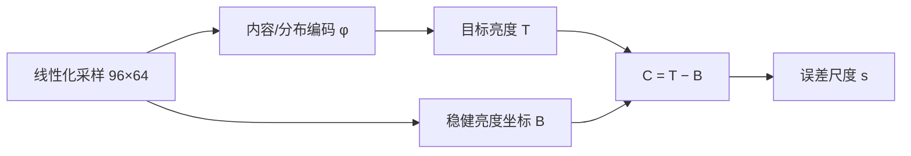

# 轻量神经测光：方法评估、当前结果与优化路线

日期：2026-10-28，Asia/Shanghai。本文只做核查、复算与方案评估，不修改训练配方、运行中的快照、原图、断点或 Android 代码。文中的“实测”指本轮从现有缓存与断点复算得到的数值；“推断”与“建议”分别标注，不能把建议当成已实现的收益。

## 0. 结论摘要

1. **工程质量高于同类研究项目。** 数据只读、SHA-256/来源/许可台账、训练配置与源码散列、RNG/优化器精确恢复、固定验证、封存测试、ONNX 数值对照、未通过验收仍如实保留——这些都做对了，是可继续投入的基础。
2. **方法上有一个根本问题：当前监督目标不可辨识。** 训练样本是“已知参考图被移动了 d 档”，但推理时只给模型移动后的图，不给参考图。模型只能估计 `E[d | 当前图]`，也就是“这类画面通常该补多少”，而不是“这张图相对它自己的参考被移动了多少”。因此零扰动（d=0）样本上的 0.495 EV 误差不是训练不足，而是这个任务定义在现有特征与数据下的经验下限。
3. **当前第 134 轮模型复算为 0.5766 EV（验证集），与文档记录的 0.5864（第 124 轮）同量级。** 16 张验证原图给出的 95% 置信区间约为 **[0.491, 0.669] EV**；0.5686 的“历史最佳”和 0.5766 在统计上不可区分。
4. **误差的第一主项是内容先验，不是曝光斜率。** 零扰动散差 0.495 EV；逐 ROI 拟合的曝光响应斜率中位数 −0.868（理想 −1），因此“斜率不对”大约只值 0.08 EV。把结构改成 `C = T(内容) − B(亮度)` 值得做，但不要期待它单独把误差降到 0.5 以下。
5. **裁切 ROI 的语义没有定义清楚，是第二个大问题。** 同一张图的 16 个 ROI 共享同一个目标，但模型对它们的预测在零扰动下从 0.266 EV（全画面）恶化到 0.51–0.86 EV（四角 4 倍裁切）。`0.577 → 0.40–0.46` 的实测差异说明：**在“参考曝光属于整个场景”的语义下，当前“逐 ROI 独立预测”的部署形态与标签不匹配**；要么按场景聚合（全画面或 16 ROI 平均），要么给裁切提供整幅上下文，要么重新定义裁切目标。
6. **持续训练已经空转。** 第 1–14 阶段共 70 轮，最好验证 MAE 一直停在首轮第 39 轮的 0.5686；每阶段只跑 5 轮，训练图数量在 230→93→161→102 之间漂移。在换目标/换标签之前，继续这条续训链没有意义。
7. **许可证现状可行，但有三个动作要先做：** 把 `tools/metering-training/` 与本文档纳入 Git（目前是未跟踪文件）；给权重和数据分别写模型卡/数据卡；用许可扫描确认没有把 GPLv3 的除尘训练代码并入（现有文档声明为独立实现）。Apache-2.0 → GPL-3.0 在法理上可行（单向兼容），但当前没有 GPL 依赖，切换只会降低采用面，建议保留 Apache-2.0，把 GPLv3 作为“必须用 GPL 组件时”的备选。

---

## 1. 核查范围与可复现性

### 1.1 核查对象

| 层 | 位置 | 说明 |
|---|---|---|
| Android 应用 | `app/src/main/java/com/lightmeter/rawmeter/` | 现有 RAW/YUV 测光、`EvaluativeMetering.kt` 全局规则、校准与相机管线 |
| 训练工具 | `tools/metering-training/` | 采样、776 维特征、MLP、训练、评估、ONNX 导出、基线对照 |
| 运行中的续训 | `outputs/shared-training-20261025/runtime-snapshot-v8-auto-admission/tools/shared-training/metering_job.py` | 分阶段续训与账本提交 |
| 数据 | `outputs/metering-training/cache-v1/`、`outputs/metering-research/shared-pool/manifest.jsonl` | 263 张原图、16 ROI/图、6144 点/ROI |
| 结果 | `outputs/metering-training/reference-v1-20261025-verified/`、`outputs/shared-training-20261025/metering-comparison/report.json` | 首轮导出与第 134 轮同组对照 |

本轮复算使用的断点：

```text
outputs/shared-training-20261025/metering/metering-shared-stage-0014/last.pt
epoch = 134
best_mae = 0.5685835734653261（仍来自第 39 轮）
stage_stale = 5
uncertainty_factor = 1.0
```

作为对照，也复算了首轮导出的 `reference-v1-20261025-verified/seed-20261025/best.pt`（第 39 轮，导出模型的误差尺度因子为 1.598）。

### 1.2 本轮新增的只读产物

```text
outputs/metering-review-20261028/
  analyze_current.py        误差拆解、逐 ROI 斜率、线性探针、B-only 探针
  analysis.json             上述结果
  groups.csv                256 个 (原图, ROI) 组的斜率与零扰动截距
  feature_sanity.py/json    暗部/高光/截断对 B 的影响
  validation_uncertainty.py/json  16 张验证原图的自助法置信区间
  scene_consensus.py/json   “逐 ROI / 16 ROI 平均 / 仅全画面”聚合对比
  scene_consensus-epoch39.json    同一分析在第 39 轮模型上的复现
```

所有脚本只读缓存与断点，不写训练目录、不改账本。数据口径与文档一致：固定验证 16 张原图 × 16 ROI × 9 档 = 2,304 个相关样本；MAE 先按原图宏平均。

---

## 2. 项目与代码构成

### 2.1 应用侧

- Kotlin/JVM 17、Camera2、自定义 View、C++17/JNI；minSdk 28、targetSdk 36。
- 现有全局测光：`EvaluativeFrameAnalyzer` 采样 → `EvaluativeMeteringAlgorithm` 计算
  ```
  B = EV 分布 5%–95% 区间均值
  U = EV 分布 98%–99.5% 区间均值
  delta = clamp(U − B − 2.5, 0, 0.5)
  recommendedEv100 = B + delta
  ```
- 测量（EV100、设备响应校准、曝光元数据）与策略（自动补偿、用户补偿）已经分层，`baseEv100 / exposureReductionEv / recommendedEv100` 分开保存——这是接入学习型策略的正确接口。
- 当前没有神经推理运行时；APK 只带精简 OpenCV。

### 2.2 训练侧

- 输入：每个 ROI 从原尺寸图上按均匀点中心取 `96×64` 个原生 RGB 点，不做缩略插值；每张图 16 个 ROI（全图 + 中央 1.5/2/4× + 四角 1.5/2/4×）。
- 特征：12×8 网格、每格 8×8 点；每格 8 项 + 全局 8 项 = 776 维；亮度 `Y=0.2126R+0.7152G+0.0722B`，`e=log2(max(Y,1e-6)/0.18)`。
- 模型：`776 → 64 → 32 → 2`，51,874 参数，51,776 MAC；输出 `C=4·tanh(r0/4)`、`s=min(softplus(r1)+0.05,4)·k`。
- 训练：AdamW、lr 1e-3、wd 1e-4、warmup 5、cosine、batch 128、25% 零扰动、其余 `U(−3,+3)`；损失 = SmoothL1(β=0.25) + 0.1×Laplace 尺度 + 0.1×两路一致性。
- 导出：safetensors + ONNX opset 17；ONNX 最大补偿差 2.265e-6 EV；桌面单线程网络 P50/P95 = 0.0688/0.1175 ms（不含取图与特征提取）。

### 2.3 需要先说清楚的一件事：现在有两个“当前模型”

| 项 | 首轮导出模型 | 续训链最新模型 |
|---|---:|---:|
| 断点 | `seed-20261025/best.pt`，第 39 轮 | `metering-shared-stage-0014/last.pt`，第 134 轮 |
| 验证全量 MAE | 0.5686 | 0.5766 |
| 验证零扰动 MAE | 0.4555 | 0.4950 |
| 测试全量 MAE | **0.5339** | 未测（按规矩不使用测试集） |
| 测试有效 MAE | 0.4335 | 未测 |
| 测试零扰动 MAE | 0.3935 | 未测 |
| 误差尺度校准因子 | 1.598（且 `feasible=false`） | 1.0（未重新校准） |
| ONNX 导出 | 有 | 无 |

因此：

- “第 134 轮 0.5766”不能写成“当前模型的测试结果”，测试结果仍只属于第 39 轮。
- 续训链 70 轮没有刷新 0.5686，也没有重新导出；**可部署的仍是第 39 轮模型**。
- 文档记录的第 124 轮 0.5864 是中间快照；现在状态文件已经是第 134 轮。引用结果时必须同时写断点 SHA 或轮数。

---

## 3. 当前结果：复算与拆解

### 3.1 总览（第 134 轮，验证集）

| 指标 | 数值 |
|---|---:|
| 全量 MAE（原图宏平均） | **0.5766 EV** |
| 有效样本 MAE（饱和≤5%、低信号≤20%） | 0.5344 EV |
| 有效样本比例 | 61.5% |
| 共同可靠子集（饱和≤5%、低信号≤5%） | 1,400 / 2,304 = 60.76% |
| 共同子集 MAE | 0.5144 EV |
| 样本绝对误差 P90（全量） | 1.3203 EV |
| 观察最大绝对误差 | 3.4933 EV |
| 零扰动平均有符号偏差 | −0.0012 EV |
| 零扰动 MAE | **0.4950 EV** |
| 零扰动标准差 | 0.7367 EV |

平均偏差几乎为零，但零扰动散差 0.74 EV——这说明模型不是“整体偏亮/偏暗”，而是**逐图判断不稳**。

同组对照（第 134 轮，共同 1,400 样本）：

| 方法 | MAE / EV | P90 / EV | 最大 / EV |
|---|---:|---:|---:|
| 当前 MLP | **0.5144** | 1.2689 | 3.4933 |
| 项目全局统计核 | 1.2177 | 2.6908 | 4.3576 |
| 完全平均（EV 域） | 1.3269 | 2.8061 | 4.4734 |
| 平均亮度后取 log2 | 1.0676 | 2.5303 | 4.2973 |

模型明显优于三条统计基线；这一点是真实的。问题在于三条基线都只是“单一常数锚点 + 固定规则”，不足以回答“非线性到底带来了多少”。

### 3.2 按曝光的误差：高光端与增益不足

| 验证曝光 Δ / EV | −3 | −2 | −1 | −0.5 | 0 | +0.5 | +1 | +2 | +3 |
|---|---:|---:|---:|---:|---:|---:|---:|---:|---:|
| MAE / EV | 0.405 | 0.460 | 0.519 | 0.487 | 0.495 | 0.647 | 0.689 | 0.557 | **0.931** |
| 有符号偏差 / EV | −0.306 | −0.073 | −0.037 | +0.003 | −0.001 | −0.181 | −0.207 | +0.221 | **+0.925** |

- 过曝 +3 EV 时目标补偿是 −3 EV，模型平均只给约 −2.08 EV，欠修正 0.93 EV。
- 欠曝 −3 EV 时目标 +3 EV，模型平均给 +2.69 EV，欠修正 0.31 EV。
- 不对称的合理解释是**信息损失**：+3 EV 后大量像素被截到 1.0，模型无法区分“正常亮场景”和“过曝”，后验均值会向 0 收缩；−3 EV 没有截断，主要只是变暗。tanh 输出头在 |C|≈3 处的导数约 0.52，也会让极端值的学习和修正变慢（这是推断，可做消融验证）。

逐 `(原图, ROI)` 拟合 `C ≈ a + b·Δ`（9 个点，理想 `a=0, b=−1`）：

| 统计量 | 数值 |
|---|---:|
| 组数 | 256 |
| 斜率均值 / 中位数 | −0.859 / −0.868 |
| 斜率 P10 / P90 | −0.992 / −0.718 |
| 斜率方向错误（>0）比例 | 0% |
| 斜率在 −1±0.1 内比例 | 35.5% |
| 零扰动截距 \|a\|≤0.25 / ≤0.5 比例 | 44.9% / 69.9% |

全画面单独拟合的斜率是 −0.852（第 39 轮为 −0.830），逐图在 −0.575 到 −1.029 之间。

**判断：** 曝光方向全部正确，主要问题是增益约 13% 不足；但把斜率强行修正到 −1、保留同样的截距，MAE 会从 0.577 降到约 0.495（因为零扰动误差不变，斜率项被消掉）。这与文档在第 114 轮用“已知零扰动锚点”得到的 0.4957 一致——**结构修正的收益约 0.08 EV，不是数量级改善**。

### 3.3 裁切 ROI：实测发现的最大一块可回收误差

零扰动下，按 ROI 类型拆：

| ROI | 零扰动 MAE / EV |
|---|---:|
| 全画面 1× | **0.266** |
| 中央 1.5× | 0.339 |
| 中央 2× | 0.422 |
| 中央 4× | 0.464 |
| 四角平均 | 0.536 |
| 左上 4× | 0.636 |
| 右下 4× | 0.856 |

同一张图内，零扰动截距的总方差 0.5427；其中原图级均值只占 33%，**67% 是同一张图内不同 ROI 之间的差异**。也就是说，模型对“同一场景的不同裁切”给出的曝光判断并不一致，而这种差异在标签上是不存在的（16 个 ROI 共享同一个目标）。

把预测按场景聚合后（同一原图、同一曝光的所有 ROI 一起处理）：

| 估计方式 | 验证 MAE / EV | 零扰动 MAE / EV |
|---|---:|---:|
| 逐 ROI 独立（当前部署形态） | 0.5766 | 0.4950 |
| 16 个 ROI 平均 | **0.4158** | 0.3047 |
| 只用全画面 1× 的预测 | **0.3957** | 0.2658 |

第 39 轮模型上同样成立：0.5686 → 0.4118（16 ROI 平均）/ 0.4627（仅全画面）。平均聚合在两个模型上都稳定在 0.412–0.416，比“仅全画面”更稳。

这说明：

1. 在“参考曝光属于整个场景”的语义下，逐 ROI 独立推理是在给同一个答案加噪声；**场景级聚合（全画面或 16 ROI 平均）在本轮复算里值 0.12–0.18 EV**。
2. 如果产品语义是“按选区重新测光”（例如 4× 只框住白墙，希望白墙本身曝光正确），那么当前把所有 ROI 的零扰动目标都设成 0 就是错的标签；白墙裁切本来就不该保持全图曝光。两种语义不能混在同一个头里。
3. 数字变焦需求应该明确：**变焦改变的是分析范围，不应改变场景的推荐曝光**；如果希望保持场景曝光，就应该使用全画面上下文，而不是让 4× 裁切独立判断。

### 3.4 验证集太小：0.5686 与 0.5766 无法区分

16 张验证原图的逐图 MAE 从 0.338 到 1.020，标准差 0.190；均值标准误 0.0475。自助法 95% 区间：

```text
宏平均 MAE = 0.5766 EV
95% CI      = [0.4910, 0.6694] EV
```

因此，按 16 张原图的采样不确定性：

- 首轮第 39 轮 0.5686、第 134 轮 0.5766 无法区分；差异远小于 CI 宽度。
- 第 114 轮 0.5900、第 99 轮 0.6113 也在区间内。
- 每阶段“连续 5 轮没有刷新最佳”就早停，在 16 张原图上基本是在拟合噪声。
- 三个种子的 0.5686/0.5797/0.5708（另一种子最佳在第 40 轮）同样不可区分。

严格的两两比较需要逐原图配对检验；单看小数点后第四位没有意义。

**建议：** 验证/测试至少各 50–100 张独立原图，按场景/来源/设备分组；模型选择用逐原图配对检验或自助法区间，而不是小数点后第四位。

### 3.5 基线强度与“非线性是否值得”

我在同一套 776 维特征上做了两个只读探针（训练集 5 个固定曝光、18,480 个样本；λ=1 的岭回归）：

| 探针 | 验证 MAE | 零扰动 MAE |
|---|---:|---:|
| 当前 MLP | 0.5766 | 0.4950 |
| 776 维线性岭回归 | 0.8173 | 0.4866 |
| 只用全局 B 的仿射回归 | 1.1301 | 0.4057 |

两点值得写进正式对照：

1. **非线性确实有价值**：线性模型差 0.24 EV，说明 MLP 学到的交互不是摆设。
2. **“只用 B 的仿射”在零扰动上比 MLP 还好（0.406 vs 0.495），但全量差很多（1.13）**。这说明 MLP 为了响应曝光，牺牲了“参考图不该被改”的准确度；而 B-only 正好相反。当前模型把“内容先验”和“曝光响应”挤在同一个表示里，二者互相干扰——这正是结构化拆分 `C = T(φ) − B` 的动机。

现有三条基线都是“一个标量锚点 + 固定规则”，属于弱基线。正式对照至少应加入：线性/岭回归、浅层 GBM、应用完整规则（含高光重拍/多帧融合的离线近似），以及“每图 oracle 常数偏移”作为误差下界的参考。

### 3.6 信号边界：暗部截断会污染 B

`B` 定义为 EV 分布 5%–95% 的精确面积均值。它只对 <5% 的极值稳健；当纯黑像素占 5%–20% 时，这些像素被压在 `log2(1e-6/0.18) = −17.46 EV`，会把 B 整体拉低。

实测（训练/验证，−2/0/+2 三个曝光）：

| 项目 | 训练 | 验证 |
|---|---:|---:|
| `B < −8 EV` 比例 | 1.36% | 0.65% |
| 低信号比例 >5% | 2.03% | 1.17% |
| 低信号比例 >20% | 1.35% | 0.39% |
| 高光截断 >5% | 33.4% | 35.4% |
| B（低信号 5%–20% 组） | **−4.79** | **−6.88** |
| B（低信号 ≤5% 组） | −0.77 | −1.05 |
| corr(B, 低信号比例) | −0.55 | −0.35 |

在验证集上，低信号 5%–20% 的 18 个样本 MAE 高达 **2.09 EV**（样本很少，但方向明确）。而模型的有效性门槛是低信号 ≤20%，应用的 `baseReliable` 门槛却是 ≤5%——两者不一致。

**建议：**

- EV 下限不要用 `1e-6`（−17.5 EV）这种远离物理噪声底的硬截断；改为按设备噪声底设一个有限下限（例如 −8 到 −10 EV），或对截断质量做显式重归一/加权。
- 把“低信号比例/截断比例”作为不确定性输入，而不是只用于筛选。
- 主损失不要无条件使用已被污染的特征；至少给严重截断样本降权或改用区间/方向标签。
- 训练输入如果可能，改用 16-bit 线性或 RAW；8-bit sRGB 在暗部一个码值可能对应 0.1–1 EV（越暗越大，码值 1→2 约 1 EV，码值 10 附近约 0.14 EV）。

### 3.7 持续训练：70 轮空转

| 阶段 | 累计轮 | 训练原图 | 阶段末验证 MAE |
|---|---:|---:|---:|
| 0001 | 69 | 230 | 0.5941 |
| 0002 | 74 | 230 | 0.6036 |
| 0003 | 79 | 93 | 0.5990 |
| 0004 | 84 | 91 | 0.5957 |
| 0005 | 89 | 87 | 0.5872 |
| 0006 | 94 | 94 | 0.5892 |
| 0007 | 99 | 102 | 0.6113 |
| 0008 | 104 | 107 | 0.5955 |
| 0009 | 109 | 161 | 0.5840 |
| 0010 | 114 | 162 | 0.5900 |
| 0011 | 119 | 131 | 0.5849 |
| 0012 | 124 | 134 | 0.5864 |
| 0013 | 129 | 99 | 0.5805 |
| 0014 | 134 | 102 | 0.5766 |

- 最好值一直停在首轮第 39 轮的 0.5686，第 14 阶段连 `best.pt` 都没有生成。
- 每阶段 5 轮，102 张训练图 → 1,632 个 ROI → 每轮 13 个 batch → 每阶段约 65 步；余弦学习率已降到约 2.5e-4。这个预算不可能改变一个已收敛的 51k 参数网络。
- 训练集在 230→93→161→102 之间漂移，没有固定 replay 核心；旧图被共享池回收或移出清单后，模型直接忘掉。
- `best` 跨阶段继承，使得“刷新历史最佳”几乎不可能；早停条件在 16 张验证图上没有统计功效。

**建议：** 在目标/数据改变前暂停这条续训链；改为“固定 replay 核心（100–150 张，永不回收）+ 新图增量”，每阶段至少 20–30 轮，学习率按阶段重置或使用 warm restart，早停用置信区间而不是绝对 1e-6。

---

## 4. 方法评价

### 4.1 做对了什么

1. **连续曝光而不是离散档位**：训练在 `[−3,+3]` 连续采样，固定九档只用于验证；这避免了“只见过整档”的假问题。
2. **两路曝光共享同一参考 ROI**：一致性约束把“同一画面提亮后应少补”变成可训练信号，思路正确。
3. **固定标准化、固定验证、封存测试**：没有用测试集调参；未知/失败不隐藏。
4. **可复现性**：配置/源码/数据/环境的散列、断点身份校验、RNG 恢复、原子写、ONNX 数值对照——这在小型研究项目里是稀缺的。
5. **数据许可与来源**：逐图许可、作者、页面、版本、散列；训练工具与图片许可分开记录。
6. **测量与策略分层**：`baseEv100 / exposureReductionEv / recommendedEv100` 分开，模型只做策略，不假装恢复绝对 EV100。
7. **对局限的诚实**：文档明确写了“不是绝对 EV100”“16 张测试不能代表泛化”“桌面延迟不是手机延迟”。这比很多论文式文档可信。

### 4.2 根本问题：目标不可辨识

设参考图（线性 RGB）为 `I`，施加的曝光扰动为 `d`，模型输入为

```text
x = clip(2^d · I, 0, 1)
```

训练目标是 `y = −d`。推理时只给 `x`，不给 `I`，也不给 `d`。所以模型能学到的只是

```text
f(x) ≈ −E[d | x]
```

而 `p(d | x)` 的形状由“参考图集合里场景亮度/内容的分布”决定。除非场景内容本身能强烈约束“这张图应该有多亮”，否则同一个 `x` 可以来自“昏暗场景、正确曝光”，也可以来自“正常场景、欠曝 2 档”。这两种情况在单帧统计上可能完全一样。

这不是网络容量问题，也不是训练轮数问题，而是**标签里没有足够信息**。三个直接证据：

- 零扰动样本的目标恒为 0，但模型 MAE 0.495、标准差 0.737；平均偏差却只有 −0.0012。说明它学的是“这类画面通常该补多少”的零均值先验，而不是“这张图没被移动”。
- 只用全局 B 的仿射回归在零扰动上 MAE 0.406，已经接近 MLP；说明大部分可学的就是亮度先验。
- 逐 ROI 的零扰动截距在同一张图内散差 0.43 EV，而目标完全相同；这部分是纯估计噪声。

**推论：**

- 在当前标签定义下，**0.25 EV 的全量 MAE 和 0.5 EV 的 P90 不是“再训久一点”能达到的**；它需要更好的锚点、更强的场景语义，或者换一个可辨识的任务。
- 继续增加网络容量/轮数，最可能的结果是把零扰动先验拟合得更细，而不是解决曝光判断。
- 文档第 11 节的三项建议方向正确，但第 1 项（`T − B`）主要修斜率（逐 ROI 约 0.08 EV；全画面口径的上限约 0.13 EV），第 2 项（选区目标）才是主项，第 3 项（区域权重）主要是可解释性，不应期待它单独降误差。

### 4.3 其他真实但次要的问题

| 问题 | 证据 | 影响 | 处理 |
|---|---|---|---|
| 曝光增益不足 | 斜率中位数 −0.868；+3 EV 欠修正 0.93 EV | 约 0.08 EV | 结构化 `T−B` 或斜率约束 |
| 裁切语义未定义 | 全画面 0.266 vs 四角 0.536（零扰动） | 0.12–0.18 EV（聚合可回收） | 场景聚合或整幅上下文或重定义标签 |
| 暗部污染 B | 低信号 5–20% 时 B≈−4.8 vs −0.77 | 少数样本 2 EV 级 | EV 下限/重归一/降权 |
| 8-bit 量化 | 暗部 1 码值约 0.1–1 EV（越暗越大） | 暗部特征噪声 | 16-bit/RAW 训练 |
| 验证集太小 | 95% CI 宽 0.18 EV | 选择不可靠 | ≥50–100 原图 + 配对检验 |
| 数据漂移 | 230→93→161→102 | 遗忘/不可比 | 固定 replay 核心 |
| 续训空转 | 70 轮无改善 | 浪费 GPU | 暂停，换目标后再启 |
| 基线弱 | 三条都是常数锚点 | 高估“相对传统”的收益 | 加线性/GBM/完整规则 |
| 误差尺度未校准 | 链上 `k=1.0`；导出 `k=1.598` 且 `feasible=false` | 不能当概率/安全阈值 | 分原图 conformal，报告覆盖率 |
| 输出头 tanh 饱和 | \|C\|≈3 处导数 0.52 | 极端档学习慢 | 与线性+clamp 做消融 |

### 4.4 对原文档第 11 节三项建议的评价

| 原建议 | 评价 | 预期收益 | 备注 |
|---|---|---|---|
| 1. 目标曝光 T 与当前曝光 B 分开，`C=T−B` | **应该做**，它把可辨识的斜率变成结构常数，模型只需学内容先验 | 逐 ROI 约 0.08 EV；全画面口径上限约 0.13 EV | 不要期待它解决零扰动散差；T 仍需要可靠锚点 |
| 2. 更可靠的选区目标 | **最该先做**，裁切歧义是 0.12–0.18 EV 的可回收误差 + 标签语义问题 | 0.1–0.2 EV，且决定产品语义 | 人工区间/真实包围/整幅上下文三选一，不能继续“所有 ROI 都零补偿” |
| 3. 显式区域权重/主体信息 | 可解释性好，但没有监督时权重不可辨识，可能只是装饰 | 准确率未知 | 先做诊断可视化；要影响精度必须有主体/偏好标签 |

### 4.5 文档本身的评价

**优点：** 结构完整、假设与局限写得清楚、数字有出处、和代码对得上；作为“当前实现说明”质量很高。

**可改进：**

- 结果没有版本戳。第 124 轮的数字在第 134 轮已过时；建议在文首固定 `checkpoint SHA + 状态文件 SHA + 复算日期`，或直接由脚本生成结果表。
- 代码链接是 `C:/Users/...` 绝对路径，换机器即失效；仓库文档应使用相对链接。
- 没有置信区间。16 张原图的 MAE 差异应给出 CI，否则 0.5686/0.5766 会被误读为真实差距。
- 没有“什么结果会推翻这个设计”的段落。建议加“falsification criteria”：例如“若加入内容/上下文特征后，零扰动 MAE 没有下降，说明模型没有学到可迁移的内容信息”；或“若结构化头的全量 MAE 与场景聚合基线差距 <0.05 EV，则结构改造不值得保留”。
- 没有区分“场景曝光”与“选区曝光”两种产品语义；这正是第 3.3 节问题的根源。
- 文档与训练代码目前都未纳入 Git（`?? tools/metering-training/`、`?? docs/research/...`），对外发布时“Apache-2.0”声明并不完整。

---

## 5. 优化路线

下面按“先改什么、预期多少、怎么验收”排序。收益是基于本轮拆解的**量级估计**，不是承诺。

### 5.1 优先级总表

| 优先级 | 改动 | 预期收益 | 成本 | 验收门槛 |
|---|---|---|---:|---|
| P0 | 明确“场景曝光”vs“选区曝光”，二选一 | 决定后面所有标签 | 1–2 天讨论 | 写进文档与 UI 模式 |
| P0 | 场景级聚合（全画面或 16 ROI 平均） | **−0.12 ~ −0.18 EV**（0.577→0.40–0.46） | 1 天 | 验证集 + 逐图配对检验 |
| P1 | 结构化 `C = T(φ) − B` | −0.08 EV，斜率变精确 | 3–5 天 | 斜率 ∈[−1.02,−0.98]，零扰动不退化 |
| P1 | 组训练（K=4–8 曝光/场景）+ 区间/排序损失 | 0.03–0.10 EV，尾部更稳 | 1–2 周 | P90/P99 与单调性 |
| P2 | 真实包围曝光 + 人工可接受区间 | **可能 0.10–0.25 EV** | 3–6 周（采集+标注） | 人工区间命中率 |
| P2 | 整幅上下文输入（低分辨率全局 + ROI 位置/倍率） | 0.03–0.08 EV，裁切更稳 | 3–5 天 | 裁切分组 MAE |
| P3 | 12×8 网格卷积 / 小 CNN（N1） | 未知，取决于数据 | 1–2 周 | 同预算下不退化 |
| P3 | 误差尺度 conformal 校准 | 覆盖率可信 | 2–3 天 | 80% 覆盖率实测 |
| P4 | 量化/移动端部署 | 不影响精度目标 | 2–4 周 | ΔEV P95 ≤0.05，P99 ≤0.15 |

### 5.2 P0：先把语义定下来

必须明确回答：

- **A. 场景曝光**：测光目标是“让整个场景按摄影者的曝光意图成像”。那么 4× 裁切白墙的目标仍是场景的 0 补偿；模型需要整幅上下文，推理应按场景聚合。
- **B. 选区曝光**：测光目标是“让当前选区本身曝光正确”。那么白墙裁切需要一个“白墙应该是什么亮度”的目标，不能继承全图的零补偿；需要选区级标签/偏好。

两种语义都合理，但不能共用“所有 ROI 目标=0”的标签。建议在应用里显式区分“评价测光（场景）”和“局部测光（选区）”，与现有 SPOT/CENTER/ANGLE 模式的关系写清楚。

**验收：** 文档里有一节“目标定义与 ROI 语义”，测试用例覆盖“4× 白墙裁切”的期望行为。

### 5.3 P1：结构化补偿头



- `B` 用当前稳健统计（或改进后的截断处理），**不经过网络**；`T` 只从尽量曝光不变的内容特征预测。
- 无截断时，`x' = 2^δ x` 使 `B' = B+δ`，于是 `C' = T−B−δ = C−δ`；斜率精确为 −1。
- 截断/低信号时结构不再精确，用可靠性权重或区间标签处理；不要假装线性。
- 仍然需要 `T` 的锚点；结构只保证“响应正确”，不保证“目标正确”。

**消融：**

1. 现有 MLP；
2. `T−B` 结构（同参数量）；
3. `T−B` + 组训练；
4. `T−B` + 整幅上下文；
5. 每个变体 3 个种子，报告逐原图配对差与 CI。

**验收：** 斜率中位数 ∈[−1.02,−0.98]；零扰动 MAE 不高于现有；全量 MAE 至少 −0.08 EV；P90 不退化。

### 5.4 P1/P2：组训练与标签

- 每个场景采 `K=4–8` 个曝光（连续或 1/3 档），组内共享内容；损失：
  ```
  L = L_anchor(参考帧) + λ·L_pair(f(x_i) − f(x_j), −(d_i − d_j)) + μ·L_inv(φ(x_i), φ(x_j)) + ν·L_interval
  ```
- `L_pair` 是可辨识的部分；`L_anchor` 只在有可靠参考/人工区间时使用。
- `L_inv` 让内容编码对曝光不敏感；可以用 stop-gradient 或显式正交约束。
- 区间标签：`[lo, hi]`，用 interval-censored loss（预测落在区间内不罚，落在外面按距离罚）。这比“唯一正确 EV”更符合摄影实际，也能容纳标注者分歧。
- 对严重截断/低信号：方向标签或“不可判定”，不要强行回归精确 EV。

### 5.5 P2：数据

| 数据源 | 用途 | 优点 | 风险/成本 |
|---|---|---|---|
| 现有 263 张 CC0/CC-BY | 场景先验、合成曝光预训练 | 已有、许可清晰、可复现 | 不是为测光采集；后期/HDR 风格多；无绝对 EV |
| 真实包围曝光（RAW，锁定 WB/ISO，1/3 档 ±3 EV） | 关系学习、斜率/一致性 | 物理一致、可测噪声/截断 | 采集慢；需要设备与场景设计 |
| 人工可接受区间/成对偏好 | 锚点、策略目标 | 直接对应“摄影意图” | 标注成本；标注者一致性要先测 |
| 场景线性 HDR/EXR 渲染 | 合成连续曝光+噪声 | 可控、可扩量 | 渲染/许可；与真实 ISP 仍有差距 |
| 手机实际 RAW/YUV 回放 | 域对齐、量化 | 与部署一致 | 需要采集工具与隐私流程 |

具体建议：

1. **先做 30–50 个场景的真实包围**，验证“人工区间”是否可标注、标注者一致性（Krippendorff α）是否够高。如果 α 很低，说明目标本身高度主观，应改用区间/排序而不是点回归。
2. 把现有池按“是否经过明显后期/HDR 色调映射”打标签；过度处理的原图不应作为“参考曝光合适”的强标签，最多作为场景先验。
3. 用 phash/近重复聚类做 split 隔离；当前 manifest 检查了 id/sha256/group，但没有用 phash 做近重复检查。
4. 验证/测试扩到各 50–100 张，按场景类别（逆光、雪景、夜景、白墙、小光源、室内外过渡）分层；报告每类。
5. 固定 replay 核心（100–150 张）永不被回收；新图只做增量。当前池在 230→93 之间漂移，是续训失效的直接原因。
6. 训练域尽量改成 16-bit 线性/RAW；如果只能用 sRGB，至少把 EV 下限改成物理噪声底，并把暗部量化误差计入不确定性。

### 5.6 P2/P3：学习方法

- **多种子 + EMA/SWA**：3 个种子平均通常能降 0.02–0.04 EV；51k 参数模型部署 3 份不现实，可先集成评估，再蒸馏回单模型。
- **早停用统计量**：以逐原图配对差的均值/CI 为准，不用绝对 1e-6；16 张原图时任何 <0.05 EV 的“提升”都不投。
- **分层交叉验证**：数据少时用 5-fold 分组 CV 选超参，而不是单一 16 张验证集。
- **不确定性**：split conformal（按原图分组）给 80%/90% 覆盖率；现有 `s` 只是尺度，不是概率。链上 `k=1.0` 未校准，不要对外使用。
- **蒸馏**：若 N1 教师有效，蒸馏到 N0；教师权重的许可要单独审计。
- **课程**：先小 |d| 后大 |d|；对 +3 EV 截断样本给区间/方向监督。
- **不要**：在没有新标签前扩大网络、增加 epoch、或对验证集做精细早停。

### 5.7 P3：架构选项

**N0 改进（推荐先做，预算不变）：**

- 12×8 网格当作 `12×8×8` 张量，先做 3×3 卷积（8→16，ReLU），再全局平均池化 → 16 维；与 8 个全局特征、2–3 个上下文特征拼接 → 32 → 2。参数量约 4–6k，比现在的 51k 更小，且具备空间局部性。
- 把 `B`、`H−B`、`P90−P10` 作为显式输入/跳连；`T` 头不要直接看 `B`（或做梯度隔离），避免内容分支复制亮度。
- 加 ROI 上下文：倍率、位置（3 维）+ 整幅低分辨率 EV 网格（例如 4×3=12 维）+ 整幅 8 个全局特征。输入从 776 增到约 800，成本可忽略。
- 输出头做消融：`4·tanh(r/4)` vs 线性 + clamp；后者在 ±3 EV 内梯度不衰减，可能改善 +3 EV 的欠修正。
- 区域注意力头只用于诊断；没有主体监督时不要把它当解释。

**N1（可选，后做）：**

- 以 96×64 的连续缩略图（不是稀疏采样点）为输入的深度可分离 CNN，4 个 block、16–32 通道，约 30–100k 参数、5–15M MAC；与 N0 统计分支融合。
- 数据量不足时，先用场景线性 HDR 合成曝光对做预训练，再用真实包围微调；或使用许可明确的预训练骨干（逐权重核对许可，不要假设“代码 MIT=权重 MIT”）。
- 只有在 N0 + 新标签仍明显不足时才上；不要把“更大模型”当成标签问题的替代品。

**部署：**

- 运行时优先 ncnn（BSD-3）或 LiteRT（Apache-2.0）；OpenCV 精简包没有 dnn，不要为了“已经有 OpenCV”重建大 AAR。
- INT8 PTQ 后必须报告 ΔEV P95/P99，并验证门控/回退是否改变；量化集不能只用验证集。
- 16 KB 页对齐、各 ABI、冷启动/热态、PSS、功耗都要单独测；桌面 0.0688 ms 不是手机指标。

### 5.8 评估与集成

- 指标：全量/有效 MAE、P90/P99、观察最大、零扰动 MAE、方向错误率、斜率、单调性、区间命中率、风险-覆盖率曲线、逐场景类别。
- 统计单位：原图/场景，不是 2,304 个相关样本；报告逐原图配对差的 CI。
- 集成契约：`C>0` 提亮 → `policyCompensationEv` → `recommendedEv100 = base − policyCompensation`；用 JVM 单测锁定符号与单位。
- 回退：低置信度、缺元数据、饱和/低信号、超分布时回到现有规则；回退不能保证规则本身正确，但能限制新增风险。
- 先修应用审计中的已知问题（处理后增益未抵消、局部 YUV 几何），再让网络学习输入；否则模型会学进确定性误差。

---

## 6. 学习路径（按阶段，带 gate）

| 阶段 | 做什么 | 产出 | 进入下一阶段的条件 |
|---|---|---|---|
| 0. 复现与拆解 | 复算当前断点、误差分解、CI | 本文与脚本 | 能解释 0.5766 的构成（零扰动/斜率/裁切） |
| 1. 语义与聚合 | 定场景/选区语义；实现场景聚合 | 设计说明 + 对照 | 聚合后验证 ≤0.45，逐图配对显著 |
| 2. 结构头 | `T−B` + 斜率约束；线性 vs tanh 消融 | 新模型 + 消融表 | 斜率 ∈[−1.02,−0.98]，全量 −0.08 |
| 3. 组训练/区间 | K 曝光组、pairwise、区间标签 | 训练配方 v2 | P90/P99 改善，单调性违例下降 |
| 4. 真实数据 | 30–50 场景包围 + 人工区间 | 数据卡 + 标签 | 标注一致性可接受；区间命中率可测 |
| 5. 上下文/架构 | 整幅上下文、网格卷积、N1（可选） | 对照实验 | 同预算下不退化，裁切分组改善 |
| 6. 部署 | ncnn/LiteRT、量化、真机 | 性能/精度报告 | ΔEV 与延迟/功耗达标 |

每个阶段只回答一个问题；不要在阶段 2 同时换数据、换损失、换架构，否则无法归因。

---

## 7. 许可证：现状、GPL-3.0 迁移与待办

### 7.1 现状核查

| 对象 | 当前状态 | 备注 |
|---|---|---|
| 应用与仓库 | Apache-2.0（根 `LICENSE`、`NOTICE`） | `NOTICE` 声明只覆盖本项目代码 |
| 训练代码 | 每个 `.py` 有 `SPDX-License-Identifier: Apache-2.0` | **但 `tools/metering-training/` 未纳入 Git** |
| 新训练权重 | 模型卡声明 Apache-2.0 | 未使用第三方预训练权重 |
| 图片 | 226 张 CC0-1.0、37 张 CC-BY-4.0（盘点时） | manifest 保留作者/许可/页面/版本/散列 |
| LIU4K-v2 | 上游声明 CC0 | 保留上游声明与来源记录，不把上游声明当成自己的保证 |
| Commons | 逐图 CC0/CC-BY-4.0 | 分发模型/数据卡时保留署名 |
| 运行时（现有） | OpenCV 4.12 Apache-2.0；NDK/系统库另有通知 | `THIRD_PARTY_NOTICES.md` 已列 |
| 运行时（未来） | ncnn BSD-3；LiteRT Apache-2.0；ONNX Runtime MIT | 与 Apache-2.0/GPLv3 均兼容 |
| 除尘训练代码 | GPLv3（另一工作树） | 现有文档声明未复制/导入；不要合并 |

**关键问题：** 训练代码和本轮文档目前是未跟踪文件（`git status` 显示 `?? tools/metering-training/`、`?? docs/research/...`）。在它们进入仓库之前，“代码采用 Apache-2.0”只对已跟踪文件成立，对外分发时无法证明训练代码的许可与来源。**先把它们提交，并保留 SPDX 头与 `NOTICE`。**

### 7.2 Apache-2.0 → GPL-3.0 是否可行

- **可行，单向。** FSF 明确 Apache-2.0 与 GPLv3 兼容（与 GPLv2 不兼容）。Apache-2.0 代码可以进入 GPLv3 组合作品；Apache 文件保留原版权与许可通知，不能把文件头改成 GPL 后声称是“重新授权”。
- **已发布的 Apache-2.0 版本不会因切换而撤回**；收到旧版本的人仍可依 Apache-2.0 使用。
- **不需要外部贡献者额外同意**（Apache-2.0 §4 允许以不同条款分发衍生作品），但仍要保留版权、NOTICE、修改说明；若项目有 CLA，按 CLA 执行。
- **GPLv3 不是“非商用”**：它不解决 CC-BY-NC、research-only、来源不明权重或数据限制。切换许可证不会让这些素材自动合规。
- **GPLv3 与 Google Play 分发通常可行**（需要提供 Corresponding Source）；若未来上架 Apple App Store，GPLv3 的附加限制与 App Store 条款存在冲突风险，需要单独评估。
- **GPLv3 传染的是组合作品**，不是“用 GPL 工具训练出的权重”。但权重、训练数据、初始权重、运行时的许可要分别记录；不要用“工具是 GPL”推导“权重必须 GPL”，也不要用“权重是 Apache”推导“训练数据没有署名义务”。

### 7.3 建议

1. **短期保持 Apache-2.0。** 当前没有 GPL 依赖，Apache-2.0 的采用面更大；GPLv3 只会限制下游。
2. **把 GPLv3 作为“必须使用 GPL 组件时”的备选**，并先做一次全仓许可审计（`reuse`/`licensee`/SBOM）。
3. **现在就做三件事：**
   - 提交 `tools/metering-training/` 与本轮文档，保留 SPDX 头；
   - 增加 `DATA_LICENSES.md`（CC0/CC-BY 清单、署名、用途限制、`permitted_role`）；
   - 更新模型卡：代码许可、权重许可、数据许可、初始权重=无、预期用途/禁止声明。
4. **如果切 GPLv3：**
   - 选 `GPL-3.0-only` 或 `GPL-3.0-or-later`，不要模糊；
   - 保留 Apache/NOTICE 文件与第三方通知；
   - 更新 `README/CONTRIBUTING`，明确贡献许可；
   - 提供 Corresponding Source（应用含 JNI/原生库）；
   - 检查 OpenCV/NDK/未来推理运行时的通知是否完整；
   - 不要在同一发布里声称“整体仅 Apache-2.0”。
5. **权重发布**（如果发布到 Hugging Face 等）：用 Apache-2.0（或 GPLv3，与代码一致），附模型卡、数据来源、CC-BY 署名、训练配置与断点 SHA；不要只上传 `model.onnx`。

---

## 8. 如果只做三件事

1. **把“场景曝光”与“选区曝光”分开，并先实现场景级聚合。** 这是本轮最大的、免费的、可立即验证的收益（0.577 → 0.40–0.46）；同时它迫使产品把 4× 裁切的语义说清楚。
2. **把补偿头改成 `C = T(φ) − B`，配组训练/区间标签。** 斜率变成结构常数，模型只学内容先验；用 3 个种子和逐图配对检验验收，目标 −0.08 EV 起步。
3. **停掉当前空转的续训，换 30–50 个场景的真实包围 + 人工可接受区间；验证/测试扩到各 50–100 张。** 没有新标签，0.25 EV 的全量 MAE 不应作为近期目标；先把“可辨识的部分”做对，再谈精度。

预期量级（以本轮拆解为据，不是承诺）：

```text
现状                          0.577（逐 ROI）
+ 场景聚合                    0.40–0.46
+ 结构头（斜率精确）          0.30–0.40（取决于 T 的质量）
+ 真实包围/区间/更多数据      0.25–0.35
+ 上下文/架构                  进一步，但收益取决于标签质量
```

---

## 附录 A：复算口径与关键数字

- 固定验证：16 张原图 × 16 ROI × 9 档（−3,−2,−1,−0.5,0,+0.5,+1,+2,+3）= 2,304 个相关样本。
- MAE：先对每张原图的样本求平均绝对误差，再对原图宏平均。
- P90：样本绝对误差的 90 分位；不是独立场景的证据。
- 斜率：对每个 `(原图, ROI)` 的 9 个点做 `C ≈ a + b·Δ` 最小二乘。
- 零扰动：`Δ=0` 子集，目标为 0，MAE 即 `mean|C|`。
- 场景聚合：同一原图、同一 Δ 的所有 ROI 预测取平均；或只用 1× 全画面预测。
- 自助法：对 16 张原图的逐图 MAE 重采样 20,000 次，取 2.5%/97.5% 分位。
- 线性探针：训练集 231 张 × 16 ROI × 5 档 = 18,480 样本，特征用导出的固定 mean/std 标准化，λ=1 闭式岭回归。
- B-only：同一标准化下的单特征仿射回归。

## 附录 B：产物与命令

```powershell
$py = 'C:\Users\15449\.codex\worktrees\dust-training\film2\.venv-training\Scripts\python.exe'
& $py -B outputs/metering-review-20261028/analyze_current.py
& $py -B outputs/metering-review-20261028/feature_sanity.py
& $py -B outputs/metering-review-20261028/validation_uncertainty.py
& $py -B outputs/metering-review-20261028/scene_consensus.py
& $py -B outputs/metering-review-20261028/scene_consensus.py `
  outputs/metering-training/reference-v1-20261025-verified/seed-20261025/best.pt
```

## 附录 C：局限

- 所有结论只针对当前 16 张验证原图与现有缓存；不是新采集数据，也不代表真实手机 RAW/YUV。
- 线性/仿射探针是诊断，不是正式基线；没有做超参搜索。
- “场景聚合”的收益依赖“同一场景的 16 个 ROI 共享目标”这一标签语义；如果产品改为选区曝光，结论要重做。
- 8-bit sRGB 反解不能恢复已截断高光、局部色调映射或真实 RAW 噪声；本文没有把显示域结论外推到传感器域。
- 人工区间/偏好的可行性、标注一致性、真实包围的采集成本，本文只给方案，没有实测。
- 许可证结论是工程判断，不是法律意见；正式发布前应做一次完整审计。
