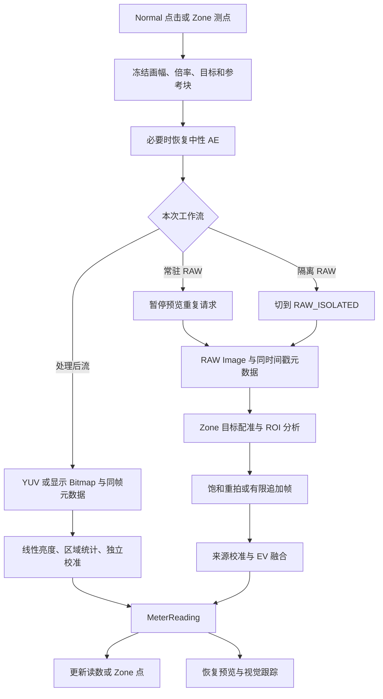

# 项目架构、测光、Zone RAW 配准与数码裁切变焦研究

本文记录改动前 `a2bace2` 基线的研究结果与诊断反例。后续构图交互和坐标修正见 [取景灰框与独立预览缩放](../VIEWFINDER_FRAMING_AND_INSPECTION_ZOOM_2026_10_25_ZH.md)；本文的“当前”均指研究时的基线，不代表后续实现仍保留全部问题。

研究日期：2026-10-25。源码基线：`a2bace2`，当前工作树为 detached HEAD，与本地 `main`、`codex/integrate-worktrees-20261024` 指向同一提交。应用版本字段仍为 `0.6.1 / 12`；源码已经包含 10 月 24 日的工作树整合，不能用 10 月 7 日发布包的状态代替当前源码状态。本轮没有查询远端发布状态。

本轮完成静态调用链追踪、原有 JVM/Robolectric 回归、原生全局 RAW 采样器测试，以及独立的受控反例。新增内容限于研究文档和可选诊断源码，没有修改生产算法、设备配置、校准数据或版本号，没有连接或安装到手机。

## 1. 主要结论

项目已经有较完整的相机兼容工作流、来源独立校准和 Zone 跟踪体系。当前最需要补齐的是跨图像来源的空间、增益和匹配置信度契约。

1. **RAW 测点配准与实时跟踪使用两套算法。** RAW 使用局部亮度块与 Bayer 绿色采样的归一化相关搜索；实时跟踪使用稀疏 LK 光流、RANSAC 相似变换、局部特征簇、ORB 重识别和陀螺仪预测。
2. **用户数码变焦主要由 GL 显示裁切实现。** 原始 YUV/RAW 缓冲不会随显示倍率自动裁切。正常 YUV 跟踪保存 1× 坐标，显示时再投影，方向合理。
3. **裁切/变焦并未在所有路径贯彻相同语义。** 已用当前生产函数复现：TextureView 跟踪备用路径的变焦坐标不一致、YUV RAW 参考块忽略实际窗口偏移、局部 YUV ROI 形状不一致，以及 ISP 备用按角度测光随变焦改变物理覆盖范围。
4. **批量 RAW 的“有匹配分数”仍不足以保证点位身份。** 独立噪声参考块也能取得 `0.250773` 的有限匹配分数，超过当前 `0.12` 门槛。现有批量保护可以拒绝几何回退，但无法排除这种误接受。
5. **处理后流的逐帧数字增益问题仍在。** 本轮重新复现同一来源、同一场景下 boost 100%→400% 引入约 +2 EV；不是要求 RAW、YUV、ISP 未校准读数相等。

原有 688 项测试全部通过；额外 9 项研究诊断中，3 项对照通过、6 项不变量断言失败。后者是现有行为的反例，并非生产改动引入的回归。本文把数值反例与真实设备表现分开描述。

## 2. 项目内容与架构

### 2.1 技术与功能

- 单 `app` 模块，Android 9/API 28 起，compile SDK 36.1、target SDK 36，JDK 17、Kotlin 2.1.20、AGP 8.13.2。
- 生产 Kotlin 源文件 225 个；常规测试 Kotlin 文件 107 个，另有 `uiPreview` 的 Robolectric 测试与 `androidTest` 实机驱动。
- 界面使用原生自绘 View/Canvas；Camera2 管理相机；OpenGL ES 处理预览；JNI/C++ 处理 RAW；随仓库固定 OpenCV 4.12.0 r2 AAR，并校验 SHA-256。
- 主要功能包括 Normal/Zone 测光、按角度取样、来源与暗角校准、负片预览、胶片互易律与宽容度、景深/距离、闪光计算、参数记录及可选 DNG/位置。
- 生产 Manifest 没有网络权限；位置是可选记录用途。胶片数据、设置、校准和记录主要由本地 assets、SharedPreferences 和文件仓库管理。

构建配置见 [app/build.gradle.kts](../../app/build.gradle.kts)。

### 2.2 职责分层

| 层次 | 关键实现 | 当前职责 |
| --- | --- | --- |
| 应用编排 | `MainActivity`、`MeterState`、`MeterLayout` | 生命周期、操作互斥、参数、模式、测光回调与预览曝光 |
| 取景/交互 | `InstrumentView`、`ZoneSystemView`、`FilmNegativeRenderer` | 画幅、GL 变焦、测点、曝光标尺、工具与显示 |
| 相机门面 | `CameraController` | 统一外部 API、流程选择、各所有者间衔接 |
| 会话/请求 | `CameraSessionCoordinator`、`CameraPreviewRequestCoordinator` | CameraDevice、Session、Reader、Surface、重复请求及恢复 |
| 采集所有者 | `RawLightMeter`、`CompatibleLightMeter`、时间戳配对器 | 捕获、精确图像/元数据配对、超时、取消和 Image 释放 |
| 临时 RAW 事务 | `CameraZoneRawCoordinator`、`ZoneRawTransaction` | 冻结输入、切换 RAW-only、结果交付、恢复常驻会话 |
| 数值 | `MeteringAnalysis`、`EvaluativeFrameAnalyzer`、`MeteringFusion`、C++ | 像素解码、区域统计、EV100、全局 B/U、融合 |
| 校准 | `CameraCalibrationStore`、`ProcessedResponseCalibration`、`VignettingCalibrationStore` | RAW/YUV/ISP 分别校准，签名与有效性检查，暗角 |
| Zone 空间 | `ZoneCoordinateMapper`、`RawPreviewRegistration`、`ZoneTrackingEngine` | 坐标、预览到 RAW 配准、跟踪与重识别 |

职责提取已经发生，但仍是单包内较集中的编排：`CameraController` 约 3,400 行，`ZoneTrackingEngine` 约 2,000 行，`MainActivity` 和 `MeterLayout` 也较大。当前问题不能单靠继续拆文件解决，需要明确各函数输入到底属于哪个空间、哪个显示代次和哪一帧。

### 2.3 三个独立选择维度

| 维度 | 内容 | 不应混淆之处 |
| --- | --- | --- |
| 测量区域/算法 | SPOT、CENTER_WEIGHTED、ANGLE、AVERAGE（界面显示 Global） | 决定统计哪里、采用什么统计量 |
| 测光管线偏好 | AUTO 高精度、ISOLATED 稳定、FAST 兼容 | 决定优先 RAW、YUV 或显示 ISP |
| 组合选择 | System / Manual | 决定具体会话组合如何探测、确认与缓存 |

AUTO 的候选工作流包括 RAW split、RAW fully isolated、FULL，失败后才搜索处理后来源。稳定偏好使用预览+YUV，兼容偏好使用显示 ISP。具体组合要经过能力筛选和实际配置/工作流探测，不是一个枚举直接对应一种硬件 Session。

“已确认 RAW 工作流”的测量失败会报错；未确认情况下才可能走允许的兼容回退。不能把历史文档中的“RAW 失败总会自动改用预览”当作所有当前路径的保证。

## 3. 测光主流程



主要入口为 [CameraController.measure / measureZoneBatch，L1239/L1312](../../app/src/main/java/com/lightmeter/rawmeter/CameraController.kt#L1239)。

### 3.1 中性曝光与来源选择

`MeteringPlan` 冻结画幅、屏幕/传感器画幅比例、显示变焦、目标、角度区域比例和参考块。若当前曝光预览有手动/补偿状态，则恢复中性 AE，等待带正确请求代次的两张稳定结果；等待最多 1,200 ms，超时后继续测量，并非保证所有情况都已收敛。

普通无目标的兼容测量优先 YUV，缺失或持续无效时使用显示 ISP。**Zone 带 target 的兼容测量直接进入显示 ISP**，不会用仅支持中心区域的 YUV 分析器冒充任意位置测点。见 [CompatibleLightMeter.measure，L96](../../app/src/main/java/com/lightmeter/rawmeter/CompatibleLightMeter.kt#L96)。

### 3.2 RAW 采集与数值

- Image 与 CaptureResult 使用完全相同的传感器时间戳，正式 RAW 配对容差为 0。
- 一次只有一张全尺寸 RAW 请求在途；分析并关闭 Image 后提交下一张，限制相机缓冲占用。
- 基础张数仍由 ISO 决定：低于 500 为 1 张，500–1199 为 2 张，1200 以上为 3 张；帧间亮度跨度超过 0.08 EV 时最多额外追加 1 张。尚未实现旧规划中的普遍“单张先验收”。
- 局部取样按 CFA 分 R/G1/G2/B，扣黑、除以白点范围，计算通道中位数，使用可用的颜色增益/变换计算亮度；目标点可应用暗角校准。
- 原生局部采样使用完整 2×2 Bayer 单元，单通道样本预算上限 65,536；不是无条件复制/排序全幅像素。
- 基本公式为 `EV100 = log2(N²/t × 100/ISO) + log2(L/0.18) + 来源校准`；RAW 多帧在 EV 域取中位数。
- 局部任意通道中位数饱和时，每次累计减少 5 EV 重拍；全局亮端截断每次累计减少 3 EV。局部到硬件下限仍饱和时报错；全局保留可信 B、对无法确认的高光明确保留未确认状态。

这里的 `RawMeteringQualityPolicy.assess` 最终也用于日志，不能把日志中的质量枚举理解成每一种质量条件都有独立、完整的拒绝动作。饱和控制与追加帧由各自路径执行。

### 3.3 Normal 全局与 Zone

Normal 的 Global/AVERAGE 对可见范围进行面积等权采样，使用 EV 分布的 5%–95% 均值 B、98%–99.5% 均值 U：

```text
delta = clamp(U - B - 2.5, 0, 0.5)
曝光建议基准 = B + delta
```

自动减曝光与用户补偿分开保存。Zone 不使用全局统计覆盖局部点；进入 Zone 时会把全局模式临时映射到按角度模式，退出后恢复 Normal 的选择。

`ZoneMarker` 保存位置、EV、来源、权重和跟踪状态。**跟踪只更新位置和状态，不持续刷新 EV。** 新建测点或显式批量复测才产生新读数。Zone 数值为 `5 + 点EV100 - 当前选定曝光EV100`；点的加权 EV 均值参与曝光摆放。

## 4. Zone 的 RAW 配准机制

代码主体为 [RawPreviewRegistration.kt](../../app/src/main/java/com/lightmeter/rawmeter/RawPreviewRegistration.kt)。

### 4.1 参考块

主线程可从最长边 384 像素的 TextureView 读回建立参考。批量只读取一次 Bitmap，保证这组初始参考来自同一显示图像。相机线程会优先用最近接收的 YUV 跟踪帧生成参考，失败才保留 Bitmap 参考。

参考块是 11×11 个亮度样本，窗口半径按画框归一化，最大 0.026、最小 0.006；参考标准差小于 2.5 时放弃。YUV 版本旋转后取 Y；Bitmap 版本取 RGB 加权亮度。它们没有共享经过验证的统一窗口映射，见第 7.2 节。

“最近 YUV”新鲜度上限为 350 ms，`capturedAtNs` 是该应用对象构造时的 `System.nanoTime()`；`ZoneTrackingFrame` 未携带原始 Image 的传感器时间戳或几何 epoch。它是近期参考，不是与点击显示帧、后续 RAW 同时曝光的图像。

### 4.2 RAW 搜索

先用 `target.previewX/Y`、画框在 TextureView 中的尺寸比例、显示倍率、旋转、镜像和传感器 viewport 得到几何位置。显示变焦的逆变换为：

```text
未变焦预览坐标 = 0.5 + (显示坐标 - 0.5) / zoom
```

随后在附近搜索 RAW。`RawGreenSampler` 读取 2×2 Bayer 单元中的绿色通道，扣黑并归一化；每个候选位置生成 121 个样本，与参考做去均值归一化相关。

| 参数 | 当前值/含义 |
| --- | --- |
| 粗搜 | 13×13 个候选，每轴步长 0.014，最大偏移 ±0.084 个画框 |
| 细搜 | 粗搜最优点附近 7×7，步长 0.003，可再移动 ±0.009 |
| 总候选上限 | 每个点 218 个候选，每候选 121 个 RAW 绿色样本 |
| 距离惩罚 | 相关性减去 `0.06 × 归一化距离平方` |
| `SEARCH_RADIUS=0.085` | 用于距离惩罚归一化，不是严格圆形搜索边界 |
| 接受条件 | 最优候选的原始相关系数至少 0.12 |
| 输出 | RAW sensorX/Y、可见裁切边界和 matchScore |

这是固定形状局部块的平移搜索，没有估计缩放、旋转、透视，也没有 ORB 描述子或多点 RANSAC。归一化相关可消除常数偏置/比例差，不能保证跨 ISP 非线性、强色彩变化、重复纹理和运动仍能正确配准。

### 4.3 单点与批量的不同安全边界

单点允许参考缺失/匹配失败后使用几何近似位置，`matchScore=NaN`。批量复测则跳过没有有限分数的点，保留这些点的旧 EV；全部失败才整体报错。批量共享同一 RAW 捕获序列，不按点数各拍一轮。

见 [RawLightMeter.processBatchPair，L506](../../app/src/main/java/com/lightmeter/rawmeter/RawLightMeter.kt#L506) 和 [finishWithBatchReadings，L775](../../app/src/main/java/com/lightmeter/rawmeter/RawLightMeter.kt#L775)。

点位一般只在第一张 RAW 上解析，后续帧及降曝光重拍复用该坐标。已经有有效读数的暗点在为亮点重拍时保留先前统计。这提高效率，但多帧之间发生相机/主体运动时，不能解释为每张 RAW 都重新跟踪了该目标。

## 5. 数码裁切变焦与测光语义

[FilmNegativeDisplayGeometry.matrix](../../app/src/main/java/com/lightmeter/rawmeter/FilmNegativeDisplayGeometry.kt#L7) 在统一 GL 渲染器中执行中心裁切、方向与镜像。虽然类名带 FilmNegative，这个显示几何也服务普通取景。

| 路径 | 变焦时的实际行为 | 当前判断 |
| --- | --- | --- |
| RAW 点测/中央重点 | 裁切范围随 zoom 缩小，方形 ROI 按裁切短边取比例 | 基本具备显示变焦语义；还受最小 32 像素及边缘收纳影响 |
| RAW 按角度 | 中心位置逆变焦，ROI 大小按未变焦物理画幅计算 | 有意保持物理角度，变焦后覆盖范围可能超出显示边框 |
| RAW 全局 | 对按画幅/zoom 裁切后的 RAW 范围统计 | 有专门裁切；特殊 HAL crop/预览窗口偏移仍需端到端比对 |
| Normal 局部 YUV | 按原始宽高分别乘 fraction，取中心矩形 | 没有接入显示 zoom/窗口几何，存在已知范围不一致 |
| 全局 YUV | `EvaluativeMeteringGeometry.yuvCrop` 使用 viewport、zoom 和预览几何 | 有独立映射；覆盖不足时拒绝并走显示备用 |
| 局部显示 ISP | 对已经 GL 变焦的 Bitmap 按短边取样，目标用 previewX/Y | 中心位置随显示；按角度 ROI 没有补偿 zoom |
| 全局显示 ISP | Bitmap 已含变焦，再使用显示窗口 crop | 不应再对 Bitmap重复除以倍率 |

RAW 的固定角度 ROI 在 `analyzeRawRegion` 中显式走 `preservePhysicalAngle`，不随显示倍率收缩；界面角度指示器则乘以 zoom 并裁剪显示。见 [MeteringAnalysis.rawMeterRoi，L622](../../app/src/main/java/com/lightmeter/rawmeter/MeteringAnalysis.kt#L622)、[MeterState.angleMeteringIndicatorFraction，L928](../../app/src/main/java/com/lightmeter/rawmeter/MeterModels.kt#L928)。

还有两个实际边界：按角度指示器是圆形，当前 RAW 分析区域为方形；为了把 ROI 收纳到可用范围，靠边时可能平移采样区域。因此不能把任意边缘测点描述为严格同心的圆形光学点测。

## 6. 变焦下的实时跟踪与 RAW 中断恢复

### 6.1 正常 YUV 跟踪

`ZoneCameraFramePipeline` 先取最新 Image，拿三槽引用计数 Y 缓冲，再预约单个 OpenCV 工作槽；工作槽忙时直接丢帧并关闭 Image，不先复制。预处理按当前方向旋转，等比例缩到最长边 512。

跟踪器把点存成 1× `baseX/baseY`，在显示时应用 viewport 和 zoom；用户改倍率时 `setDisplayZoom` 只重新发布投影位置，不重建光流参考。该设计避免把单纯显示裁切当成相机运动。

跟踪证据依次包括：

1. 全局与局部 Shi–Tomasi 角点，默认全局 160 个、每点局部最多 16 个，局部特征总预算 240。
2. 金字塔 LK 正向/反向跟踪，普通前后向误差阈值 1.8 像素；快速运动使用更大窗口/层数和 3.2 像素阈值。
3. 优先用全局角点估计 `estimateAffinePartial2D` 的 RANSAC 相似变换，减少局部主体对相机运动模型的牵引。
4. 局部角点簇与多个点的共享残差修正视差；低支持点不会独立大幅拉动整个点组。
5. ORB/Hamming KNN 重识别，Lowe 比率 0.74，至少 6 个好匹配、5 个内点、内点比例 0.55，缩放范围 0.55–1.8；优先局部搜索，间隔执行更大范围恢复。
6. 陀螺仪做光流初值、缺少视觉证据时的短时预测及离屏方向传播。它不更新测光 EV，也不等价于持续视觉确认。

跟踪工作槽/调度周期是预算，不是实测帧率保证。退到 TextureView 或原生库不可用时的行为应分别测试，不能用正常 YUV 路径的结论覆盖它们。

### 6.2 隔离 RAW 期间

```text
冻结目标和参考
→ 暂停视觉、冻结点的显示位置
→ 切换 RAW-only
→ 隐藏的点位估计由陀螺仪短时推进
→ RAW 结果可先交付，仍锁住下一次采集
→ 恢复常驻预览/YUV
→ 重建光流、等待曝光恢复、ORB 重识别
```

[CameraZoneRawCoordinator](../../app/src/main/java/com/lightmeter/rawmeter/CameraZoneRawCoordinator.kt) 以事务身份过滤过期回调；读数先交付与会话恢复是分开的状态。UI 在收到结果后停止测量转圈，但恢复结束前保持操作锁，避免再入。

只有预期和观察到的物理摄像头 ID 都非空且不同时，才视为已证明换镜头并拒绝 RAW；缺失 ID 表示未知。批量不回退成逐点兼容测量。OpenCV 加载失败时使用静态、不确定标记。

## 7. 本轮确认的问题与证据

下面数值来自当前生产函数与合成输入，表示可构造的错误，不表示所有实景都会出现相同 EV 偏差或位移。优先级是本轮研究建议。

### 7.1 P2：TextureView 跟踪备用路径未区分已经变焦的图像

触发条件：YUV 缺失、超时、质量无效或被禁用，跟踪改用 `TextureView.getBitmap()`，并且 zoom>1。

`captureFrame → processBitmap` 直接把显示 Bitmap 转成灰度，没有还原 GL 变焦；`basePreviewToTexture/textureToBasePreview` 仍按 1× 分析域换算，也不接收倍率。`setDisplayZoom` 只改变最终投影，不处理备用图像的尺度变化。

受控例子：零旋转、完整正方形 viewport、1000×1000 分析尺寸、2× 变焦、显示点 x=0.60。UI 到 1× 得到 0.55；代码随后把特征簇中心放到 **x=550**，但显示 Bitmap 中对象在 **x=600**。1× 对照为 600，正确。映射误差在这个不涉及 OpenCV 原生运算的例子中已经确定，实际漂移/丢点频率仍需手机验证。

位置：[ZoneTrackingEngine.captureFrame/processBitmap，L591/L709](../../app/src/main/java/com/lightmeter/rawmeter/ZoneTrackingEngine.kt#L591)，[ZoneCoordinateMapper，L39/L75](../../app/src/main/java/com/lightmeter/rawmeter/ZoneCoordinateMapper.kt#L39)。

### 7.2 P2：YUV RAW 参考块忽略真实取景窗口的位置和尺寸

YUV 版 `createReference` 只用 `frameAspect + frameX/frameY + zoom` 构造居中窗口，没有使用 target 的 `previewX/Y` 和 `previewFrameWidth/HeightFraction`。Bitmap 版和 RAW 搜索却使用这些实际布局参数。

Normal/Zone 为避免 SurfaceTexture 反复变形，共用覆盖两种模式窗口的 TextureView；实际 Zone 画框可能位于这个传输窗口的偏移子区域。只按画幅居中裁切不等于取到了这个真实子区域。

本轮用同一张 128×128 灰度横向渐变图，实际窗口横向范围 0.30–1.00、中心 previewX=0.65、宽度比例 0.70、画框比例 0.70，目标位于画框中心。YUV 参考中心为 **128**，显示参考中心为 **166**；中心完整窗口对照一致。两者虽然都满足纹理阈值，却取了不同位置。

它还会影响参考的尺度：YUV 块与 RAW 候选块未必覆盖相同物理大小。新鲜 YUV 参考又会优先替换初始显示参考，因此这不是只影响没有 Bitmap 的情况。

位置：[RawPreviewRegistration.createReference，L18/L63](../../app/src/main/java/com/lightmeter/rawmeter/RawPreviewRegistration.kt#L18)、[CameraZoneRawCoordinator.freezeReference，L229](../../app/src/main/java/com/lightmeter/rawmeter/CameraZoneRawCoordinator.kt#L229)、[MeterLayout.zoneMeteringTarget，L2872](../../app/src/main/java/com/lightmeter/rawmeter/MeterLayout.kt#L2872)。

### 7.3 P2：局部 YUV ROI 与短边方形/显示变焦范围不一致

`YuvRegionAnalyzer` 使用 `width*fraction` 和 `height*fraction`，并始终取原图中心；局部调用没有消费已经传入的 viewport/previewGeometry，后两者只在 AVERAGE 分支使用。

本轮 400×200 图像、fraction=0.08 时，分析器取 **32×16**，短边方形应为 **16×16**。保持中间 16×16 全部不变，仅把两侧条带由 32 改为 128，在显式线性输入下，亮度从 `0.125490` 变为 `0.313725`，对应 **+1.321928 EV**。这证明测点外像素能够改变读数。

变焦问题由调用链也可直接确认：局部 YUV 分支没有 zoom 参数和逆变焦裁切；GL 放大不改变它实际采到的缓冲区域。不能把此结论泛化成全局 YUV 裁切也错误。

位置：[MeteringAnalysis.analyzeYuvPreview，L116](../../app/src/main/java/com/lightmeter/rawmeter/MeteringAnalysis.kt#L116)、[YuvRegionAnalyzer，L25/L52](../../app/src/main/java/com/lightmeter/rawmeter/YuvRegionAnalyzer.kt#L25)。与 [10 月 21 日历史审计](../METERING_CODE_AUDIT_2026_10_21_ZH.md) 的问题相符，本轮重新执行了当前实现的区域反例。

### 7.4 P2：显示 ISP 的按角度备用测光随变焦收缩物理区域

RAW 明确对 ANGLE 保持未变焦物理尺寸；显示 ISP 对已经变焦的 Bitmap 仍使用不变的 `meteringRoiFraction`。局部 `analyzePreview` 没有消费 zoom 来放大角度区域。

本轮固定曝光、固定线性场景，96×96 显示图从 1× 变为 2×，中心暗块相应从 8×8 放大为 16×16；物理角度 fraction 均为 0.20。正确的固定物理覆盖应保持相同亮度分布，现有读数却由 **10.123434 EV 变为 8.123434 EV，差 −2 EV**。

该问题适用于确实进入 ISP 的 ANGLE 操作，例如稳定/高精度路径的备用测量。FAST 偏好本来禁止选择 ANGLE，不能把反例描述为 FAST 默认就提供了角度测光。

位置：[MeteringAnalysis.analyzePreview / analyzePreviewRegion，L45/L524](../../app/src/main/java/com/lightmeter/rawmeter/MeteringAnalysis.kt#L45)、[CompatibleLightMeter.analyzeDisplayCapture，L370](../../app/src/main/java/com/lightmeter/rawmeter/CompatibleLightMeter.kt#L370)。

### 7.5 P2：RAW 相关性门槛会把独立纹理误当成身份匹配

当前选择“相关性减距离惩罚”最高的候选，最后仅检查该点原始相关性≥0.12；没有次优峰间隔、多点几何一致性或独立身份检验。

本轮用独立种子的 121 点随机参考和 512×512 Bayer 中性随机纹理，得到 **score=0.250773162**，返回 `(263.168, 284.672)`，属于有限匹配分数；同一 RAW 真参考的对照得到 score=1.0、位置 `(256,256)`。

这个实验验证了“没有匹配身份也可能接受”，并未估计自然场景误匹配率。重复纹理、低纹理、切换延迟中的大运动和参考位置错误，会使这个风险更值得关注。批量用 `isFinite()` 作为是否覆写旧 EV 的条件，因此不能把“匹配分数有限”当作充分可靠证据。

位置：[RawPreviewRegistration.resolve，L95/L196](../../app/src/main/java/com/lightmeter/rawmeter/RawPreviewRegistration.kt#L95)、[RawLightMeter.processBatchPair，L541](../../app/src/main/java/com/lightmeter/rawmeter/RawLightMeter.kt#L541)。

### 7.6 P1：处理后流没有抵消逐帧 post-RAW boost

局部 ISP/YUV 的 cameraEv 直接使用 SENSOR_SENSITIVITY，全局分析共享的归一化同样没有抵消 `CONTROL_POST_RAW_SENSITIVITY_BOOST`。

本轮显式使用线性响应、相同曝光/ISO/光圈/校准，将 boost 从 100% 改为 400%，输出灰度同步由 32 改为 128，均未截断。当前局部 ISP 和全局 ISP 都从 **8.123434 EV 变为 10.123434 EV**。场景不变，误差 **+2 EV**。当前 YUV 公式的遗漏也经静态路径确认，本轮未把 YUV boost 再另列为动态断言。

固定来源偏移可吸收某个固定增益的误差，无法普遍抵消测量时逐帧变化。修复时应保持 RAW 的传感器 ISO 语义，同时考虑既有处理后校准可能吸收旧误差，不能复制 RAW 校准来强制对齐来源。

位置：[MeteringAnalysis，L96/L163](../../app/src/main/java/com/lightmeter/rawmeter/MeteringAnalysis.kt#L96)、[EvaluativeFrameAnalyzer.frame，L138](../../app/src/main/java/com/lightmeter/rawmeter/EvaluativeFrameAnalyzer.kt#L138)。详细历史依据见 [既有审计](../METERING_CODE_AUDIT_2026_10_21_ZH.md)。

## 8. 当前限制和未证实项

- 单点几何回退本身是当前产品策略，不能把成功返回读数等同于完成了视觉配准。后续可考虑让匹配来源/质量随结果传到 UI。
- 多帧 RAW 与降曝光重拍复用首次点位；本轮没有在真实运动场景中量化其误差。
- `CameraGeometryContext` 已区分预览与 RAW 域并提供 epoch，但 `PreviewLumaReference` 本身只保存样本、网格和半径。跨时刻、镜像、HAL crop 与不同坐标域的一致性，尚未由同一参考对象完整表达。
- RAW 无 target 的居中裁切、全局 YUV 的几何裁切及实际 GL 子窗口并非完全同一函数。在偏移窗口、特殊 HAL crop/电子防抖、自动逻辑镜头和输出比例覆盖下，应做实际像素对应验证；本文不把所有 RAW 变焦路径一概判错。
- 前置镜像、90/270 度传感器方向、YUV↔TextureView 来源切换、5× 变焦的纹理不足和离屏重入，仍需要设备端视觉验证。
- 现有相机兼容/恢复体系有大量状态测试；没有因此获得跨设备绝对曝光精度、热态吞吐和功耗的证明。

## 9. 验证、复现与现状

### 9.1 本轮执行

| 检查 | 结果 |
| --- | --- |
| 原有 JVM/Robolectric | 119 套件、688 项，失败/错误/跳过均为 0 |
| 可选研究诊断 | 9 项，3 项对照通过、6 项不变量失败；均为 AssertionError，无执行错误 |
| 原生全局 RAW 采样器 | 用 C++17/O2/Wall/Wextra 编译并运行，通过 CFA、offset、stride、bounds、crop、clipping、dark、budget、shading 检查 |
| 手机测试、安装、外部测光表 | 本轮未执行 |
| APK/Release/Lint | 本轮未重复构建或检查；10 月 24 日历史整合记录包含构建与 Lint 证据 |

历史设备记录已经覆盖部分 RAW 角度 1×/2×、Zone 两点批量、后台恢复、不同镜头和连续降曝光重拍；它们没有覆盖本轮所有反例。来源间未校准差值和同机重复性，不等于独立参考下的绝对准确度。

相关记录：[工作树整合](../WORKTREE_INTEGRATION_2026_10_24_ZH.md)、[10 月 18 日设备验证](../DEVICE_METERING_VALIDATION_2026_10_18_ZH.md)。旧 RAW 延迟规划中的“恢复后才交付”“不做共享批量”等描述，已有部分被当前实现取代，应以本轮代码追踪为准。

### 9.2 可独立运行的反例

研究源码保留在 [zone-zoom-audit-20261025](zone-zoom-audit-20261025/)。通过单独 Gradle init 脚本加入测试源集，正常构建不会加载这些故意失败的反例，不改 `app/build.gradle.kts`。

```powershell
# 原有回归，预期通过
.\gradlew.bat :app:testDebugUnitTest '-PuiPreview=true' '-Pandroid.useAndroidX=true' --offline --console=plain

# 可选研究诊断，当前基线预期 9 项中 6 项断言失败
.\gradlew.bat :app:testDebugUnitTest --tests '*ZoneZoomResearchTest' '-PuiPreview=true' '-Pandroid.useAndroidX=true' -I docs\research\zone-zoom-audit-20261025\audit.init.gradle --offline --console=plain
```

诊断没有依赖审计者私有目录、手机图像、校准记录或历史工作树；输入图像由固定种子/规则在内存生成。修复后应逐项把反例转入正式回归，并调整对应断言预期。Java RAW Image 适配器只模拟内存与平面，不模拟真实 HAL。

本地完整反例 XML 与输出另保存在被忽略的 `app/build/research-zone-zoom-20261025/`；后续 clean 会删除该目录，已纳入文档的源码和关键数值不依赖它。

## 10. 建议的后续顺序

1. **统一空间契约。** 明确 UI 画框、GL 输出、1× 预览、原始 YUV、RAW active array 五个空间，用真实 viewport 参数建立双向映射；将是否已变焦、旋转/镜像和几何代次放进参考/跟踪帧证据。先修 7.1/7.2，再复用同一映射修局部 ROI。
2. **统一各来源的区域语义。** 明确点测/中央重点按显示范围，ANGLE 按物理角度；处理后来源分支也应遵守。保留来源各自的光度解码与校准。
3. **修处理后曝光归一化。** 补上逐帧增益抵消，并处理旧 YUV/ISP 校准的迁移/失效，不改变 RAW 标定定义。
4. **提高 RAW 配准可信度。** 增加峰值唯一性、有效纹理与多点几何/运动一致性证据；不要只把 0.12 换成另一个未经验证的常数。保留批量失败点旧 EV 的边界。
5. **做真实设备矩阵。** 覆盖 1×/2×/5×、偏移画框、横竖屏、前置镜像、YUV 有/无、主动触发 TextureView 备用、RAW 中断恢复、重复纹理/低纹理/运动，以及带独立参考的曝光验证。

未来神经测光或进一步性能优化应建立在输入范围和曝光归一化正确的基础上。现有 B/U/delta、RAW 采样和事务隔离可以继续复用，当前研究没有理由推翻整个相机兼容架构。
