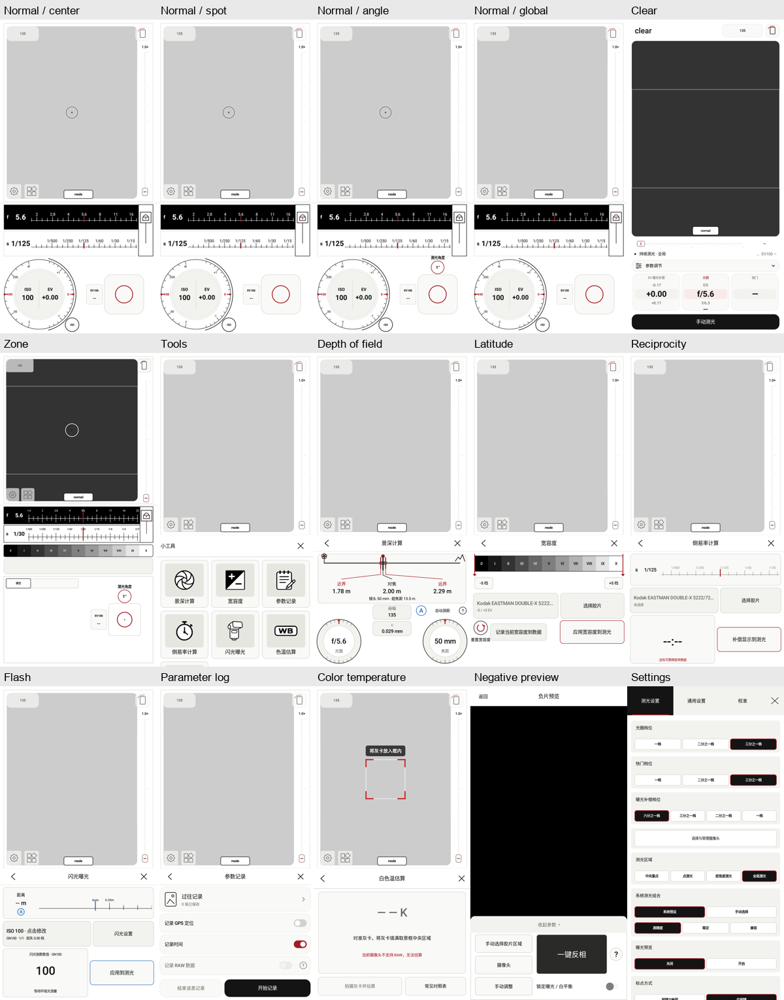

# 0.7.0 模拟器截图

Android 9 x86_64，720×1440，密度 280。真实运行界面；关闭虚拟相机以避免软件图形后端冲突，取景区为空白。未注入虚构测光结果。

这些截图用于模式与工具界面的展示。

| 页面 | 原始截图 |
| --- | --- |
| Normal / center | [normal-center_weighted.png](normal-center_weighted.png) |
| Normal / spot | [normal-spot.png](normal-spot.png) |
| Normal / angle | [normal-angle.png](normal-angle.png) |
| Normal / global | [normal-average.png](normal-average.png) |
| Clear | [clear.png](clear.png) |
| Zone | [zone.png](zone.png) |
| Tools | [tools.png](tools.png) |
| Depth of field | [depth-of-field.png](depth-of-field.png) |
| Latitude | [latitude.png](latitude.png) |
| Reciprocity | [reciprocity.png](reciprocity.png) |
| Flash | [flash.png](flash.png) |
| Parameter log | [parameter-log.png](parameter-log.png) |
| Color temperature | [color-temperature.png](color-temperature.png) |
| Negative preview | [negative-preview.png](negative-preview.png) |
| Settings | [settings.png](settings.png) |
